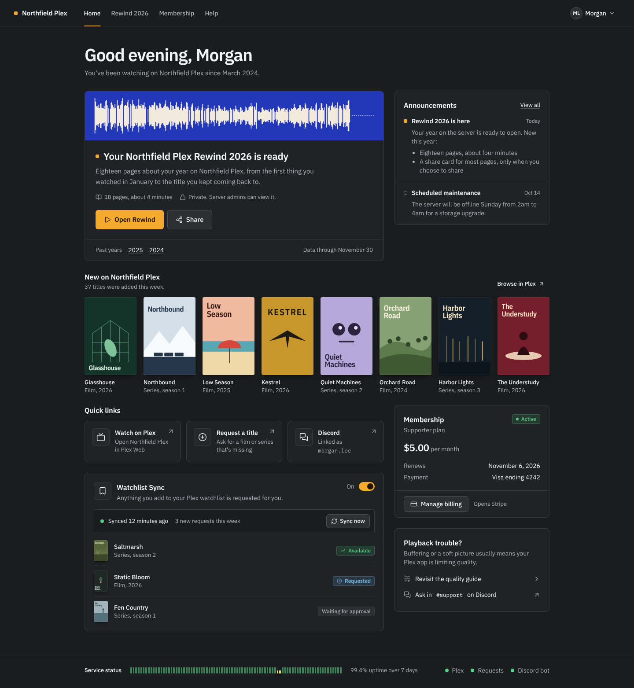
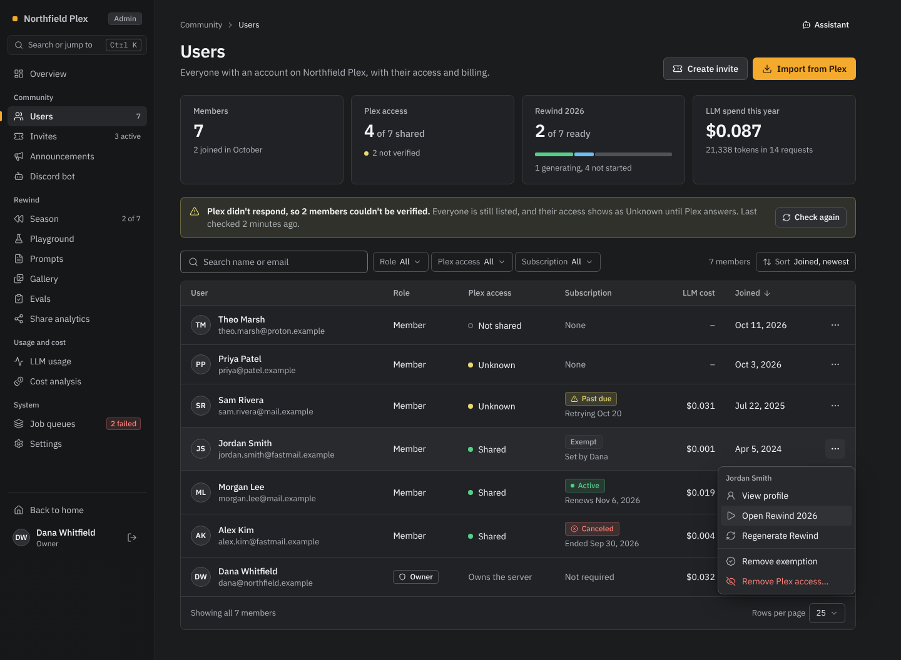
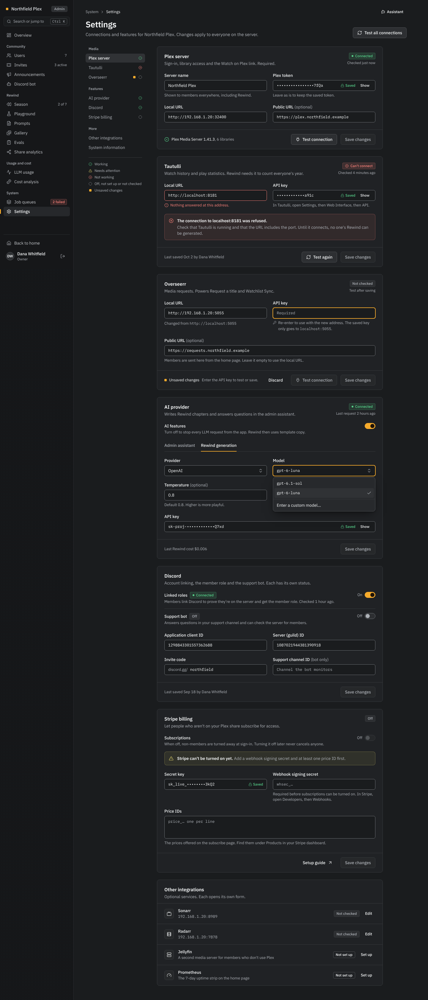
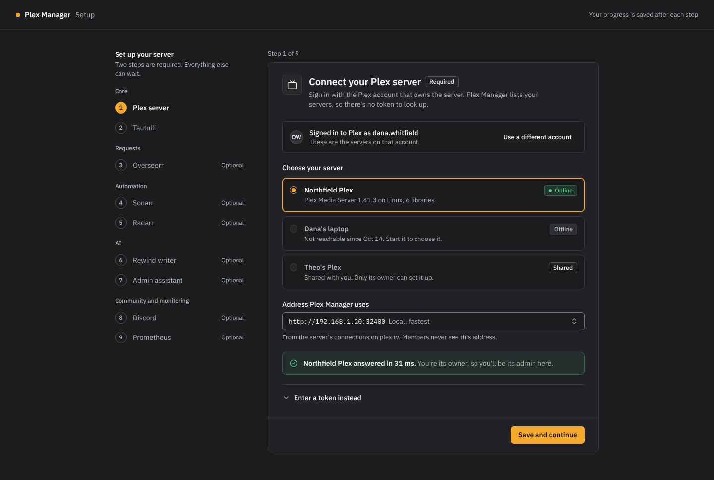
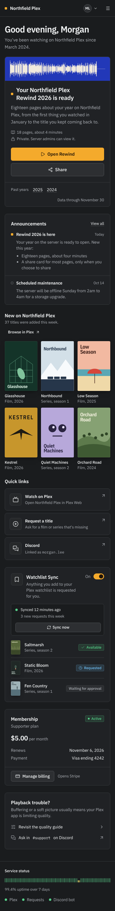
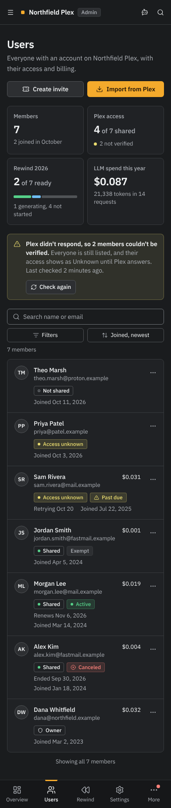
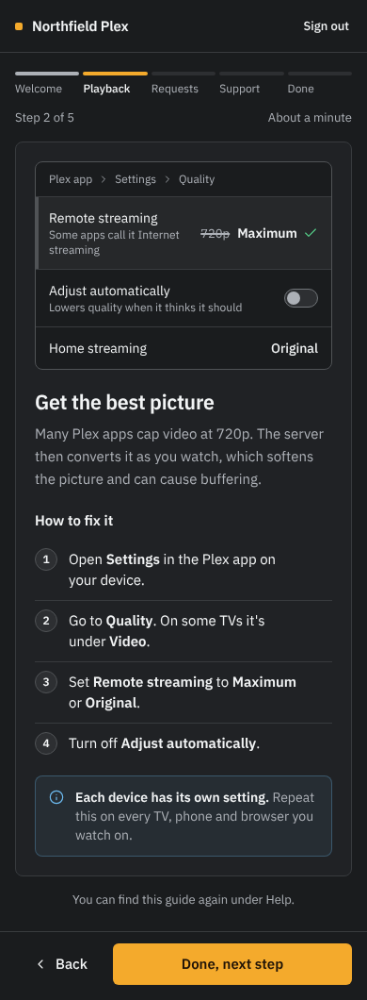
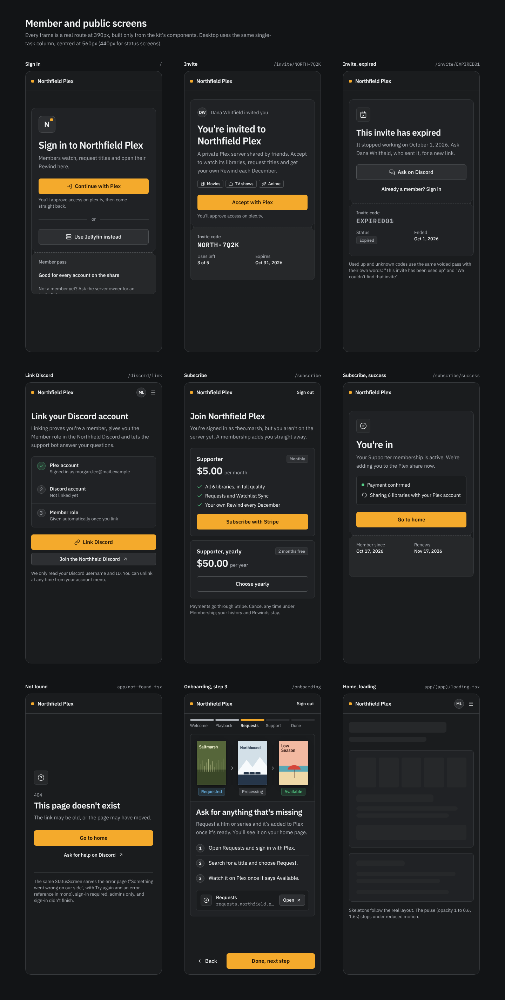
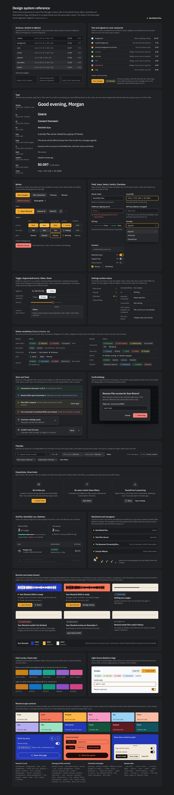

# Plex Manager UI design system and app-wide refresh

- **Date:** 2026-10-17
- **Status:** Final design for the app-wide refresh, revised after review ([Review notes](#review-notes)) and reconciled with the Rewind design on 2026-10-18 ([Reconciliation notes](#reconciliation-notes-2026-10-18)). Rewind 2026 is designed in [`rewind-2026-design.md`](rewind-2026-design.md) and plugs into this system through the ink-and-field contract in [section 4.4](#44-the-rewind-scope-contract), which both documents share.
- **Direction:** Quiet Precision (judge-panel winner, totals 228 against 226 and 214), with grafts from Media-forward and Unified Signature and a fix for every weakness the judges raised.
- **Inputs:** `research/ui-ux-audit.md` (finding IDs `UI-01` to `UI-46`), `research/code-duplication.md` (`DUP-09`, `DUP-12`, `DUP-13`, `DUP-14`), `research/security-audit.md` (`SEC-16`, `SEC-20`, `SEC-21`, `SEC-30`, `SEC-31`, `SEC-42`, `SEC-53`, `SEC-55`, `SEC-57`), `research/best-practices-and-ops.md` (`BP-05`), `research/modern-ui-stack-2026.md`, `research/visual-generation-skills.md`, `design/rewind-2026-design.md` (FR-1, FR-19 to FR-25, FR-36, FR-48 and sections 4.4, 5.2, 5.3, 6.3, 7.7, 9.7, 10, 11.1), the 152 screenshots of today's app, and the three candidate concepts and mockups.
- **Mockups:** self-contained HTML in [`mockups/ui/`](mockups/ui/) rendered to [`mockups/ui/png/`](mockups/ui/png/) at device scale 1. The full list is in [section 11](#11-final-mockups).



## Contents

1. [Goals and principles](#1-goals-and-principles)
2. [Decision summary](#2-decision-summary)
3. [Foundations](#3-foundations)
4. [Theming architecture](#4-theming-architecture)
5. [Component library](#5-component-library)
6. [Layout and page patterns](#6-layout-and-page-patterns)
7. [Content, tone and branding](#7-content-tone-and-branding)
8. [Accessibility rules](#8-accessibility-rules-wcag-22-aa)
9. [Migration strategy](#9-migration-strategy)
10. [Page-by-page refresh checklist](#10-page-by-page-refresh-checklist)
11. [Final mockups](#11-final-mockups)
12. [Open questions for the owner](#12-open-questions-for-the-owner)
13. [Review notes](#review-notes)

---

## 1. Goals and principles

### 1.1 What the refresh must achieve

The owner asked for the whole app to become consistent, modern and clean. The audit measured why it isn't:

| Measured today | Target |
|---|---|
| Four visual languages: cyan/purple slate admin, a neon starfield for setup, onboarding and invite, a pink/purple home with gradient-text titles, and gold-on-black Rewind (`UI-16`) | One app theme on every non-Rewind surface. Rewind is a scoped theme over the same token names. |
| 2,165 raw `slate-*` utilities in 222 files, 14 accent hues, 164 `bg-gradient-to-*`, 30 gradient-text titles (`UI-18`, recounted 2026-10-17) | Semantic tokens only. A CI ratchet stops new raw palette classes. |
| 108 to 115 hand-copied card containers; `Card` has 3 importers (`DUP-14`, `UI-22`) | `<Card>` and a dozen composites (PageHeader, DataTable, StatTile, EmptyState, SettingsSection...) |
| `text-slate-500/600` on `slate-800/900` at 2.36 to 3.74:1; white on cyan-600 at 3.60:1; Pause Queue at 2.94:1 (`UI-12`) | Every text pair at 4.5:1 or more in dark and light and 7:1 or more on every Rewind ink, enforced by a Jest token test |
| 15 h1 styles, 4 admin header styles, 5 header-action styles, 3 back-link forms (`UI-20`, `UI-21`) | One `PageHeader` with one h1 style |
| 16 hand-built tables, 3 pagination styles, filters re-implemented per page (`UI-23`) | One `DataTable` and one `FilterBar`, URL-driven |
| The users page, the admin landing page, shows "No users found" next to "Total Users 7" when Plex is unreachable (`UI-05`) | Filters default to All. Unreachable Plex shows "Unknown" access plus a warning alert with "Check again". |
| 10 primary-CTA treatments, most of them gradients (`UI-16`) | Six flat button variants and one primary per view |
| Pinch-zoom disabled on every page (`UI-11`) | Zoom enabled; 16px controls below `md` so iOS doesn't zoom on focus |
| 243 inline SVGs, 32 to 34 inline spinners, lucide used in 1 file (`UI-26`) | `lucide-react` only, one `Spinner` |
| Reduced motion honoured in 3 of 57 animated files; about 12 infinite animations on home (`UI-15`) | No infinite decoration in the app theme; global reduced-motion rule |

Target: **WCAG 2.2 AA** on every page, dark theme first, light theme specified and tested.

### 1.2 Principles

1. **Clarity comes from structure, not decoration.** Hierarchy is made with type, spacing and three measured line weights. There are no gradients on chrome, no glows and no blur.
2. **One accent with three jobs.** Plex amber marks the next action (the one primary button), where you are (active nav, selected tab, current step) and keyboard focus. It never colours text, headings, stat values or decoration. Non-text uses read `primary-indicator`, which is the same amber in dark and a darker amber in light, so every state mark keeps 3:1.
3. **The library brings the colour.** Member pages are about films and series, so real poster art (and, inside Rewind, the member's print ink) provides warmth and identity. The chrome around it stays quiet. Admin uses the same parts without artwork, at working density.
4. **Status is a word first.** Colour appears only with a label: a badge carries a word, a dot sits beside a word, a meter has a text legend. One status vocabulary (`lib/ui/status.ts`) is used everywhere.
5. **Everything maps to shadcn names.** Tokens use shadcn/ui's names on Tailwind v4, so generated Base UI primitives work unmodified. The few additions (hover tokens, `border-strong`, status tokens) are mapped in `@theme inline`.
6. **Rewind is a sibling theme, not another product.** Inside `[data-theme="rewind"]` every element that carries a `data-field` remaps the same token names to its print ink, so Button, Switch, Sheet and Toast render in ink with no Rewind copies.
7. **Measured, not claimed.** Contrast, colour-vision separation, overflow and minimum font size are computed by scripts and kept in CI.
8. **Avoid the generic AI-design tells** (`visual-generation-skills.md` 4.1.1): no ALL-CAPS tracked eyebrows, no gradient text, no one-word highlight colours, no arrow-suffixed CTAs, no middle-dot meta strings. A graphite canvas with one amber action is itself a known tell. Member and public screens counter it with the library, the Rewind inks and the pass; admin, setup and status screens accept it on purpose ([2.4](#24-what-was-rejected-and-why)).

---

## 2. Decision summary

### 2.1 Chosen direction

**Quiet Precision**, refined. It is a tool-like system built from graphite neutrals (hue 255, chroma 0.006 or less, canvas `#1a1c1e`, so neither navy nor near-black), crisp 1px borders in three measured weights, one Plex-amber accent (`oklch(79% 0.155 75)`), and IBM Plex Sans with IBM Plex Mono. The server's own name, preceded by an 8px amber "pip", is the brand.

The judges split. Two of three named Media-forward the winner on identity and member delight; one named Quiet Precision on implementability, accessibility and migration cost; the totals favoured Quiet Precision. This design keeps Quiet Precision's foundation (shadcn convention, measured contrast, low migration cost, calm admin) and takes Media-forward's strongest idea, the library as the source of colour on member surfaces, in a form that needs no new pipeline before the Rewind deadline.

### 2.2 Grafted ideas

| From | Idea | Where it lands |
|---|---|---|
| Media-forward | Library-forward member home: a "New on Northfield Plex" poster row and watchlist rows with posters. The Rewind card carries the member's ink strip instead of a poster stack, so it spoils nothing. | `home.html`; `Poster` primitive ([5.5](#55-new-composites-and-their-props)) |
| Media-forward | `Poster` primitive only (2:3, radius 4, title always in HTML, deterministic generated fallback). `PosterWall`, the sharp-based `--ambient` colour pipeline and public-page artwork are deferred until after Rewind ships. | [3.11](#311-imagery) |
| Media-forward | Five-plus Rewind card states, including an eligibility explanation instead of returning null | `components.html`, [5.5](#55-new-composites-and-their-props) `RewindCard` |
| Media-forward | Sticky bottom action bar on mobile onboarding and setup (ghost Back plus large primary) | `onboarding.html`, `screens.html` |
| Media-forward | FilterBar active-filter chips with "Clear filters"; on mobile a "Filters" button opening a bottom Sheet | `components.html`, `admin-users.html` (mobile) |
| Media-forward | Setup grouped stepper with Optional captions and Skip; the connected-Plex confirmation shows the server's real posters | `setup.html` |
| Media-forward | A components reference sheet showing every token and state, used as the Playwright `toHaveScreenshot()` target | `components.html` |
| Media-forward | Settings section nav with a status legend and "Checked ..." timestamps under each badge | `admin-settings.html` |
| Media-forward | Typed confirmation on the most destructive actions (remove Plex access) | `components.html` ConfirmDialog |
| Media-forward, Unified Signature | Delete the `html, body { height: 100%; overflow-x: hidden }` rule in `app/globals.css` | [9.2](#92-order-of-work) step 1 |
| Unified Signature | Ticket "pass" for invites: the stub prints the code, uses left and expiry; expired, used-up and unknown codes render a voided stub. Sign-in reuses it as a member pass. | `invite.html`, `screens.html` |
| Unified Signature | Onboarding playback illustration built from real UI pieces: a mock Plex settings panel with "720p" struck through and "Maximum" checked | `onboarding.html` |
| Unified Signature | Domain-status-to-badge table, adopted as `lib/ui/status.ts` and reconciled with Quiet Precision's settings vocabulary | [5.6](#56-status-vocabulary-libuistatusts) |
| Unified Signature | "Saved" lock tag on stored secrets (12px success lock plus "Saved", last four characters in mono) next to a Show button | `admin-settings.html` |
| Unified Signature | Monogram from the first grapheme (`Intl.Segmenter`) through `app/icon.tsx`; wordmark falls back when the name has glyphs Plex Sans doesn't cover | `components.html` Wordmark |
| Unified Signature | `text-wrap: balance` on display and heading sizes, `text-wrap: pretty` on paragraphs | `app/globals.css` base layer |
| Unified Signature | Mapping from today's cinematic tokens and class strings into the Rewind scope, and the list of every surface that renders the scope (now on the Rewind design's ink model) | [4.4](#44-the-rewind-scope-contract) |
| Unified Signature | Mobile admin bottom tab bar with a grouped More sheet; tablet sidebar collapses to icons | `admin-users.html`, `admin-settings.html` (mobile) |
| Unified Signature | Admin assistant moves to a page-header ghost button that opens a right Sheet, so it never covers primary actions | `admin-users.html` |
| Unified Signature | Footer meta in settings sections ("Last saved Oct 2 by Dana Whitfield", "Plex Media Server 1.41.3, 6 libraries") | `admin-settings.html` |
| Unified Signature | Validate the wordmark with the seeded "Test Plex Server", a long name and a non-Latin name | `components.html` |

### 2.3 Fixes for every weakness the judges raised about Quiet Precision

| Weakness (judge) | Fix |
|---|---|
| Bland; a grey Linear/Vercel clone; weakest identity for a media community; low member delight | Member surfaces now carry the library: a poster row of recent additions, posters in the watchlist, a poster lifecycle in onboarding, a pass for invites and sign-in, and the Rewind card's strip in the member's own print ink. Admin stays calm on purpose. |
| The home card was "two products glued together": half graphite, half a warm art window | The RewindCard is one app-theme `Card`. Only its top strip is in the Rewind scope: the member's archetype field with their year's soundtrack printed in ink (Rewind 4.4). There is no art window, and the strip is the source of the view transition into the cover. |
| The art window's Charter serif on warm near-black drifted back to the gold-on-black cliché | No serif and no near-black. The strip prints in the member's archetype ink from the Rewind design (twelve print inks, ultramarine to mint, Rewind 5.3), the card's type is Plex Sans, and amber appears only on the one CTA. |
| Amber primary (hue 75) and warning (hue 95) were kept apart only by a usage rule; ΔE 6.9 under deuteranopia | Warning moves to lemon `oklch(88% 0.13 102)`. Measured separation from primary: ΔE 11.5 normal, 9.0 deuteranopia, 12.4 protanopia. Warning is still never a fill and always carries a triangle icon and a word. |
| Light-theme badges failed on the page background and sidebar (4.27 to 4.46; axe 4.45 on the sidebar "2 failed" badge) | Light status tokens darkened by 3 to 4 L points and badge tints dropped to 10%. Every light badge now measures 5.20 or more on every surface, including background and sidebar ([3.4](#34-measured-contrast)). The test covers background, card, popover, muted and sidebar. |
| Avatar initials at 11.5px | Avatars are 12px/600 at every size. Measured minimum text in every app mockup: 12px. |
| No mobile settings layout (946px at 390) | Designed: 56px top bar, a "Jump to" select replaces the section nav, single-column fields, full-width footers. Measured `scrollWidth` 390. |
| `chart-5` was red and read as destructive | `chart-5` is magenta `oklch(66% 0.17 355)`. The palette passes the dataviz validator in both themes ([3.5](#35-chart-palette)). |
| Didn't say to delete the `html, body` overflow rule | Step 1 of the migration ([9.2](#92-order-of-work)). |
| Rewind card states unspecified (Generating, Failed, not open yet, not eligible) | Eight states specified ([5.5](#55-new-composites-and-their-props) `RewindCard`), six of them mocked on the real inks in `components.html` with the year archive. |
| Mobile admin dropped the bottom tab bar the audit recommended (`UI-32`) | Bottom tab bar: Overview, Users, Rewind, Settings, More (grouped sheet). |
| Arrow-suffixed CTAs ("Open Rewind ->") and middle-dot meta strings | Banned in the content rules ([7.3](#73-banned-patterns)) and by the CI copy check. Meta lines are separate items with gaps and icons. |
| Setup, sign-in, invite, subscribe, Discord linking and status screens were described but not mocked | Mocked: `setup.html` (claim, Plex at 1440 and 390, Overseerr), `invite.html`, and nine 390px frames in `screens.html` (sign-in, invite, invite expired, Discord link, subscribe, subscribe success, 404, onboarding Requests step, loading). |
| §14 claimed "no text below 12px" and "no overflow at 390" without proof | Every PNG in [section 11](#11-final-mockups) lists its measured `scrollWidth` and smallest font size. |
| No Overview or Rewind console slot in the nav | Overview and the Rewind group (Season, Playground, Prompts, Gallery, Evals, Share analytics, matching Rewind 10) are in the IA ([6.2](#62-admin-shell-and-navigation-ia)), with a ship plan. |
| Uniform radius and 1px borders on everything ("SaaS card kit") | Radius is assigned by role (4 posters and badges, 6 controls, 8 cards, 12 media cards and dialogs), and the member surfaces are carried by imagery rather than by boxes. The admin side intentionally keeps the calm card kit. |

### 2.4 What was rejected, and why

| Rejected | Why |
|---|---|
| Media-forward's warm umber surfaces with ivory primary and no accent hue | An ivory primary is a weak "this is the button" signal, and admin without artwork read as monochrome brown. Umber is also a larger visual jump from today's slate, so the codemod output needs more review. |
| Media-forward's Bricolage Grotesque 120px marquee over a poster wall | Close to busy, and the hero depends on a recently-added wall and a sharp-based ambient-colour pipeline that don't exist. When artwork fails (the seeded poster proxy returns 500s) the hero has nothing to show. A modest poster row with a first-class generated fallback gives most of the warmth, degrades gracefully and costs a fraction of the work. |
| Media-forward's sonner toasts and the bundled framer-motion to motion migration | The research recommends Base UI Toast behind the existing `useToast` facade. The `motion` rename belongs to the Rewind phase, which owns most of the motion code. |
| Media-forward's brand-coloured service tiles (Plex amber, Overseerr purple, Discord blurple) | Third-party hues compete with status colour. Service glyphs are monochrome in neutral tiles. |
| Media-forward's globals.css with dark values on `:root` and no `@custom-variant dark` | shadcn's generated Button, Input, Select, Switch and Badge carry `dark:` classes keyed to `.dark`. Without the variant they follow the OS setting. |
| Unified Signature's Big Shoulders display face, two lamps (tungsten orange plus daylight blue) and the Inline marquee cut | Four font families, non-tabular numerals that can't sit in tables, a repurposed `--accent` that turns every shadcn hover blue, and light-theme colour-vision collapse (tungsten against destructive ΔE 2.2 under deuteranopia). |
| Unified Signature's Chart.js to Recharts rewrite before the deadline | 14 files of scope before Rewind. Chart.js stays behind one theme module now; the Recharts move is scheduled after Rewind ([9.2](#92-order-of-work) phase 5). |
| Unified Signature's film-strip stepper, cinema motifs on most surfaces and filler like "Screen 01 / Ticket 0042" | Motifs multiply bespoke components and risk kitsch. Only the invite pass survives, because it solves a real problem (public pages without artwork). |
| Quiet Precision's original placeholder Rewind art window (Bitstream Charter, warm near-black) | Replaced by the RewindCard's field strip in the member's ink. |
| A three-mode admin nav (sidebar, 64px rail, bottom tabs) with custom code | The rail is shadcn Sidebar's built-in `collapsible="icon"`, so it costs no custom code. Only the sidebar and bottom tabs get baseline screenshots. |
| An identity device on every screen without artwork | Admin, setup, 404 and auth status screens are graphite with one amber action, which is the "dark canvas plus one warm accent" pattern `visual-generation-skills.md` 4.1.1 flags. We accept it there on purpose: they are tools and dead ends, and decoration would compete with the status they report. Public first impressions do get a device that needs no library art: sign-in reuses the pass as a member pass (`screens.html`) and invites keep theirs. Owner opt-in artwork for sign-in stays [open question 4](#12-open-questions-for-the-owner). |

### 2.5 Alternatives considered

- **Media-forward** made the server's library the hero: the server name as a 120px Bricolage Grotesque marquee over a wall of recent posters, warm umber surfaces, ivory text, an ivory "screen white" primary and no accent hue, with colour tinted per poster from key art. It had the most distinctive member home and the broadest component sheet, and two judges preferred it. It lost on implementability and risk. Its signature depended on server work that doesn't exist (a poster proxy that works, a recently-added feed, a sharp-based dominant-colour pipeline, a public-artwork setting). Its CSS left shadcn's `dark:` classes keyed to the OS. Its default theme had an unreported AA failure (destructive badge on popover, 4.23), and its settings page overflowed at 390px (830px). Its best ideas are grafted here in their cheap form.
- **Unified Signature ("House Lights")** treated the app as the lobby of a small cinema and Rewind as the feature presentation: a warm charcoal canvas, cream type, Big Shoulders for titles and numbers, Hanken Grotesk for text, tungsten orange for the way forward and daylight blue for facts, with ticket stubs and film-strip steppers. It had the tightest app-to-Rewind bridge and the best status table. It lost because its mockups broke its own rules (five enabled tungsten Saves on one settings page), it repurposed `--accent` against shadcn's meaning, its light theme collapsed under colour-vision simulation, and it added four fonts and a chart rewrite before the deadline. Its status table, ticket pass, onboarding illustration and Rewind migration table are grafted here.

---

## 3. Foundations

### 3.1 Colour principles

- **Graphite, not navy, not black.** Neutrals use hue 255 with chroma 0.006 or less. The canvas is `oklch(22.5% 0.005 255)` (`#1a1c1e`). Surfaces step up about 3 L points per layer: sidebar 20.5, background 22.5, card 25.2, muted 27.5, popover 28, secondary 30.5, accent 31.5. Graphite sits close to today's slate, so the codemod causes little visual surprise.
- **One accent.** `primary` is Plex amber nudged for dark surfaces (Plex's `#e5a00d` is `oklch(75.4% 0.155 77)`; ours is `oklch(79% 0.155 75)`, `#f4aa2c`). It appears only on: the primary button (one per view), the focus ring, active-location markers (sidebar strip, top-nav underline, selected tab, current stepper segment, the Rewind generation progress bar), switches and checkboxes that are on, the unread and "Unsaved changes" pips, and the brand pip. Every non-text state mark reads `primary-indicator` (equal to `primary` in dark; `oklch(55% 0.12 62)` in light, because the 79% amber measures only 1.79 to 1.98:1 on light surfaces). The button fill keeps `primary` in both themes, because its label carries 9.19:1. The brand pip is part of the logotype and stays `primary`.
- **Three line weights.** `border` (about 1.4:1, card outlines and dividers), `border-strong` (about 2:1, secondary and outline button edges, badges, avatars, popovers), `input` (3:1 or more on every surface, with the floor at 3.14 on the dark popover; every form-control boundary, which satisfies WCAG 1.4.11).
- **Status colours are signals.** `success`, `warning`, `info` and `destructive` appear only as an icon colour, a 6 to 8px dot beside a word, a tinted badge, or a tinted alert. The only solid status fill is the destructive confirm button inside an AlertDialog.
- **Amber is never warning.** Primary is always a solid fill with dark text; warning is never a fill and always carries a `triangle-alert` icon and a word.
- **No third-party brand colours.** Discord blurple, Overseerr purple and Plex's own orange tiles are gone; service glyphs are monochrome.

### 3.2 Dark theme (default)

| Token | OKLCH | Hex | Role |
|---|---|---|---|
| `--background` | `oklch(22.5% 0.005 255)` | `#1a1c1e` | Page canvas, input fill |
| `--foreground` | `oklch(96.5% 0.003 255)` | `#f2f3f5` | Text, headings, values |
| `--card` | `oklch(25.2% 0.005 255)` | `#202224` | Cards, tables, panels |
| `--card-foreground` | `oklch(96.5% 0.003 255)` | `#f2f3f5` | |
| `--popover` | `oklch(28% 0.006 255)` | `#27292c` | Menus, select lists, toasts, dialogs |
| `--popover-foreground` | `oklch(96.5% 0.003 255)` | `#f2f3f5` | |
| `--primary` | `oklch(79% 0.155 75)` | `#f4aa2c` | The one accent |
| `--primary-hover` (extra) | `oklch(83% 0.145 77)` | `#fcba4b` | Primary hover: lighter, never an opacity blend |
| `--primary-foreground` | `oklch(20% 0.03 65)` | `#1f1307` | Text and icons on amber |
| `--primary-indicator` (extra) | `var(--primary)` | `#f4aa2c` | Non-text state marks: switch on, checkbox fill, current step, progress fill, unread and unsaved pips |
| `--primary-indicator-foreground` (extra) | `var(--primary-foreground)` | `#1f1307` | Switch thumb and check mark on the indicator |
| `--secondary` | `oklch(30.5% 0.006 255)` | `#2d2f32` | Secondary button fill, neutral badge |
| `--secondary-hover` (extra) | `oklch(34% 0.006 255)` | `#36383b` | |
| `--secondary-foreground` | `oklch(96.5% 0.003 255)` | `#f2f3f5` | |
| `--muted` | `oklch(27.5% 0.005 255)` | `#26282a` | Table header, tiles, skeleton, disabled fill |
| `--muted-foreground` | `oklch(76% 0.01 255)` | `#adb1b7` | Secondary text. The dimmest text allowed. |
| `--accent` | `oklch(31.5% 0.006 255)` | `#303235` | Hover and highlighted item (shadcn's meaning, not brand) |
| `--accent-foreground` | `oklch(96.5% 0.003 255)` | `#f2f3f5` | |
| `--destructive` | `oklch(74% 0.15 25)` | `#fb817a` | Error text, destructive icons and borders |
| `--destructive-foreground` | `oklch(20% 0.04 25)` | `#250e0d` | Text on the solid confirm button only |
| `--success` (extra) | `oklch(77% 0.15 155)` | `#56d089` | Connected, active, available |
| `--success-foreground` (extra) | `oklch(20% 0.04 155)` | `#051b0e` | |
| `--warning` (extra) | `oklch(88% 0.13 102)` | `#e9db6f` | Past due, unknown, needs setup |
| `--warning-foreground` (extra) | `oklch(22% 0.04 95)` | `#201a03` | |
| `--info` (extra) | `oklch(77% 0.11 240)` | `#6ebdf3` | Requested, generating, tips |
| `--info-foreground` (extra) | `oklch(20% 0.04 240)` | `#031826` | |
| `--{tone}-subtle` (extra) | `color-mix(in oklab, var(--{tone}) 14%, transparent)` | | Badge fills for the four status tones |
| `--border` | `oklch(35% 0.006 255)` | `#383b3e` | Card outlines, dividers, table rules |
| `--border-strong` (extra) | `oklch(44% 0.006 255)` | `#505356` | Button, badge and avatar edges, popover outline |
| `--input` | `oklch(56% 0.008 255)` | `#717579` | Form-control boundaries |
| `--ring` | `oklch(79% 0.155 75)` | `#f4aa2c` | Focus ring |
| `--chart-1` | `oklch(67% 0.14 70)` | `#cb8315` | Amber, a darker step than primary |
| `--chart-2` | `oklch(62% 0.14 250)` | `#398ad6` | Blue |
| `--chart-3` | `oklch(66% 0.12 175)` | `#19aa8e` | Teal |
| `--chart-4` | `oklch(60% 0.16 305)` | `#9763cc` | Violet |
| `--chart-5` | `oklch(66% 0.17 355)` | `#df5e97` | Magenta |
| `--sidebar` | `oklch(20.5% 0.005 255)` | `#161719` | Admin sidebar and mobile tab bar |
| `--sidebar-foreground` | `oklch(82% 0.006 255)` | `#c1c4c8` | Idle nav labels |
| `--sidebar-primary` | `oklch(79% 0.155 75)` | `#f4aa2c` | Active-item strip |
| `--sidebar-primary-foreground` | `oklch(20% 0.03 65)` | `#1f1307` | |
| `--sidebar-accent` | `oklch(27.5% 0.006 255)` | `#26282b` | Active and hover item fill |
| `--sidebar-accent-foreground` | `oklch(96.5% 0.003 255)` | `#f2f3f5` | Active label |
| `--sidebar-border` | `oklch(30% 0.006 255)` | `#2c2e31` | |
| `--sidebar-ring` | `oklch(79% 0.155 75)` | `#f4aa2c` | |
| `--overlay` (extra) | `oklch(14% 0.005 255 / 0.72)` | `#08090b` at 72% | Dialog and sheet scrim, no blur |

### 3.3 Light theme (specified, ships behind a flag)

Same names, inverted ladder. Status tokens are dark enough to read as text on white and as badge text on a 10% tint.

| Token | OKLCH | Hex |
|---|---|---|
| `--background` | `oklch(98.5% 0.002 255)` | `#f9fafb` |
| `--foreground`, `--*-foreground` (neutral) | `oklch(20% 0.006 255)` | `#141619` |
| `--card`, `--popover` | `oklch(100% 0 0)` | `#ffffff` |
| `--primary` | `oklch(79% 0.155 75)` | `#f4aa2c` (unchanged) |
| `--primary-hover` | `oklch(75% 0.155 72)` | `#e99b1a` (darker on light) |
| `--primary-foreground` | `oklch(20% 0.03 65)` | `#1f1307` |
| `--primary-indicator` / `--primary-indicator-foreground` | `oklch(55% 0.12 62)` / `oklch(98.5% 0 0)` | `#a25f12` / `#fafafa` (the ring value; amber at 79% L is 1.79 to 1.98:1 as a mark on light surfaces) |
| `--secondary` / `--secondary-hover` | `oklch(95.5% 0.003 255)` / `oklch(92.5% 0.004 255)` | `#eff0f2` / `#e4e6e9` |
| `--muted` | `oklch(96.5% 0.003 255)` | `#f2f3f5` |
| `--muted-foreground` | `oklch(47% 0.012 255)` | `#565b62` |
| `--accent` | `oklch(94.5% 0.004 255)` | `#ebedef` |
| `--destructive` | `oklch(49% 0.19 27)` | `#b31319` |
| `--success` | `oklch(46% 0.12 155)` | `#006b39` |
| `--warning` | `oklch(47% 0.1 85)` | `#745500` |
| `--info` | `oklch(47% 0.13 250)` | `#065da0` |
| `--{status}-foreground` | `oklch(98.5% 0 0)` | `#fafafa` |
| `--{tone}-subtle` | `color-mix(in oklab, var(--{tone}) 10%, transparent)` | |
| `--border` / `--border-strong` / `--input` | `oklch(90% 0.004 255)` / `oklch(84% 0.005 255)` / `oklch(62% 0.008 255)` | `#dcdee1` / `#c8cbce` / `#83868b` |
| `--ring`, `--sidebar-primary`, `--sidebar-ring` | `oklch(55% 0.12 62)` | `#a25f12` (amber at 79% L is only 1.9:1 on white) |
| `--sidebar-primary-foreground` | `oklch(98.5% 0 0)` | `#fafafa` |
| `--chart-1..5` | `oklch(64% 0.135 62)`, `oklch(55% 0.15 250)`, `oklch(60% 0.11 175)`, `oklch(55% 0.18 305)`, `oklch(60% 0.19 355)` | `#c57722`, `#0f74c5`, `#11957c`, `#8b4ec4`, `#d14186` |
| `--sidebar` / `--sidebar-foreground` / `--sidebar-accent` / `--sidebar-border` | `oklch(97% 0.003 255)` / `oklch(35% 0.008 255)` / `oklch(93% 0.004 255)` / `oklch(90% 0.004 255)` | `#f4f5f7` / `#383b3f` / `#e6e8ea` / `#dcdee1` |
| `--overlay` | `oklch(20% 0.006 255 / 0.4)` | |

The primary button stays amber with dark text in light mode. The RewindCard strip and the Rewind viewer look the same in both app themes, because every element that carries a `data-field` re-declares every token a primitive reads ([4.4](#44-the-rewind-scope-contract)).

**Shipping decision.** Phase 1 ships dark only. Light is fully specified, tested by the token test and rendered for two full pages (`home--desktop-light.png`, `admin-users--desktop-light.png`). It is enabled behind `Config.lightThemeEnabled` (default off) once every page has a light baseline screenshot.

### 3.4 Measured contrast

Computed from the OKLCH values with an OKLab-to-sRGB conversion. Tints are composited in sRGB over each surface, exactly as the browser does. The scripts ([`mockups/ui/source/tools/tokens.js`](mockups/ui/source/tools/tokens.js) for the app themes and [`rwcheck.js`](mockups/ui/source/tools/rwcheck.js) for the twelve Rewind inks, both on [`color.js`](mockups/ui/source/tools/color.js)) fail on any pair below its threshold and are ported to `lib/design/__tests__/tokens.test.ts`. **All pairs pass** (re-run 2026-10-17 after review).

**Dark, text (4.5:1 required)**

| Text | background | card | popover | muted | secondary | accent | sidebar |
|---|---|---|---|---|---|---|---|
| `foreground` | 15.45 | 14.37 | 13.18 | 13.40 | 12.10 | 11.67 | 16.18 |
| `muted-foreground` | 7.97 | 7.41 | 6.80 | 6.91 | 6.24 | 6.02 | 8.35 |
| `destructive` | 6.96 | 6.47 | 5.94 | 6.03 | 5.45 | 5.26 | 7.29 |
| `success` | 8.76 | 8.15 | 7.48 | 7.60 | 6.86 | 6.62 | 9.18 |
| `warning` | 12.03 | 11.19 | 10.26 | 10.43 | 9.42 | 9.09 | 12.60 |
| `info` | 8.37 | 7.79 | 7.14 | 7.26 | 6.56 | 6.32 | 8.77 |
| `sidebar-foreground` | 9.80 | 9.11 | 8.36 | 8.50 | 7.67 | 7.40 | 10.26 |

**Dark, badges** (status text on its own 14% tint over each surface)

| Badge | background | card | popover | muted | sidebar |
|---|---|---|---|---|---|
| `destructive` | 5.53 | 5.11 | 4.69 | 4.77 | 5.84 |
| `success` | 6.65 | 6.14 | 5.62 | 5.71 | 7.03 |
| `warning` | 8.52 | 7.84 | 7.17 | 7.29 | 9.03 |
| `info` | 6.38 | 5.89 | 5.39 | 5.48 | 6.74 |

**Dark, fills and alerts**

| Pair | Ratio |
|---|---|
| `primary-foreground` on `primary` / `primary-hover` | 9.19 / 10.58 |
| `destructive-foreground` on `destructive` (confirm button) | 7.44 |
| `secondary-foreground` on `secondary` / `secondary-hover` | 12.10 / 10.62 |
| `muted-foreground` on `secondary-hover` | 5.48 |
| `foreground` / `muted-foreground` on alerts (8% tint on card): destructive, warning, success, info | 12.65 / 6.53, 11.85 / 6.11, 12.33 / 6.36, 12.34 / 6.37 |

**Light, text**

| Text | background | card | popover | muted | secondary | accent | sidebar |
|---|---|---|---|---|---|---|---|
| `foreground` | 17.34 | 18.10 | 18.10 | 16.36 | 15.88 | 15.41 | 16.60 |
| `muted-foreground` | 6.53 | 6.82 | 6.82 | 6.16 | 5.98 | 5.81 | 6.25 |
| `destructive` | 6.63 | 6.92 | 6.92 | 6.25 | 6.07 | 5.89 | 6.34 |
| `success` | 6.39 | 6.67 | 6.67 | 6.03 | 5.85 | 5.68 | 6.12 |
| `warning` | 6.59 | 6.88 | 6.88 | 6.22 | 6.03 | 5.86 | 6.31 |
| `info` | 6.54 | 6.83 | 6.83 | 6.17 | 5.99 | 5.82 | 6.26 |
| `sidebar-foreground` | 10.82 | 11.30 | 11.30 | 10.21 | 9.91 | 9.62 | 10.36 |

**Light, badges** (10% tint)

| Badge | background | card | popover | muted | sidebar |
|---|---|---|---|---|---|
| `destructive` | 5.57 | 5.80 | 5.80 | 5.26 | 5.34 |
| `success` | 5.50 | 5.73 | 5.73 | 5.20 | 5.28 |
| `warning` | 5.70 | 5.93 | 5.93 | 5.39 | 5.46 |
| `info` | 5.62 | 5.86 | 5.86 | 5.32 | 5.40 |

**Light, fills:** `primary-foreground` on `primary` 9.19, on `primary-hover` 7.95; `sidebar-primary-foreground` on `sidebar-primary` 4.81; `destructive-foreground` on `destructive` 6.62; alerts 15.74 to 16.09 (`foreground`) and 5.93 to 6.06 (`muted-foreground`).

**Non-text (WCAG 1.4.11, 3:1 for control boundaries, state marks and focus)**

| Token | Dark: background / card / popover / muted / sidebar | Light: background / card / popover / muted / sidebar |
|---|---|---|
| `input` | 3.68 / 3.42 / 3.14 / 3.19 / 3.85 | 3.49 / 3.64 / 3.64 / 3.29 / 3.34 |
| `ring`, `primary-indicator`, `sidebar-primary` | 8.65 / 8.05 / 7.38 / 7.50 / 9.06 | 4.81 / 5.02 / 5.02 / 4.54 / 4.61 |
| `primary` (in light a button fill only, never a mark) | 8.65 / 8.05 / 7.38 / 7.50 / 9.06 | 1.89 / 1.98 / 1.98 / 1.79 / 1.81 |
| `primary-indicator-foreground` on `primary-indicator` (thumb, check) | 9.19 | 4.81 |
| `border` (decorative only) | 1.51 / 1.41 / 1.29 / 1.31 / 1.58 | 1.29 / 1.35 / 1.35 / 1.22 / 1.24 |
| `border-strong` (decorative, or an edge whose label already identifies the control) | 2.20 / 2.05 / 1.88 / 1.91 / 2.31 | 1.56 / 1.63 / 1.63 / 1.48 / 1.50 |

The token test asserts every non-text use of `input`, `ring` and `primary-indicator` at 3:1 or more on background, card, popover, muted and sidebar in both themes, and a recipe test fails if any `components/ui` recipe uses `primary` (rather than `primary-indicator`) for a switch track, checkbox fill, step segment, progress fill or pip.

**Colour-vision separation** (OKLab ΔE x100, Machado 2009 simulation)

| Pair | Dark: normal / deutan / protan | Light: normal / deutan / protan |
|---|---|---|
| primary vs warning | 11.5 / 9.0 / 12.4 | 32.5 / 33.0 / 30.3 |
| primary vs destructive | 13.8 / 9.3 / 13.5 | 33.3 / 30.1 / 37.2 |
| primary vs success | 19.7 / 10.4 / 9.6 | 37.2 / 35.6 / 27.2 |
| destructive vs warning | 22.4 / 14.6 / 21.9 | 16.1 / 2.9 / 7.0 |
| success vs destructive | 27.4 / 2.9 / 14.2 | 27.8 / 7.1 / 10.4 |

Success and destructive collapse under deuteranopia (2.9) and light destructive and warning do too. That is expected for red/green pairs and is why status is never colour alone: every badge carries a word and a distinct icon (`circle-check`, `circle-x`, `triangle-alert`, `info`/`clock`), and every dot sits beside a word.

### 3.5 Chart palette

Validated with the dataviz skill's `validate_palette.js` on 2026-10-17.

| Theme | Surface | Slots | Result |
|---|---|---|---|
| Dark | `#202224` (card) | `#cb8315`, `#398ad6`, `#19aa8e`, `#9763cc`, `#df5e97` | All pass. Worst adjacent CVD ΔE 10.1 (protan, magenta/violet), normal-vision floor 15.3, all 3:1 or more. |
| Light | `#ffffff` | `#c57722`, `#0f74c5`, `#11957c`, `#8b4ec4`, `#d14186` | All pass. Worst adjacent CVD ΔE 11.4, normal 16.4, all 3:1 or more. |

**Feeding Chart.js.** Chart.js 4.5.1 derives hover and border colours through `@kurkle/color` 0.3.4, which has no `oklch()` parser (verified in this repo: `new Color('oklch(67% 0.14 70)').valid === false`, so `getHoverColor` returns `undefined`), and `getComputedStyle` on a custom property returns the declared string, not sRGB. So `lib/charts/theme.ts` never reads CSS variables. `chartTheme(mode)` returns hex from `lib/design/tokens.ts`: `themes[mode]['chart-1'..'chart-5'].hex`, `border` for gridlines, `muted-foreground` for ticks, and `popover`, `popover-foreground` and `border-strong` for tooltips. The mode is the resolved theme class, which the server passes to the chart island. A Rewind chart takes `rewindInks[ink]` instead. `lib/charts/__tests__/theme.test.ts` asserts that every colour handed to Chart.js parses with `@kurkle/color`. `ChartCard` puts `role="img"` and the summary `aria-label` on the canvas, which clears today's axe `role-img-alt` failures on cost analysis; the Recharts 3 move stays in phase 5.

Rules: series take slots in fixed order and are never recoloured by rank; more than five series fold into "Other" (`muted-foreground`); values and labels use text tokens, never the series colour; status colours are never series colours; gridlines use `--border`, ticks `--muted-foreground`. Every chart gets a text title, an `aria-label` summary and a "View as table" toggle (`UI-24`).

### 3.6 Typography

**Families**

- **IBM Plex Sans**, variable (`wght` 100 to 700, `wdth` 75 to 100; verified in the installed Next 16 `font-data.json`, with subsets cyrillic, cyrillic-ext, greek, latin, latin-ext and vietnamese). Every interface sentence, label and number.
- **IBM Plex Mono** (400, 500, 600). URLs, API keys, tokens, IDs, invite codes, model names, Discord handles and code.

Why Plex: an engineered grotesque with humanist touches (angled terminals, open counters, a slightly calligraphic `a` and `g`) that reads as precise without the neutrality of Inter or Geist, the faces most generated UIs default to. Sans and Mono share proportions and vertical metrics, so a URL in a sentence sits flush with the label beside it. Its figures are tabular by default (measured), so numbers align in tables and stat tiles; we still set `tabular-nums` where numbers line up. The `wdth` axis condenses long server names (`font-stretch-85%`, a bare-percentage utility that the installed Tailwind 4.3.2 generates) before truncation; `font-stretch` only works because `next/font` loads the `wdth` axis. License: SIL OFL 1.1.

```ts
// app/fonts.ts
import { IBM_Plex_Mono, IBM_Plex_Sans } from 'next/font/google'

export const plexSans = IBM_Plex_Sans({
  subsets: ['latin', 'latin-ext', 'greek', 'cyrillic', 'vietnamese'],
  axes: ['wdth'],
  variable: '--font-plex-sans',
  display: 'swap',
})
export const plexMono = IBM_Plex_Mono({
  subsets: ['latin', 'latin-ext'],
  weight: ['400', '500', '600'],
  variable: '--font-plex-mono',
  display: 'swap',
})
// app/layout.tsx: <html lang="en" className={cn('dark', plexSans.variable, plexMono.variable)}>
```

`next/font` self-hosts the files at build time, which fits CSP `font-src 'self'`. For Satori and `next/og` (the icons and any app-side image), commit subset static TTF instances under `lib/og/fonts/` with the OFL text; [7.5](#75-brand-devices) has the subset, size budget and fallback rules. Rewind's own display and text faces (Archivo and Newsreader, Rewind 5.4) load only where story pages render: the member Rewind layout, the share page layout and the admin preview page all import `app/(app)/rewind/fonts.ts`. The playground preview is an iframe on the Rewind route, and the home RewindCard strip sets no Rewind type, so home never loads them.

**Scale.** Single-size steps are Tailwind v4 `--text-*` theme tokens with line-height, tracking and weight sub-tokens. Theme tokens can't change at a breakpoint or set `font-stretch`, so the three responsive steps (`text-display`, `text-h1`, `text-stat`) are `@utility` rules in `app/globals.css` with an `@variant md` block ([4.1](#41-appglobalscss)). `PageHeader` renders `text-h1`, `StatTile` renders `text-stat`, and the home greeting, sign-in, invite and status titles render `text-display`; nobody pairs `text-*` and `md:text-*` by hand. Weights are 400, 500 and 600 only.

| Utility | Size / line height | Weight | Tracking | Used for |
|---|---|---|---|---|
| `text-display` | 40/48 (30/36 below `md`), `wdth` 92 | 600 | -0.022em | Home greeting, sign-in, invite and status titles. One per page at most. |
| `text-h1` | 28/36 (24/32 below `md`) | 600 | -0.015em | Page titles in admin and setup |
| `text-h2` | 20/28 | 600 | -0.01em | Section titles, onboarding and Rewind-card titles |
| `text-h3` | 16/24 | 600 | -0.005em | Card and settings-section titles |
| `text-lead` | 17/28 | 400 | 0 | Intro paragraphs on member pages |
| `text-body` | 15/24 | 400 | 0 | Default body on member pages |
| `text-ui` | 14/20 | 400 or 500 | 0 | Admin body, table cells, buttons, nav, menu items |
| `text-label` | 13/18 | 500 | 0 | Dense field labels, table headers, stat labels, meta lines |
| `text-caption` | 12/16 | 500 | 0 | Badges, kbd, avatar initials, dates in lists. **The minimum.** |
| `text-stat` | 28/36 (24/32 below `md`), tabular | 600 | -0.02em | Stat tile values |
| `font-mono` | 13/20 (15/20 in inputs below `md`) | 400 | 0 | URLs, keys, IDs, model names |

**Rules**

- Sentence case everywhere: buttons ("Save changes"), nav ("LLM usage"), headings, badges, table headers, group labels.
- No ALL-CAPS tracked eyebrows. Group labels and table headers are 12 to 13px/500 `muted-foreground` in sentence case.
- No gradient text and no single-word highlight colours. Emphasis is weight 600 in `foreground`.
- `text-wrap: balance` on `text-display`, `text-h1`, `text-h2` and all `h1` to `h3`; `text-wrap: pretty` on `p`, `li` and `dd` (base layer).
- Form controls use 16px text below `md` and 14px from `md` up.
- Prose is 46 to 72ch (`max-w-prose`). Markdown (announcements, assistant answers) renders through `MarkdownBody`, which uses `shadcn/typeset`, so list bullets come back (`UI-25`).
- Numbers that line up get `tabular-nums`. Money, durations and dates go through `lib/utils/format.ts` ([7.4](#74-numbers-money-and-dates)).

### 3.7 Spacing, layout and density

Tailwind's 4px scale. Rhythm steps: 4, 8, 12, 16, 20, 24, 32, 40, 48, 64. Half steps (`*.5`) are banned outside `components/ui` internals; the current 190 half-step paddings are migrated.

| | Member surfaces (home, onboarding, setup, auth, invite, subscribe, Discord link) | Admin |
|---|---|---|
| Container | `max-w-[1120px]` home; `max-w-[560px]` single-task flows; `max-w-[440px]` status screens; setup `max-w-[976px]` (stepper 260 + form 640) | `max-w-[1160px]` default, `max-w-[960px]` forms and editors, full width for wide tables |
| Page padding | 48px top, 32px sides (`md`+); 28px top, 16px sides (mobile) | 24px top, 40px sides (`lg`+); 20px top, 16px sides (mobile) |
| Section gap | 32px between home sections, 24px between cards | 24px |
| Card padding | 20 to 28px | 16 to 24px (stat tiles 16/20, settings sections 20/24) |
| Control height | 44px (`lg`) for the primary action of a flow | 36px default, 32px in toolbars and table rows |
| Table rows | n/a | 52 to 64px with two-line cells, 44px single-line |

Home grid: `grid-cols-[minmax(0,1fr)_352px]` at `lg`, single column below with a reading order (Rewind, announcements, new titles, quick links, watchlist, membership, help) set with `order-*`.

Breakpoints are Tailwind's defaults: `sm` 640, `md` 768, `lg` 1024, `xl` 1280. Reflow is verified at 320px.

### 3.8 Radius, borders and elevation

**Radius by role** (`--radius: 0.5rem`)

| Token | Value | Used for |
|---|---|---|
| `rounded-sm` | 4px | Badges, checkboxes, kbd, menu items, posters |
| `rounded-md` | 6px | Buttons, inputs, nav items, tiles |
| `rounded-lg` | 8px | Cards, tables, menus, toasts, alerts |
| `rounded-xl` | 12px | Dialogs, sheets, the invite and member pass |
| `rounded-full` | | Avatars, switches, dots, filter chips |

No 16 or 24px bubbly radii and no pill buttons in the app theme. The Button sizes `pill` (44px, `rounded-full`) and `icon-pill` (a 38px circle in a 44px hit area) and the variants `ink` and `ink-outline` exist for the Rewind scope only, where the print chrome uses them (Rewind 4.6); ESLint restricts them to `components/rewind/**` ([9.6](#96-guardrails)). Inside the scope `--radius` is 0.375rem, so the role scale becomes 2, 4, 6 and 10px.

**Borders.** Every in-page surface has a 1px border; borders do the separating that blur and shadow do today. Cards use `border`; popovers, badges, avatars and secondary buttons use `border-strong`; inputs use `input`. 2px appears only as the focus ring and the active-tab or top-nav underline.

**Elevation.** In-page surfaces have no shadow. Floating layers get one token each:

Source variables are `--elevation-*` (defined per theme) and map to the `shadow-popover`, `shadow-dialog` and `shadow-poster` utilities in `@theme inline`; the names differ so the mapping is never self-referential.

| Token | Dark | Light |
|---|---|---|
| `--elevation-popover` (`shadow-popover`) | `0 1px 0 oklch(100% 0 0 / 0.04) inset, 0 12px 32px -8px oklch(0% 0 0 / 0.55), 0 2px 6px oklch(0% 0 0 / 0.3)` | `0 12px 32px -8px oklch(20% 0.01 255 / 0.18), 0 2px 6px oklch(20% 0.01 255 / 0.08)` |
| `--elevation-dialog` (`shadow-dialog`) | `0 24px 64px -16px oklch(0% 0 0 / 0.7)` | `0 24px 64px -16px oklch(20% 0.01 255 / 0.3)` |
| `--elevation-poster` (`shadow-poster`) | `0 1px 2px oklch(0% 0 0 / 0.35), 0 6px 16px -6px oklch(0% 0 0 / 0.5)` | `0 1px 2px oklch(20% 0.01 255 / 0.18), 0 6px 16px -6px oklch(20% 0.01 255 / 0.25)` |

`backdrop-blur` is banned (170 uses today) except the optional sticky member top bar on scroll (`bg-background/85 backdrop-blur-sm`). Scrims are solid `bg-overlay`.

**Z-index scale**, used as `z-(--z-dropdown)`: `--z-sticky: 10`, `--z-sidebar: 20`, `--z-tabbar: 30`, `--z-dropdown: 40` (menus, selects, popovers, tooltips), `--z-overlay: 50`, `--z-modal: 60`, `--z-popover-in-modal: 70`, `--z-toast: 80`. This replaces `z-[200]`, `z-[9999]` and `z-[10000]`. Every popup is portalled by Base UI, so stacking contexts can't trap it (the root cause of the covered users filter menu, `UI-14`).

### 3.9 Motion

| Token | Value | Used for |
|---|---|---|
| `--duration-fast` | 120ms | Hover and press colour changes; exits |
| `--duration-base` | 180ms | Menus, selects, tooltips: opacity plus a 4px translate from the trigger side; switch thumb |
| `--duration-slow` | 240ms | Dialogs (opacity plus 98% to 100% scale), sheets (slide), toasts (slide 8px) |
| `--ease-out-quiet` | `cubic-bezier(0.2, 0, 0, 1)` | All entrances and state changes |
| `--ease-in-quiet` | `cubic-bezier(0.4, 0, 1, 1)` | Exits |

- **No infinite decorative animation in the app theme**: no starfields, twinkles, floating icons, wiggles or gradient shifts (delete `animate-twinkle`, `animate-float`, `animate-wiggle`, `gradient-shift`). The only loops are the skeleton pulse (opacity 1 to 0.6, 1.6s) and spinners inside loading buttons.
- **Page transitions:** none by default. React 19.3 `<ViewTransition>` is used only for Rewind's two route handoffs (Rewind 5.6). One is the RewindCard to cover handoff: the card's field strip (`view-transition-name: rewind-field`) expands to fill the viewport and becomes the cover in 420ms on `--rw-ease-ink`, and Done plays it in reverse (Rewind 4.4). The other is story to article mode. The transition pseudo-elements hang off `<html>`, outside the scope, so the Rewind block states that duration and curve literally ([4.1](#41-appglobalscss)). Owned by the Rewind phase.
- **Reduced motion:** a global base-layer rule sets every animation and transition to 0.01ms, except on `[data-slot="spinner"]` and inside the Rewind scope, and removes scroll smoothing under `prefers-reduced-motion: reduce`; `<MotionConfig reducedMotion="user">` wraps the app in `lib/providers.tsx`; view transitions are skipped. Spinners keep rotating (they convey state, alongside `aria-busy` and their label); the skeleton pulse stops. Inside `[data-theme="rewind"]`, Rewind applies the same policy with its own rule (Rewind 5.6): no movement, opacity crossfades of at most 120ms, and the progress segment keeps the timing of a story the member chose to play. The 0.01ms clamp would otherwise turn every page at once.
- **No timed interstitials.** The forced 1.5s "Great!" screens in setup and onboarding go (`UI-33`). Step changes are instant and move focus to the new step's h1.
- Rewind owns its own motion budget inside its scope.

### 3.10 Iconography

- **Set:** `lucide-react` only (installed 1.23.0). It replaces 243 inline SVGs, the 32 to 34 inline spinners and the dead `service-icons.tsx`.
- **Sizes:** 16px in admin, buttons, menus and inputs; 12px inside badges; 14px inside meta lines and breadcrumbs; 20px in member tiles, empty states and the mobile tab bar.
- **Stroke:** 1.75 everywhere (2 inside 12px badges), set once in `components/ui/icon.tsx`.
- **Colour:** `currentColor`. At rest icons are `muted-foreground`; on active, selected and hover states they turn `foreground`. Status icons take their tone. Icons are never amber except inside the primary button.
- **Containers:** a 40px (or 32px) `tile` (`bg-muted border rounded-md`) holds feature and service glyphs. No coloured gradient squares.
- **Accessibility:** decorative icons get `aria-hidden`; icon-only buttons get an `aria-label` that names the target ("Actions for Sam Rivera", "Sign out").
- **Concept map** (one glyph per concept, kept in `lib/ui/icons.ts`):

| Concept | Icon | Concept | Icon |
|---|---|---|---|
| Plex / watch | `tv` | Requests (Overseerr) | `circle-plus` |
| Discord | `messages-square` | Discord bot | `bot` |
| Tautulli / history | `chart-line` | Sonarr / Radarr | `tv-minimal` / `film` |
| Jellyfin | `server` | Prometheus / uptime | `gauge` |
| Rewind | `rewind` (nav), `play` (open) | Invites | `ticket` |
| Users | `users` | Announcements | `megaphone` |
| Prompts | `file-text` | Playground | `flask-conical` |
| LLM usage / cost | `activity` / `coins` | Queues | `layers` |
| Settings | `settings` | Overview | `layout-dashboard` |
| External link | `arrow-up-right` | Test connection | `plug` |
| Success / error / warning / info | `circle-check` / `circle-x` / `triangle-alert` / `info` | Saved secret | `lock` |

If real brand marks are wanted on sign-in buttons, use monochrome Simple Icons (CC0) at 16px in `foreground`, following each brand's guidelines.

### 3.11 Imagery

- **One poster route.** Posters come from Plex metadata through `app/api/rewind/poster/[ratingKey]/route.ts`, which replaces `app/api/wrapped/poster/...` (Rewind 5.8) and is owned jointly by both designs. The app requests `tone=none`; Rewind also requests duotones. Before the "New on" row ships, the route must:
  - send `Cache-Control: private` on every response, for sessions and shares alike (Rewind 5.8 sets `private, max-age=31536000, immutable`), never `public`, so no shared cache keeps serving a poster after a link is revoked (`SEC-21`);
  - let a session fetch only a key that appears in the viewer's own Rewind or a key whose library section is shared with the session user, so no session can fetch any `ratingKey`. The user's shared sections come from their Plex share, cached for 10 minutes; the owner and admins see every section, which also covers the admin preview. Filtering the "New on" list alone doesn't close `SEC-21`;
  - accept a share's asset key (`?s=<assetKey>`, never the share token) only for the art keys of that share's published pages (Rewind 5.8, 6.2);
  - resize through the Plex photo transcoder for `?w=96|160|240|480` under a 10s upstream timeout, and return 404 (never 500) when Plex or the art is missing, within 3s once the miss is cached (Rewind 5.8).
- **`Poster` primitive** (`components/ui/poster.tsx`, props in [5.5](#55-new-composites-and-their-props)): 2:3, `rounded-sm`, `shadow-poster`, a 1px inset hairline. It renders a plain `` with explicit `width` and `height`, `loading="lazy"` and `decoding="async"` below the fold, and a `src` on the proxy with the smallest allowed `w` that covers its width at 2x. `next/image` would add nothing here: phase 0 of the research sets `images.unoptimized: true`, so `sizes` produces no `srcset`, and the resizing has to come from the proxy. The title is always in HTML under or beside the image, never only inside the artwork. In the "New on" row each poster links to the item in the server's Plex web app (`{plexWebUrl}/web/index.html#!/server/{machineIdentifier}/details?key=%2Flibrary%2Fmetadata%2F{ratingKey}`), matching "Browse in Plex".
- **Fallback.** When the image fails or Plex is down, a deterministic title card renders at the same size. Its palette is a fixed list of 8 pairs taken from the Rewind inks (field and ink of coral, marigold, rose, sky, mint, ultramarine, forest and oxblood, measured at 7.04 to 12.15:1 with the WCAG formula on their hex, as in Rewind 5.2), chosen by `hash(ratingKey) % 8`, with the title set in Plex Sans 600 at `font-stretch-85%` in the pair's ink. `lib/ui/poster-palette.ts` holds the list, and its test asserts 4.5:1 or better for every pair. No gradient blobs.
- **Where imagery appears:** member home ("New on" row, watchlist rows), the onboarding Requests step, setup's Plex-connected confirmation, and Rewind. The RewindCard carries no posters (they would spoil the Top shows and Top films pages). Admin pages have no artwork. Public pages (sign-in, invite) show no library artwork by default for privacy; the pass carries their identity instead.
- **Placeholders in mockups** are original flat SVG posters with invented titles.

---

## 4. Theming architecture

### 4.1 `app/globals.css`

Production follows shadcn's convention: light values on `:root`, dark values on `.dark`, and `<html class="dark">` by default. (The mockups put dark on `:root` and light on `[data-theme="light"]` only for convenience.) Three cascade rules hold the file together:

- **One layer.** The `:root`, `.dark` and Rewind blocks are all unlayered, like shadcn's generated globals, and come in that order. Unlayered declarations beat layered ones, so wrapping any one of them in `@layer theme` (as an earlier Rewind snippet did) would make it lose to the others and Rewind would render graphite.
- **The Rewind remap lives on `[data-field]` elements.** `var()` inside a custom property resolves on the element where it is declared, so the remap is declared on each element that carries `data-field`, not on the `data-theme` root. Its specificity (0,1,0) equals `.dark`'s and it comes later, so it wins on a dark ink that also carries `.dark`.
- **A bounded dark variant.** `dark:` matches the element that carries `.dark` and everything inside it, and stops at a `.light` region (a light Rewind ink, or a paper popup inside a dark page). Without the bound, `<html class="dark">` would fire shadcn's `dark:` classes on every paper page. A `.dark` region is never nested inside a `.light` one; the token test checks the Rewind components for it.

```css
@import "tailwindcss";
@import "tw-animate-css";
@import "shadcn/typeset.css";            /* prose for MarkdownBody */

@custom-variant dark (&:where(.dark, .dark *):not(:where(.light, .light *)));

/* ---------- 1. Light values (shadcn convention; ships behind a flag) ---------- */
:root {
  color-scheme: light;
  --radius: 0.5rem;
  --focus-width: 2px; --focus-offset: 2px;
  --background: oklch(98.5% 0.002 255);
  --foreground: oklch(20% 0.006 255);
  /* ...every token in section 3.3... */
  --primary-indicator: oklch(55% 0.12 62);
  --primary-indicator-foreground: oklch(98.5% 0 0);
  --success-subtle: color-mix(in oklab, var(--success) 10%, transparent);
  --warning-subtle: color-mix(in oklab, var(--warning) 10%, transparent);
  --info-subtle: color-mix(in oklab, var(--info) 10%, transparent);
  --destructive-subtle: color-mix(in oklab, var(--destructive) 10%, transparent);
  --overlay: oklch(20% 0.006 255 / 0.4);
  --elevation-popover: 0 12px 32px -8px oklch(20% 0.01 255 / 0.18), 0 2px 6px oklch(20% 0.01 255 / 0.08);
  --elevation-dialog: 0 24px 64px -16px oklch(20% 0.01 255 / 0.3);
  --elevation-poster: 0 1px 2px oklch(20% 0.01 255 / 0.18), 0 6px 16px -6px oklch(20% 0.01 255 / 0.25);
  --z-sticky: 10; --z-sidebar: 20; --z-tabbar: 30; --z-dropdown: 40;
  --z-overlay: 50; --z-modal: 60; --z-popover-in-modal: 70; --z-toast: 80;
}

/* ---------- 2. Dark values (default: <html class="dark">) ---------- */
.dark {
  color-scheme: dark;
  --background: oklch(22.5% 0.005 255);
  --foreground: oklch(96.5% 0.003 255);
  /* ...every token in section 3.2... */
  --primary-indicator: var(--primary);
  --primary-indicator-foreground: var(--primary-foreground);
  --success-subtle: color-mix(in oklab, var(--success) 14%, transparent);
  --warning-subtle: color-mix(in oklab, var(--warning) 14%, transparent);
  --info-subtle: color-mix(in oklab, var(--info) 14%, transparent);
  --destructive-subtle: color-mix(in oklab, var(--destructive) 14%, transparent);
  --overlay: oklch(14% 0.005 255 / 0.72);
  --elevation-popover: 0 1px 0 oklch(100% 0 0 / 0.04) inset, 0 12px 32px -8px oklch(0% 0 0 / 0.55), 0 2px 6px oklch(0% 0 0 / 0.3);
  --elevation-dialog: 0 24px 64px -16px oklch(0% 0 0 / 0.7);
  --elevation-poster: 0 1px 2px oklch(0% 0 0 / 0.35), 0 6px 16px -6px oklch(0% 0 0 / 0.5);
}

/* ---------- 3. Rewind scope (section 4.4; ink values owned by rewind-2026-design.md 5.2) ---------- */
[data-theme="rewind"] {
  --rw-paper: oklch(94% 0.02 85);       --rw-on-paper: oklch(19% 0.012 70);   --rw-paper-deep: var(--rw-on-paper);
  --rw-coral: oklch(71.5% 0.16 34);     --rw-on-coral: oklch(18% 0.035 30);   --rw-coral-deep: oklch(43% 0.15 30);
  /* ...marigold, rose, sky, peach, lilac and mint likewise; ultramarine, forest, oxblood and petrol
     have --rw-on-<ink> = paper (oxblood: oklch(93% 0.03 60)) and --rw-<ink>-deep = the field (table in 4.4) */
  --font-display: var(--font-rw-archivo);
  --font-text: var(--font-rw-newsreader);
  --rw-dur-xs: 120ms; --rw-dur-s: 240ms; --rw-dur-m: 420ms; --rw-dur-l: 640ms; --rw-dur-xl: 900ms;
  --rw-ease-stretch: cubic-bezier(.16, 1, .3, 1);
  --rw-ease-ink: cubic-bezier(.65, 0, .35, 1);
  --rw-ease-data: cubic-bezier(.2, .8, .2, 1);
  --rw-ease-ui: var(--ease-out-quiet);
  font-family: var(--font-text);
}
/* the member's archetype, on the root through data-archetype (12 rules generated from Rewind 5.3) */
[data-theme="rewind"][data-archetype="midnight-marathoner"] {
  --arch-field: var(--rw-ultramarine); --arch-spot: var(--rw-marigold); --arch-deep: var(--rw-ultramarine);
}
[data-field]:where([data-theme="rewind"], [data-theme="rewind"] *) {
  /* from Rewind 5.2 */
  --background: var(--field);     --foreground: var(--ink);
  --card: var(--field);           --card-foreground: var(--ink);
  --popover: var(--rw-paper);     --popover-foreground: var(--rw-on-paper);   /* sheets print on paper */
  --primary: var(--ink);          --primary-foreground: var(--field);
  --secondary: transparent;       --secondary-foreground: var(--ink);
  --muted-foreground: var(--ink);                                              /* no grey text in print */
  --border: var(--ink);  --input: var(--ink);  --ring: var(--ink);
  --radius: 0.375rem;
  /* closing set (this contract): every other token a shared primitive reads, so no graphite leaks in */
  --primary-hover: var(--ink);                                                 /* solid ink never lightens */
  --secondary-hover: var(--ink);  --accent: var(--ink);  --accent-foreground: var(--field);  /* hovers reverse out */
  --muted: transparent;                                                        /* no tinted wells */
  --border-strong: var(--ink);
  --primary-indicator: var(--ink);  --primary-indicator-foreground: var(--field);
  --success: var(--ink);  --warning: var(--ink);  --info: var(--ink);  --destructive: var(--ink);
  --success-foreground: var(--field);  /* ...warning, info and destructive likewise */
  --success-subtle: transparent;       /* ...warning, info and destructive likewise */
  --chart-1: var(--ink);  --chart-2: var(--spot);  --chart-3: var(--ink);  --chart-4: var(--ink);  --chart-5: var(--ink);
  --overlay: oklch(19% 0.012 70 / 0.55);
  --elevation-popover: none;  --elevation-dialog: none;  --elevation-poster: none;
  --focus-width: 3px;  --focus-offset: 3px;                                    /* Rewind 11.1 */
  color: var(--ink);
}
[data-field="paper"] { --field: var(--rw-paper); --ink: var(--rw-on-paper); --deep: var(--rw-paper-deep); --spot: var(--arch-deep, var(--rw-ultramarine)); color-scheme: light; }
[data-field="coral"] { --field: var(--rw-coral); --ink: var(--rw-on-coral); --deep: var(--rw-coral-deep); --spot: var(--rw-on-coral); color-scheme: light; }
/* ...marigold, rose, sky, peach, lilac and mint likewise: spot = their own ink, color-scheme: light */
[data-field="ultramarine"] { --field: var(--rw-ultramarine); --ink: var(--rw-on-ultramarine); --deep: var(--rw-ultramarine); --spot: var(--rw-marigold); color-scheme: dark; }
/* ...forest, oxblood and petrol likewise: spot = their own ink, color-scheme: dark */
/* Rewind additions (4.4 "Rewind may add"), set through inkProps options: the archetype pages and the back cover */
[data-field][data-spot="arch"] { --spot: var(--arch-spot, var(--ink)); }
[data-field="paper"][data-ink="arch-deep"] { --ink: var(--arch-deep); --deep: var(--arch-deep); --spot: var(--arch-deep); }
[data-theme="rewind"] [data-slot="button"]:disabled { border-style: dashed; opacity: 0.6; }   /* disabled has no fill in print */
@utility font-display { font-family: var(--font-display); }   /* Rewind chrome and controls (Rewind 5.1) */
@utility font-text { font-family: var(--font-text); }
/* the card-to-cover handoff runs on <html>, outside the scope, so it states --rw-dur-m and --rw-ease-ink literally */
::view-transition-group(rewind-field) { animation-duration: 420ms; animation-timing-function: cubic-bezier(.65, 0, .35, 1); }

/* ---------- 4. Tailwind mapping ---------- */
@theme inline {
  --color-background: var(--background);
  --color-foreground: var(--foreground);
  --color-card: var(--card);
  --color-card-foreground: var(--card-foreground);
  --color-popover: var(--popover);
  --color-popover-foreground: var(--popover-foreground);
  --color-primary: var(--primary);
  --color-primary-hover: var(--primary-hover);
  --color-primary-foreground: var(--primary-foreground);
  --color-primary-indicator: var(--primary-indicator);
  --color-primary-indicator-foreground: var(--primary-indicator-foreground);
  --color-secondary: var(--secondary);
  --color-secondary-hover: var(--secondary-hover);
  --color-secondary-foreground: var(--secondary-foreground);
  --color-muted: var(--muted);
  --color-muted-foreground: var(--muted-foreground);
  --color-accent: var(--accent);
  --color-accent-foreground: var(--accent-foreground);
  --color-destructive: var(--destructive);
  --color-destructive-foreground: var(--destructive-foreground);
  --color-destructive-subtle: var(--destructive-subtle);
  --color-success: var(--success);
  --color-success-foreground: var(--success-foreground);
  --color-success-subtle: var(--success-subtle);
  --color-warning: var(--warning);
  --color-warning-foreground: var(--warning-foreground);
  --color-warning-subtle: var(--warning-subtle);
  --color-info: var(--info);
  --color-info-foreground: var(--info-foreground);
  --color-info-subtle: var(--info-subtle);
  --color-border: var(--border);
  --color-border-strong: var(--border-strong);
  --color-input: var(--input);
  --color-ring: var(--ring);
  --color-chart-1: var(--chart-1);
  --color-chart-2: var(--chart-2);
  --color-chart-3: var(--chart-3);
  --color-chart-4: var(--chart-4);
  --color-chart-5: var(--chart-5);
  --color-sidebar: var(--sidebar);
  --color-sidebar-foreground: var(--sidebar-foreground);
  --color-sidebar-primary: var(--sidebar-primary);
  --color-sidebar-primary-foreground: var(--sidebar-primary-foreground);
  --color-sidebar-accent: var(--sidebar-accent);
  --color-sidebar-accent-foreground: var(--sidebar-accent-foreground);
  --color-sidebar-border: var(--sidebar-border);
  --color-sidebar-ring: var(--sidebar-ring);
  --color-overlay: var(--overlay);

  --radius-sm: calc(var(--radius) - 4px);   /* 4px  (Rewind 2px)  */
  --radius-md: calc(var(--radius) - 2px);   /* 6px  (Rewind 4px)  */
  --radius-lg: var(--radius);               /* 8px  (Rewind 6px)  */
  --radius-xl: calc(var(--radius) + 4px);   /* 12px (Rewind 10px) */

  --shadow-popover: var(--elevation-popover);
  --shadow-dialog: var(--elevation-dialog);
  --shadow-poster: var(--elevation-poster);

  --font-sans: var(--font-plex-sans), ui-sans-serif, system-ui, sans-serif;
  --font-mono: var(--font-plex-mono), ui-monospace, SFMono-Regular, Menlo, monospace;

  /* single-size steps; display, h1 and stat are @utility rules below */
  --text-h2: 1.25rem;       --text-h2--line-height: 1.75rem;    --text-h2--letter-spacing: -0.01em;       --text-h2--font-weight: 600;
  --text-h3: 1rem;          --text-h3--line-height: 1.5rem;     --text-h3--letter-spacing: -0.005em;      --text-h3--font-weight: 600;
  --text-lead: 1.0625rem;   --text-lead--line-height: 1.75rem;
  --text-body: 0.9375rem;   --text-body--line-height: 1.5rem;
  --text-ui: 0.875rem;      --text-ui--line-height: 1.25rem;
  --text-label: 0.8125rem;  --text-label--line-height: 1.125rem; --text-label--font-weight: 500;
  --text-caption: 0.75rem;  --text-caption--line-height: 1rem;   --text-caption--font-weight: 500;
}

/* Motion: theme-independent and always emitted as variables, so the Rewind scope can read them */
@theme static {
  --ease-out-quiet: cubic-bezier(0.2, 0, 0, 1);
  --ease-in-quiet: cubic-bezier(0.4, 0, 1, 1);
  --duration-fast: 120ms; --duration-base: 180ms; --duration-slow: 240ms;
  --animate-skeleton: skeleton 1.6s ease-in-out infinite;
  @keyframes skeleton { 50% { opacity: 0.6; } }
}

/* Responsive type steps (section 3.6). font-stretch works because next/font loads the wdth axis. */
@utility text-display {
  font-size: 1.875rem; line-height: 2.25rem; letter-spacing: -0.022em; font-weight: 600; font-stretch: 92%;
  @variant md { font-size: 2.5rem; line-height: 3rem; }
}
@utility text-h1 {
  font-size: 1.5rem; line-height: 2rem; letter-spacing: -0.015em; font-weight: 600;
  @variant md { font-size: 1.75rem; line-height: 2.25rem; }
}
@utility text-stat {
  font-size: 1.5rem; line-height: 2rem; letter-spacing: -0.02em; font-weight: 600; font-variant-numeric: tabular-nums;
  @variant md { font-size: 1.75rem; line-height: 2.25rem; }
}

/* ---------- 5. Base layer ---------- */
@layer base {
  * { @apply border-border outline-ring; }
  html { scroll-padding-top: 4.5rem; -webkit-text-size-adjust: 100%; }
  body { @apply bg-background text-foreground font-sans text-body antialiased; }
  h1, h2, h3, .text-display, .text-h1, .text-h2 { text-wrap: balance; }
  p, li, dd { text-wrap: pretty; }
  :focus-visible { outline: var(--focus-width) solid var(--ring); outline-offset: var(--focus-offset); }
  @media (prefers-reduced-motion: reduce) {
    /* the Rewind scope applies the same policy with its own rule (Rewind 5.6) */
    :not([data-slot="spinner"], [data-theme="rewind"], [data-theme="rewind"] *),
    :not([data-theme="rewind"], [data-theme="rewind"] *)::before,
    :not([data-theme="rewind"], [data-theme="rewind"] *)::after {
      animation-duration: 0.01ms !important; animation-iteration-count: 1 !important;
      transition-duration: 0.01ms !important; scroll-behavior: auto !important;
    }
    ::view-transition-group(*), ::view-transition-old(*), ::view-transition-new(*) { animation: none !important; }
  }
}
/* Deleted: html, body { height: 100%; overflow-x: hidden } (made <body> the scroll container, UI-18);
   the six @theme cinematic colours (replaced by the Rewind inks); twinkle, float, wiggle, gradient-shift. */
```

`app/layout.tsx`:

```tsx
export const metadata: Metadata = {
  metadataBase: new URL(env.NEXT_PUBLIC_APP_URL),
  title: { template: `%s - ${serverName()}`, default: serverName() },     // lib/brand.ts (UI-39)
}
export const viewport: Viewport = {
  width: 'device-width',
  initialScale: 1,                                  // maximumScale and userScalable removed (UI-11)
  themeColor: [{ media: '(prefers-color-scheme: dark)', color: '#1a1c1e' }, { color: '#1a1c1e' }],
}
// <html lang="en" className={cn(themeClass, plexSans.variable, plexMono.variable)} suppressHydrationWarning>
// <body><a href="#main" className="sr-only focus:not-sr-only ...">Skip to content</a>{children}</body>
```

**Theme resolution.** `themeClass` is `'dark'` unless `Config.lightThemeEnabled` is on and the `pm-theme` cookie says `light`, so it is resolved on the server with no flash. The flag comes from the existing settings loader wrapped in React `cache()` (and the settings cache behind it), so the root layout adds no database read per request. The picker is an "Appearance" radio group (Dark, Light) in the account menu and on `/account`, shown only behind the flag; it sets the cookie in a Server Action and calls `router.refresh()`. **System** is left out until the nonce CSP lands (`BP-05`, `SEC-53`): it needs an inline script before first paint, which will then run through `next/script` with the request nonce.

### 4.2 Tokens beyond shadcn's set

| Token | Why |
|---|---|
| `primary-hover`, `secondary-hover` | Opacity hovers (`hover:bg-primary/90`) blend amber into graphite and muddy it. Generated Button and outline recipes are edited to use these. |
| `primary-indicator`, `primary-indicator-foreground` | Non-text state marks at 3:1 in both themes (light amber `primary` is 1.79 to 1.98:1 as a mark) |
| `border-strong` | The third line weight for badges, avatars, popovers and secondary edges |
| `success`, `warning`, `info` (+ `-foreground`, `-subtle`), `destructive-subtle`, `destructive-foreground` | Status vocabulary |
| `overlay` | Solid scrim |
| `shadow-popover`, `shadow-dialog`, `shadow-poster` | One shadow per floating layer |
| `--focus-width`, `--focus-offset` | 2px at 2px in the app, 3px at 3px in Rewind (Rewind 11.1) |
| `--z-*` | Z-index scale |
| Reserved for the Rewind scope: `--rw-*`, `--field`, `--ink`, `--spot`, `--deep`, `--arch-*`, `--font-display`, `--font-text`, and the `font-display` and `font-text` utilities | Set only inside the scope; the app theme never reads or defines these names (guardrail in [9.6](#96-guardrails)) |

`accent` keeps shadcn's meaning (neutral hover and highlighted item). It is never the brand colour. Recipes that fill with `accent` also set `text-accent-foreground`, as shadcn's do; in the app that is `foreground`, and in Rewind it is the field, so hovers reverse out.

### 4.3 `lib/design/tokens.ts` and the sync test

Satori (`next/og`) can't read CSS variables, `oklch()` or `color-mix()`, and Chart.js can't parse `oklch()` (3.5), so share cards, OG cards and charts take hex from one TypeScript mirror. It replaces the separate `lib/design/rewind-tokens.ts` the Rewind design proposed: there is one mirror module and one test.

```ts
// lib/design/tokens.ts
export type TokenName = 'background' | 'foreground' | 'card' | /* ...every name in 3.2... */ 'sidebar-ring'
export interface TokenValue { oklch: string; hex: `#${string}` }

export const themes = {
  dark:  { background: { oklch: 'oklch(22.5% 0.005 255)', hex: '#1a1c1e' }, /* ... */ },
  light: { background: { oklch: 'oklch(98.5% 0.002 255)', hex: '#f9fafb' }, /* ... */ },
} as const satisfies Record<'dark' | 'light', Record<TokenName, TokenValue>>

export type InkName = 'paper' | 'coral' | 'marigold' | 'rose' | 'sky' | 'peach' | 'lilac' | 'mint'
  | 'ultramarine' | 'forest' | 'oxblood' | 'petrol'
export interface RewindInk { field: TokenValue; on: TokenValue; deep: TokenValue; spot: InkName | 'on' | 'arch-deep'; scheme: 'light' | 'dark' }
export const rewindInks = {
  paper:       { field: { oklch: 'oklch(94% 0.02 85)', hex: '#f1eadc' }, on: { oklch: 'oklch(19% 0.012 70)', hex: '#17130e' },
                 deep: { oklch: 'oklch(19% 0.012 70)', hex: '#17130e' }, spot: 'arch-deep', scheme: 'light' },
  ultramarine: { field: { oklch: 'oklch(42% 0.2 268)', hex: '#2238b8' }, on: { oklch: 'oklch(94% 0.02 85)', hex: '#f1eadc' },
                 deep: { oklch: 'oklch(42% 0.2 268)', hex: '#2238b8' }, spot: 'marigold', scheme: 'dark' },
  /* ...the other ten, as in the 4.4 table... */
} as const satisfies Record<InkName, RewindInk>

/** Props for an element that prints in an ink: <section {...inkProps('coral')}>. The options add Rewind 5.3's
 *  attributes: { spot: 'arch' } on the cover and centrefold, { ink: 'arch-deep' } on the back cover. */
export function inkProps(ink: InkName, opts?: { spot?: 'arch'; ink?: 'arch-deep' }):
  { 'data-field': InkName; 'data-spot'?: 'arch'; 'data-ink'?: 'arch-deep'; className: 'light' | 'dark' }

export const radius = { sm: 4, md: 6, lg: 8, xl: 12 } as const
export const fonts = { sans: 'IBM Plex Sans', mono: 'IBM Plex Mono' } as const
```

`lib/design/__tests__/tokens.test.ts` keeps the CSS and the mirror in step and replaces every hand-written hex (today in `app/api/wrapped/og-image/route.tsx`):

1. **Sync:** parse `app/globals.css` (`:root`, `.dark`, `[data-theme="rewind"]` and the twelve `[data-field="..."]` rules) with a small regex parser; assert the token and ink names equal `tokens.ts` and every `oklch()` string matches exactly.
2. **Hex:** convert every `oklch` to sRGB (port of `mockups/ui/source/tools/color.js`) and assert it equals the stored hex within 1/255 per channel.
3. **App contrast:** every pair in [3.4](#34-measured-contrast) in dark and light, including badges and the non-text rows on background, card, popover, muted and sidebar.
4. **Rewind contrast:** for each ink, the ink on its field and the deep ink on paper at 7:1 or better, the spot against the field at 3:1 or better, and every archetype field and spot pair from Rewind 5.3 at 3:1 or better ([4.4](#44-the-rewind-scope-contract)).
5. **Closing set:** every `TokenName` that a `components/ui` recipe reads is declared in the `[data-field]` rule, so a token added later can't leak a graphite value into Rewind; and no Rewind component nests a `.dark` element inside a `.light` one.
6. **Charts:** the dataviz checks on `chart-1..5` for both themes; the `@kurkle/color` parse test lives beside `lib/charts/theme.ts` (3.5).

### 4.4 The Rewind scope contract

Rewind 2026 is designed in `rewind-2026-design.md`. This contract is the one both documents implement, and phase 1 writes it into `app/globals.css` before any Rewind page exists. It adopts the Rewind design's ink and field model.

**Mechanism.**

- The Rewind root (`app/(app)/rewind/layout.tsx`, the share page layout `app/rewind/s/[token]/layout.tsx`) carries `data-theme="rewind"` and also `data-field` plus the scheme class of the current page, so the chrome (progress segments, folio, Pause, Close) prints in the page's ink. Each page carries its own `data-field`. Components get both attributes (and `data-spot` or `data-ink` where Rewind 5.3 needs them) from `inkProps(ink, opts)` in `lib/design/tokens.ts`; no Rewind component writes a colour.
- `.dark` and `color-scheme: dark` go only on the four dark inks (ultramarine, forest, oxblood, petrol); the eight light inks (paper, coral, marigold, rose, sky, peach, lilac, mint) carry `.light` and `color-scheme: light`. With the bounded variant ([4.1](#41-appglobalscss)), shadcn's `dark:` classes fire on dark inks only, even under `<html class="dark">`.
- **Popups print on paper.** Sheet, Popover, Tooltip and Toast popups inside Rewind carry `data-field="paper"` and `.light` on their popup element, and portal into the Rewind root: `components/ui` popups read a `PortalContainer` context (default `document.body`) that the Rewind layout provides. A portal to `body` would leave the scope and render graphite.
- Embedded uses follow the same rule on a single element: the home RewindCard strip is `<div data-theme="rewind" {...inkProps(ink)}>`, and the admin preview wraps the story in one scope root.
- Because every element with a `data-field` remaps the same names, `Button`, `Switch`, `Checkbox`, `Toggle`, `Slider`, `SegmentedControl`, `Sheet`, `Toast`, `Tabs` and `Tooltip` render in ink with no copies, which removes today's three button languages in one row of the viewer (`UI-16`).

**Rules** (they replace the old L 22% to 34% field band):

- Text is 7:1 or better: the ink on its field, or the deep ink on paper (Rewind 5.2, NFR-4). Spot colours and other non-text marks are 3:1 or better against the field, and are never told apart by colour alone.
- One field and one ink per page, plus at most one spot colour. No gradients.
- **No status colour inside the scope.** The tones (`success`, `warning`, `info`, `destructive`) collapse to the page's ink, and the subtle tints to transparent. A `StatusBadge` in Rewind is an ink outline chip; the word and the icon (`circle-check`, `triangle-alert`, `circle-x`, `info`) carry the state, as principle 4 already requires. The review suggested re-declaring the light-theme status values on light inks and paper instead; measured on paper they are 5.60 to 5.80:1 as text and 4.84 to 5.02:1 on a 10% chip, under Rewind's 7:1 rule, and they would fail on most coloured fields, so the scope pins them to ink.
- No raw hex in Rewind components; everything reads tokens, or `rewindInks` in Satori and charts.
- Controls inside the scope are 44px or larger (Rewind 11.1); focus is a 3px ink ring at 3px.

**What the scope sets.** These lists match the block in 4.1 exactly.

- **From Rewind 5.2:** `background`, `foreground`, `card`, `card-foreground` (field and ink); `popover`, `popover-foreground` (paper and its ink); `primary` (ink), `primary-foreground` (field); `secondary` (transparent), `secondary-foreground` (ink); `muted-foreground` (ink; secondary text is italic Newsreader, not a tint); `border`, `input`, `ring` (ink); `--radius: 0.375rem`.
- **Closing set (this contract):** `primary-hover` (ink; ink buttons underline on hover instead of lightening); `secondary-hover`, `accent` (ink) with `accent-foreground` (field), so hovers and highlighted menu items reverse out; `muted` (transparent; disabled buttons go dashed at 60% opacity); `border-strong` (ink); `primary-indicator` (ink) and `primary-indicator-foreground` (field); the four tones (ink), their foregrounds (field) and subtle tints (transparent); `chart-1` (ink), `chart-2` (spot), `chart-3..5` (ink; series differ by solid, hatched and outlined marks); `overlay` (`oklch(19% 0.012 70 / 0.55)`); `elevation-*` (none; print uses 1.5px ink keylines); `--focus-width` and `--focus-offset` (3px).
- **Inherited unchanged:** the spacing scale, control heights (Rewind raises targets to 44px), breakpoints, the z-index scale, `--duration-*`, `--ease-out-quiet` and `--ease-in-quiet` (Rewind maps `--rw-ease-ui` to `--ease-out-quiet`), toast placement, and `font-mono`. The reduced-motion policy holds too, but the base-layer clamp skips the scope and Rewind applies the policy with its own rule ([3.9](#39-motion), Rewind 5.6). `sidebar-*` tokens never render inside the scope.
- **Rewind may add:** `--rw-<ink>`, `--rw-on-<ink>` and `--rw-<ink>-deep` for the twelve inks; `--field`, `--ink`, `--spot` and `--deep` per element; `--arch-field`, `--arch-spot` and `--arch-deep` (from the member's archetype, set on the root through `data-archetype`), with the `data-spot="arch"` and `data-ink="arch-deep"` rules that read them; `--font-display` and `--font-text` (Archivo and Newsreader) with the `font-display` and `font-text` utilities; `--rw-dur-*` and `--rw-ease-*`, plus the literal `rewind-field` view-transition rule; the artboard unit `--u`; texture tokens. The app theme never reads or defines these names.

**Measured on the twelve inks** (the WCAG 2.2 formula on the `rewindInks` hex, as the token test and Rewind 5.2 compute them; `rwcheck.js` worked from unquantised OKLCH and read up to 0.07 higher). "Ink on field" covers body text, `ink` and reversed `ink-outline` buttons, segmented and toggle selections, status chips, the focus ring, input boundaries, switch tracks and thumbs, and the checkbox fill, because inside the scope all of them are the ink on the field or the field on the ink. The paper popover (sheets, toasts, tooltips) measures 15.44 on every page.

| Ink | Scheme | Field | Ink | Ink on field (7:1) | Spot vs field (3:1) | Deep on paper (7:1) | Minor rule, 40% ink (decorative) |
|---|---|---|---|---|---|---|---|
| paper | light | `#f1eadc` | `#17130e` | 15.44 | 7.30 worst archetype deep | 15.44 | 2.51 |
| coral | light | `#f6795c` | `#1f0b08` | 7.04 | 7.04 (own ink) | 7.30 | 2.16 |
| marigold | light | `#feb644` | `#1f1306` | 10.39 | 10.39 | 7.35 | 2.31 |
| rose | light | `#f69ac3` | `#230e1a` | 8.99 | 8.99 | 7.69 | 2.25 |
| sky | light | `#9ad3f5` | `#031c30` | 10.73 | 10.73 | 7.34 | 2.30 |
| peach | light | `#f7bda4` | `#26120c` | 10.88 | 10.88 | 7.44 | 2.33 |
| lilac | light | `#b6adf0` | `#141030` | 8.92 | 8.92 | 7.54 | 2.26 |
| mint | light | `#9be3c3` | `#071a13` | 12.15 | 12.15 | 7.35 | 2.37 |
| ultramarine | dark | `#2238b8` | `#f1eadc` | 7.54 | 5.15 (marigold) | 7.54 | 2.41 |
| forest | dark | `#13543d` | `#f1eadc` | 7.42 | 7.42 | 7.42 | 2.51 |
| oxblood | dark | `#5e1921` | `#f8e4d4` | 10.41 | 10.41 | 10.72 | 2.86 |
| petrol | dark | `#11525f` | `#f1eadc` | 7.32 | 7.32 | 7.32 | 2.49 |

Archetype field and spot pairs (Rewind 5.3), all 3:1 or better: ultramarine and marigold 5.15, forest and mint 6.00, peach and oxblood 7.80, mint and ultramarine 6.09, rose and ultramarine 4.44, paper and ultramarine deep 7.54, petrol and marigold 5.00, oxblood and peach 7.80, marigold and oxblood 7.32, lilac and forest 4.33, sky and ultramarine 5.59.

For the record, the placeholder contract this replaces failed on the real inks: its fixed foreground `oklch(97% 0.012 85)` measured 1.09 to 1.61:1 on paper, marigold, mint and sky, its amber ring 1.09 to 1.60:1, and dark-value warning, success, info and destructive on paper 1.19, 1.64, 1.71 and 2.06:1.

**Primitives in the scope.** `Button` has two Rewind-only variants and two sizes, restricted to `components/rewind/**` ([5.4](#54-primitive-recipes)): `ink` (solid ink, underline on hover), `ink-outline` (1.5px ink border, reverses out on hover), `pill` (44px, `rounded-full`) and `icon-pill` (a 38px circle in a 44px hit area, for the viewer's Settings, Pause/Play and Close). The share sheet is `Sheet side="bottom" grabber` printed on paper, not a `ModalShell` variant. Format and stat pickers are `SegmentedControl` and `Toggle`; the race scrubber is `Slider`.

**Migration from today's Cinematic Premiere theme** (`components/wrapped/cinematic/theme.ts`, the `@theme` block in `app/globals.css`):

| Today | In the scope |
|---|---|
| `--color-stage`, `--color-stage-panel` | `--field` of the page's ink (`--background`, `--card`) |
| `--color-gold`, `--color-gold-bright` | `--ink` (`--primary`, `--ring`); spot colours for marks |
| `--color-ivory`, `--color-taupe` | `--ink`; secondary text is italic Newsreader, not a tint |
| `GOLD_HIGHLIGHT_CLASS` (gradient text) | A fact token in Archivo 760 in the same ink; no gradient, no highlight colour |
| `EYEBROW_CLASS` (caps, 0.35em tracking) | The folio ("05/18 Top shows"), the only place a page name appears |
| `DISPLAY_CLASS` (OS `font-serif`, uppercase, tracked) | `font-display` (Archivo), mixed case |
| Viewer Previous / Next / Pause / Share / Download / Show all | Standard `Button`s under the scope: `ink-outline` `icon-pill` buttons (38px circles in 44px hit areas), an `ink-outline pill` "Share this page", the solid `ink pill` "Share the poster" |
| Hex constants in `app/api/wrapped/og-image/route.tsx` | `rewindInks` from `lib/design/tokens.ts`, in the card route |

**Surfaces that render the scope:** the home `RewindCard` strip (the card body is app theme); `/rewind/[year]` and `/rewind/[year]/read` with their loading and error states; the public share page `/rewind/s/[token]` (which today falls back to the neon starfield); the admin preview `/admin/users/[userId]/rewind/[year]` and the playground preview iframe; and the card routes `app/api/rewind/card/[rewindId]/[page]` (owner session) and `app/api/rewind/card/s/[assetKey]/[page]` (a share's asset key), in story, square and OG sizes, which read `rewindInks`.

---

## 5. Component library

### 5.1 How components are made

- shadcn/ui CLI v4 on **Base UI** (`npx shadcn@latest init -b base`), with `components.json` pointing `ui` at `@/components/ui` and `utils` at `@/lib/utils`. Each primitive is added with `--dry-run` and `--diff` against the existing file, then restyled to the recipes below.
- New dependencies: `@base-ui/react`, `tw-animate-css`, `class-variance-authority`, `@tanstack/react-table`, `cmdk` (Command menu), and the `shadcn/typeset` CSS. Existing: `lucide-react`, `clsx`, `tailwind-merge` (`cn`), `@tanstack/react-query`, `react-markdown`.
- Every primitive forwards `data-testid` to its root and keeps `data-slot` attributes. Every existing `data-testid` survives the migration (CLAUDE.md rule).
- Composites live in `components/ui/` when they are app-wide (PageHeader, DataTable, EmptyState) and in `components/shell/` for shells. The new folders (`components/shell/`, `lib/design/`, `lib/ui/`, `lib/brand.ts`) are added to the CLAUDE.md file tree in the same PR that creates them; formatters go in `lib/utils/format.ts`, following the existing `lib/utils/` convention ([7.4](#74-numbers-money-and-dates)).

### 5.2 Inventory: today's primitives

| Today (`components/ui/`) | Target | Notes |
|---|---|---|
| `button.tsx` (variants primary, success, danger, secondary, ghost; cyan-purple gradient primary) | shadcn `button.tsx` | Variants `primary`, `secondary`, `outline`, `ghost`, `destructive`, `link`; sizes `sm` 32, `default` 36, `lg` 44, `icon` 36, `icon-sm` 32; `render` prop for links; `loading`. Rewind-scope only (lint-restricted to `components/rewind/**`): variants `ink` and `ink-outline`, sizes `pill` 44 and `icon-pill` 38 (44px hit area). Adapter maps `danger` to `destructive`, `success` to `secondary` (one call site, reviewed by hand), `md` to `default`. |
| `card.tsx` (`padding` prop, hard-coded slate + blur) | shadcn `card.tsx` | `Card`, `CardHeader`, `CardTitle`, `CardDescription`, `CardAction`, `CardContent`, `CardFooter`. Adapter keeps `padding`. |
| `badge.tsx` (`tone`) | `badge.tsx` + `status-badge.tsx` | Variants `neutral`, `outline`, `success`, `warning`, `info`, `destructive`. Adapter keeps `tone`. |
| `alert.tsx` (`tone` info/warning/danger/success, `title`, `icon`, `action`) | shadcn `alert.tsx` | Same API; `danger` aliases `destructive`. Role `alert` for destructive/warning, `status` otherwise. |
| `styled-input.tsx`, `styled-textarea.tsx` (`size`, `resize`) | `input.tsx`, `textarea.tsx` + `field.tsx` | Adapters keep `size` and `resize` during migration. |
| `styled-checkbox.tsx` + 7 raw checkboxes | `checkbox.tsx` (Base UI Checkbox) | |
| `switch.tsx` (`checked`, `onCheckedChange`, `loading`, `label`) + 4 hand-rolled toggles + `LLMToggle.tsx` and `llm-toggle.tsx` | shadcn `switch.tsx` | Keeps `loading` and `label`; stable label, state in `aria-checked`. Delete both LLM toggles. |
| `styled-dropdown.tsx` (`value`, `onChange`, `options`, `optgroups`, `size`; inline list, `text-[10px]` at `sm`) | `select.tsx` (Base UI Select) | Adapter `StyledDropdown` renders `Select` with the same props until its 9 importers move. Portalled, listbox semantics, typeahead. |
| `styled-select.tsx` (`@deprecated`, 0 imports) | Delete | |
| `modal-shell.tsx` (`isOpen`, `onClose`, `maxWidth`, `labelledBy`) | `dialog.tsx`, `alert-dialog.tsx`, `sheet.tsx` | Adapter `ModalShell` renders `Dialog` with `open`/`onOpenChange` until its 4 importers move. It is deprecated and gains no variants: Rewind's share sheet is `Sheet side="bottom"`, not `ModalShell presentation="sheet"`. |
| `toast.tsx` (`useToast` with `showToast`, `showSuccess`, `showError`, `showInfo`) | `toast.tsx` on Base UI Toast | Same `useToast` facade for the 36 call sites. Adds `title`, `description`, `action`; errors persist; live regions. |
| `loading-spinner.tsx` (`size`, `label`) | `spinner.tsx` (lucide `loader-circle`) | Adapter keeps `size` and `label` (sr-only). |
| `loading-screen.tsx` (full-screen) | `skeleton.tsx` + route `loading.tsx` skeletons | Full-screen spinner kept only for the Plex sign-in redirect. |
| `error-state.tsx` (`error`, `reset`, `title`, `message`) | `status-screen.tsx` (full page) and `error-state.tsx` (in-card) | Same props; digest shown in mono. |
| `pagination.tsx` (raw `<select>`) | `data-table/pagination.tsx` | URL-driven; Select for rows per page. |
| `date-range-picker.tsx` + `cost-date-filter.tsx` + `discord-date-filter.tsx` | `date-range-filter.tsx` (Popover + Calendar, presets) | One URL-synced filter with `param` and `defaultRange` props (`DUP-14`, `UI-13`). |
| `service-icons.tsx` (dead, missing files) | Delete; use `lib/ui/icons.ts` | |
| (none) | `label.tsx`, `field.tsx`, `dropdown-menu.tsx`, `popover.tsx`, `tooltip.tsx`, `tabs.tsx`, `command.tsx`, `sidebar.tsx`, `avatar.tsx`, `kbd.tsx`, `separator.tsx`, `progress.tsx`, `scroll-area.tsx`, `calendar.tsx`, `icon.tsx`, `time.tsx` | Generated and restyled |
| (none; Rewind needs them, so phase 1 builds them) | `sheet.tsx` (Base UI Dialog; `side: 'right' \| 'bottom'`, `grabber?: boolean`), `toggle.tsx` (Base UI Toggle, `aria-pressed`), `slider.tsx` (Base UI Slider, `aria-valuetext`), `segmented-control.tsx` (Base UI RadioGroup, `role="radiogroup"`, arrow keys) | Recipes in [5.4](#54-primitive-recipes), drawn in both themes and in ink in `components.html`. Shipped by 2026-11-08, before the Rewind story work starts. |

### 5.3 Inventory: repeated ad-hoc patterns

| Pattern today | Count | Target |
|---|---|---|
| Hand-copied panel `bg-slate-800/50 backdrop-blur-sm border border-slate-700 rounded-lg p-6` | 108 to 115 literals in 31 to 36 files (`DUP-14`) | `<Card>` |
| Inline spinner SVG (`M4 12a8 8 0 018-8V0C5.373...`) | 32 to 34 in 26 to 28 files | `<Spinner>` or `<Button loading>` |
| Inline `<svg>` icons (check path x16, chevron x8, close x7, warning x6) | 243 to 246 in 82 to 85 files | `lucide-react` via `lib/ui/icons.ts` |
| Page headings `text-2xl sm:text-3xl font-bold text-white mb-2` | 13 to 14 copies | `<PageHeader>` |
| Stat tiles | about 30 copies in 6+ files | `<StatTile>` in `<StatGrid>` |
| Hand-built `<table>` | 15 to 16 files, 84 `<th>`, 0 with `scope` | `<DataTable>` |
| Filters: `users-filter.tsx`, `cost-date-filter.tsx`, `discord-date-filter.tsx`, LLM usage filters | 4+ implementations | `<FilterBar>` with `FilterSelect` and `DateRangeFilter` |
| Hand-rolled `fixed inset-0` overlays: `preview-modal.tsx`, `user-actions-menu.tsx`, `historical-wrapped-selector-header.tsx`, `app/(app)/page.tsx` | 4+ | `Dialog`, `Sheet`, `DropdownMenu` |
| Confirm modals: `confirm-modal.tsx` and per-button confirm logic (regenerate, change role, unshare, toggle exempt, grant access, cancel subscription) | 6+ buttons (`UI-42`) | `<ConfirmDialog>` + `useActionDialog` |
| Rewind status panels (parse error, failed, not found), duplicated user/admin | 2 copies | `<RewindStatusPanel>` |
| Error and status screens | 6 designs (`UI-19`) | `<StatusScreen>` |
| Empty copy ("No users found") | 37 files | `<EmptyState>` |
| Hand-rolled pills and badges | 15+ in 10 files | `<Badge>`, `<StatusBadge>` |
| Steppers: onboarding and setup | 2 (`UI-33`) | `<Stepper>` |
| Chart.js registration and theme | 14 files, 193 hex literals | `lib/charts/theme.ts` + `<ChartCard>` |
| Brand-text and full-screen loading | 7 `loading.tsx` + `LoadingScreen` | Route skeletons |
| Money and date formatting | about 33 `toFixed` sites, 33 date calls, 9 local `formatDate` copies, 2 byte formatters (`DUP-09`) | `lib/utils/format.ts` |
| Markdown rendering (`formatted-text.tsx`, announcements, assistant) | 3 | `<MarkdownBody>` |
| Decorative backgrounds (`space-background.tsx`, `status-background.tsx`) | 2 | Delete |
| Floating gradient chat bubble (`chat-window.tsx`) | 1 | Header ghost button plus right `Sheet` |
| Admin nav (`admin-nav.tsx`, `mobile-nav/*`, pasted SVGs) | 1 + 3 | `lib/admin/nav.ts` + `<AdminShell>` |
| Service link cards (`media-server-link-card.tsx`, `requests-card.tsx`, `discord-card.tsx`; the dead `plex-link-card.tsx` goes in phase 0) | 3 | `<QuickLink>` |

### 5.4 Primitive recipes

**Button.** Radius 6, 16px icons with an 8px gap, no trailing arrows (external links get a trailing `arrow-up-right`).

| Variant | Classes |
|---|---|
| `primary` | `bg-primary text-primary-foreground font-semibold hover:bg-primary-hover` |
| `secondary` | `bg-secondary text-secondary-foreground border border-border-strong hover:bg-secondary-hover hover:text-accent-foreground` |
| `outline` | `border border-border-strong bg-transparent hover:bg-accent hover:text-accent-foreground` |
| `ghost` | `hover:bg-accent hover:text-accent-foreground` |
| `destructive` | `bg-destructive-subtle text-destructive border border-destructive/40 hover:bg-destructive/20` |
| `destructive-solid` (AlertDialog confirm only) | `bg-destructive text-destructive-foreground font-semibold` |
| `link` | `underline underline-offset-3 decoration-border-strong hover:decoration-foreground` |
| `ink` (Rewind scope only) | `bg-primary text-primary-foreground border-[1.5px] border-primary font-semibold hover:underline underline-offset-4 decoration-[1.5px]` (solid ink never lightens) |
| `ink-outline` (Rewind scope only) | `bg-transparent text-primary border-[1.5px] border-primary font-semibold hover:bg-primary hover:text-primary-foreground` (reverses out) |
| size `pill` (Rewind scope only) | `h-11 px-5 rounded-full`; the Rewind chrome sets Archivo 600 on its labels (Rewind 5.4) |
| size `icon-pill` (Rewind scope only) | `size-[38px] p-0 rounded-full relative before:absolute before:-inset-[3px]` (a 44px hit area); the viewer's Settings, Pause/Play and Close (Rewind 4.6) |
| any, disabled | `bg-muted text-muted-foreground border-border` (never faded amber); ghost stays transparent |
| any, loading | Spinner replaces the leading icon, label changes to the progressive ("Saving"), `aria-busy`, width kept |

**Input, Textarea, Field.** 36px (40px and 16px text below `md`), `bg-background border border-input rounded-md px-3`, placeholder `text-muted-foreground`. Focus `border-ring` plus a 2px inset `outline-ring`. Invalid `border-destructive` with `aria-invalid`. Slots: leading icon or prefix (`discord.gg/`), trailing `SecretSaved` marker and Show button. `<Field>` composes `Label` (14px/500 `foreground`; "(optional)" in `muted-foreground` 400), the control, `FieldDescription` (13px muted) and `FieldError` (13px `destructive` with `circle-alert`), wired with `htmlFor`, `aria-describedby` and `aria-invalid` (fixes the 48 orphan labels, `UI-13`).

**Select** (Base UI). Trigger looks like an input with a trailing `chevrons-up-down`. List: `bg-popover border-border-strong rounded-lg shadow-popover p-1`, 32px items with 4px radius, highlighted `bg-accent`, selected item has a trailing `check`, an optional "Enter a custom model..." footer item. In filter bars the trigger is a 32px "filter button" (`border-border-strong`, muted key plus value: "Role All").

**Switch and Checkbox.** Switch 36x20: off `bg-secondary border-input` with a `muted-foreground` thumb; on `bg-primary-indicator border-primary-indicator` with a `primary-indicator-foreground` thumb sliding 16px over 180ms; inside a 44px hit area on touch. The visible label is stable ("Watchlist Sync"), with an optional "On"/"Off" text beside it. Checkbox 16px, radius 4, `border-input`; checked `bg-primary-indicator` with a 12px `primary-indicator-foreground` `check` at stroke 3. (Light: the burnt amber `#a25f12` at 4.54 to 5.02:1 with a white thumb at 4.81:1; the 79% amber would be 1.79 to 1.98:1.)

**Toggle.** 32px (36 default), `rounded-md border border-border-strong bg-transparent text-foreground text-label`, optional 14px icon; pressed `bg-foreground text-background border-foreground` with `aria-pressed="true"`. In Rewind that inverse is solid ink with field text.

**SegmentedControl.** A `role="radiogroup"` track `border border-border rounded-md p-0.5` (half steps are allowed inside `components/ui`) with 28px segments in `text-label` `muted-foreground`; the selected segment is `bg-foreground text-background`. Arrow keys move the selection, Tab leaves the group. Same inverse in Rewind.

**Slider.** A 4px track `bg-input/45` with the range in `bg-primary-indicator`, and an 18px thumb `bg-background border-2 border-primary-indicator` (the thumb edge carries the 3:1). `aria-valuetext` names the value ("August"). In Rewind every part is ink, and the unfilled track is hatched.

**Sheet.** `side="right"`: 420px, full height, `rounded-l-xl` (the assistant). `side="bottom"`: full width, `rounded-t-xl`, `max-h-[85dvh]`, safe-area padding, optional `grabber` (a 36x4px `bg-border-strong` bar). Both use the Dialog panel recipe below. In Rewind the popup carries `data-field="paper"`, so the sheet prints on paper with ink controls.

**Card.** `bg-card border rounded-lg`, no shadow. Header `px-5 pt-5` (`px-6` in settings) with `CardTitle` (`text-h3`) over `CardDescription` (14px muted) and an optional `CardAction`. Content `px-5 py-4`. Footer `border-t px-5 py-3 flex items-center gap-3` with result text on the left. Interactive cards change only the border on hover (`hover:border-border-strong`).

**Badge.** 22px, 8px padding, radius 4, `text-caption`, optional 6px dot or 12px icon. `neutral` `bg-secondary text-muted-foreground border-border`; `outline` `border-border-strong text-foreground`; tones `bg-{tone}-subtle text-{tone} border-{tone}/30`. Badges are for states; categories are plain text, except the Owner and Admin role badges (outline), and a chapter or page counter is never a badge.

**Alert.** `rounded-lg border p-3 text-ui`, a 16px tone icon, a 600 title run into a `muted-foreground` body, actions on the right (they wrap below on mobile). Tones `info`, `success`, `warning`, `destructive`: `bg-{tone}/8 border-{tone}/30`.

**Tabs.** Underline style: 40px, 14px/500, inactive `muted-foreground`, active `foreground` with a 2px `ring` underline on a 1px `border` baseline. Real `role="tablist"` from Base UI.

**Dialog, AlertDialog, Sheet.** Panel `bg-popover border-border-strong rounded-xl shadow-dialog p-6`, `max-w-[480px]` (640 for forms). Title 18/26 600, description muted, actions right-aligned (Cancel ghost, then confirm). Scrim `bg-overlay`. Below `md`, dialogs become bottom sheets (`rounded-t-xl`, full width, `max-h-[85dvh]`). Sheets slide from the right (assistant, 420px) or bottom (filters, More nav, Rewind's share sheet). While a Dialog or Sheet is open, the rest of the page is inert, so errors from that dialog render inline inside it (as `ConfirmDialog` does), never as an actionable toast.

**DropdownMenu.** Popover styling, optional `menu-label` header naming the row's entity ("Jordan Smith"), 32px items with a 16px muted icon, separators, destructive items in `text-destructive` ending in "..." when they open a confirm.

**Toast.** 360px, `bg-popover border-border-strong rounded-lg shadow-popover`, 14px, padding 14/16. A 16px tone icon, a 600 title, optional muted description, optional ghost action ("Retry", "View job") and a close button. Bottom-right on desktop, bottom full-width with 16px insets on mobile, `z-(--z-toast)` above dialogs (`UI-42`). Success and info without an action: `role="status"`, 5s, paused on hover and focus. Any toast with an action never auto-dismisses (Base UI Toast `timeout: 0`), because a keyboard or screen-reader user can't reliably reach a timed action (WCAG 2.2.1). Errors: `role="alert"`, no auto-dismiss. The viewport is a landmark region named "Notifications" that F6 reaches ([8](#8-accessibility-rules-wcag-22-aa)).

**Tooltip.** Only for icon-only buttons and truncated text; 12px/500 on `popover`, 6px radius, 400ms delay.

**Avatar.** 32px (28px small), `bg-secondary border border-border-strong`, initials 12px/600 `foreground`. No per-user colours.

**Kbd.** 20px, `border-border-strong bg-background`, Plex Mono 12px muted. Keyboard hints render only under `pointer-fine:` (`@media (pointer: fine)`), so touch layouts never show them.

**Skeleton.** `bg-muted rounded-md animate-skeleton`, shaped like the content it stands for.

**Spinner.** lucide `loader-circle`, 16px, `animate-spin`, `data-slot="spinner"` (exempt from the reduced-motion rule), `aria-hidden` with an sr-only label from the caller.

### 5.5 New composites and their props

```ts
// components/shell/app-shell.tsx: member shell (section 6.1)
interface AppShellProps {
  serverName: string
  user: { name: string; initials: string; isAdmin: boolean; discordHandle?: string | null }
  nav: Array<{ href: Route; label: string; match?: 'exact' | 'prefix' }>   // Home, Rewind 2026, Membership?, Help
  notice?: ReactNode                          // the one page-wide Alert slot (section 6.1)
  children: ReactNode
}

// components/shell/admin-shell.tsx: sidebar, mobile top bar, bottom tab bar, assistant sheet
interface AdminShellProps { serverName: string; user: SessionUser; navCounts: NavCounts; children: ReactNode }
// lib/admin/nav.ts
interface AdminNavItem { id: string; label: string; href: Route; icon: LucideIcon; group: 'Community' | 'Rewind' | 'Usage and cost' | 'System' | null;
  match: 'exact' | 'prefix'; mobile: 'tab' | 'more'; badge?: (c: NavCounts) => { text: string; tone?: Tone } | null }

// components/ui/page-header.tsx
interface PageHeaderProps {
  title: string                               // equals the nav label, or the entity name on detail pages
  description?: ReactNode
  breadcrumbs?: Array<{ label: string; href?: Route }>
  actions?: ReactNode                         // Buttons only; secondary first, primary last
  meta?: ReactNode                            // badges or a status line under the title
}

// components/ui/data-table/data-table.tsx (TanStack Table)
interface DataTableProps<T> {
  columns: ColumnDef<T>[]                     // meta: { align?: 'end'; priority?: 1 | 2 | 3; mobile?: 'title' | 'sub' | 'badges' | 'meta' | 'hidden' }
  data: T[]
  getRowHref?: (row: T) => Route              // first cell renders a real <Link>, no tr onClick (UI-23)
  rowActions?: (row: T) => RowAction[]        // ghost icon button "Actions for {name}" + DropdownMenu
  toolbar?: ReactNode                         // <FilterBar>
  pagination: { page: number; pageSize: number; total: number }   // URL-driven
  sort?: { id: string; desc: boolean }        // URL-driven, aria-sort on headers
  empty: ReactNode                            // <EmptyState kind="first-use" | "filtered" | "unavailable">
  loading?: boolean                           // renders skeleton rows
  'data-testid'?: string
}
// Below md the same column defs render a stacked list (no sideways scroll).

// components/ui/filter-bar.tsx
interface FilterBarProps {
  search?: { param: string; placeholder: string }
  filters: Array<{ param: string; label: string; options: Array<{ value: string; label: string }>; defaultValue: string }> // default "all"
  sort?: { param: string; options: Array<{ value: string; label: string }> }
  resultCount: { shown: number; total: number; noun: string }   // aria-live="polite": "7 members"
}
// Shows active-filter chips with "Clear filters" and a ghost "Reset" only when a filter differs from its default.
// Below md: search, then "Filters" (opens a bottom Sheet with the same Selects, applied-count badge) and "Sort".

// components/ui/stat-tile.tsx
interface StatTileProps {
  label: string
  value: ReactNode                            // tabular, foreground, never coloured
  unit?: string                               // "of 7 shared"
  meta?: ReactNode                            // optional StatusDot + text
  meter?: Array<{ value: number; tone: Tone | `chart-${1|2|3|4|5}`; label: string }>   // segmented, with aria-label
  href?: Route
}
// StatGrid: 4 across at lg, 2 across below (never one per row, UI-22).

// components/ui/empty-state.tsx
interface EmptyStateProps {
  kind: 'first-use' | 'filtered' | 'unavailable'
  icon: LucideIcon
  title: string                               // "No invites yet" | "No users match these filters" | "Tautulli isn't answering"
  description: string
  primaryAction?: ReactNode                   // first-use: "Create invite"; filtered: "Clear filters"; unavailable: "Retry"
  secondaryAction?: ReactNode
}

// components/ui/status-screen.tsx: full-page 404, error, denied, sign-in required, admins only
interface StatusScreenProps {
  icon: LucideIcon
  code?: string                               // "404", or an error digest, shown in mono muted
  title: string
  description: string
  primaryAction: ReactNode
  secondaryAction?: ReactNode
}
// components/ui/error-state.tsx: the in-card version, same props as today (error, reset, title, message).
// It never renders error.message (SEC-20, UI-19): lib/ui/error-copy.ts maps error.digest and known codes to
// copy ("Tautulli didn't answer"), shows the digest in mono, and falls back to "Something went wrong on our side".
// Values whose load failed render "—" with aria-label="Not available", never 0 (UI-19).

// components/ui/skeleton.tsx + skeleton presets
export function PageHeaderSkeleton(): JSX.Element
export function StatGridSkeleton({ count }: { count: number }): JSX.Element
export function TableSkeleton({ rows, columns }: { rows: number; columns: number }): JSX.Element

// components/ui/settings-section.tsx
interface SettingsSectionProps {
  id: string                                  // anchor for the section nav
  title: string
  description: string
  status: ConnectionStatus                    // from lib/ui/status.ts
  checkedAt?: Date | null                     // "Checked 4 minutes ago"
  children: ReactNode                         // FormField grid
  footerMeta?: ReactNode                      // "Last saved Oct 2 by Dana Whitfield"
  onTest?: () => Promise<TestResult>          // "Test connection"; result renders inline (role="status")
  form: { isDirty: boolean; isPending: boolean; onDiscard: () => void;   // Save disabled until dirty; "Unsaved changes" pip
          blockedReason?: string }            // "Enter the API key to test or save": disables Test and Save
}

// components/ui/form-field.tsx (wraps Field + Label + control + description + error)
interface FormFieldProps {
  name: string
  label: string
  optional?: boolean
  description?: ReactNode
  error?: string
  changedFrom?: string                        // "Changed from http://localhost:5055"
  children: ReactElement                      // Input | Textarea | Select | Switch | SecretInput
}

// components/ui/secret-input.tsx
interface SecretInputProps {
  name: string
  saved?: { last4: string; origin: string } | null   // origin of the URL the secret was saved with
  currentOrigin?: string | null               // live origin of the section's URL field
  onReveal?: () => Promise<string>            // audit-logged (SEC-55)
}
// States: saved (masked mono value ending in the last four, a 12px success lock plus "Saved", Show); empty; entered;
// reenter-required (SEC-31): when currentOrigin differs from saved.origin, the saved marker is replaced by an empty
// required field with the hint "Re-enter to use with the new address", and the section's blockedReason disables
// Test connection and Save until a value is entered. The server action enforces the same rule.

// components/ui/stepper.tsx
interface StepperProps {
  steps: Array<{ id: string; label: string; optional?: boolean; group?: string; state: 'done' | 'current' | 'upcoming' | 'skipped' }>
  orientation: 'horizontal' | 'vertical'      // horizontal: 4px segments + labels (5 steps or fewer); vertical: grouped list (setup)
}
// Current step: aria-current="step"; "Step 2 of 5" text; focus moves to the step h1 on change.

// components/ui/confirm-dialog.tsx
interface ConfirmDialogProps {
  trigger: ReactElement
  title: string                               // names the object: "Remove Plex access for Sam Rivera?"
  description: string                         // names the consequence
  confirmLabel: string                        // "Remove access"
  pendingLabel?: string                       // "Removing"
  tone?: 'default' | 'destructive'
  typeToConfirm?: string                      // "sam rivera" for the most destructive actions
  action: () => Promise<{ error?: string }>   // stays open and pending; error renders inside the dialog
}

// components/ui/toast.tsx: facade kept
// useToast(): { showToast, showSuccess, showError, showInfo } plus toast({ title, description, tone, action })

// components/ui/status-badge.tsx
interface StatusBadgeProps<D extends StatusDomain> { domain: D; value: StatusValue<D>; sub?: string }

// components/ui/poster.tsx (one API for the app and Rewind, owned jointly; section 3.11)
interface PosterProps {
  ratingKey: string; title: string; year?: number; genre?: string
  size: 'xs' | 'sm' | 'md' | 'lg'             // 48 / 96 / 160 / 240px wide; requests the smallest proxy w covering 2x: 96 / 240 / 480 / 480
  w?: 96 | 160 | 240 | 480                    // overrides the size's w; Rewind's wrapper sizes the box in artboard units
  tone?: 'none' | { spot: InkName; field: InkName }   // 'none' (default) full colour; a pair requests Rewind's duotone (&tone=<spot>.<field>, Rewind 5.8)
  href?: string                               // "New on" row: the item in the server's Plex web app
  priority?: boolean                          // eager load, no lazy
  fallback?: ReactNode                        // default: the poster-palette title card; Rewind passes its halftone title card (Rewind 5.8)
}
// ; fallback title card from
// lib/ui/poster-palette.ts (8 ink pairs, 4.5:1 or better, tested). Rewind uses it through
// components/rewind/media/poster.tsx, a wrapper that adds the 1.5px ink keyline, the page's duotone pair and its title card.

// components/dashboard/rewind-card.tsx: an app-theme Card with a field strip (Rewind 4.4)
type RewindCardState =
  | { kind: 'ready'; year: number; pages: number; readSeconds: number; edition: 'full' | 'pocket' | 'postcard'; ink: InkName;
      soundtrack: SoundtrackGeometry; share: { state: 'off' } | { state: 'on'; pages: number; expiresOn: Date | null }; unread: boolean }
  | { kind: 'generating'; year: number; progress?: number }
  | { kind: 'failed'; year: number; code: RewindFailureCode }   // copy from a code map, never the stored message
  | { kind: 'before-season'; year: number; opensOn: Date; lastYear?: number }
  | { kind: 'not-eligible'; reason: 'jellyfin-only' | 'joined-late'; firstYear?: number }
  | { kind: 'closed'; year: number; closedOn: Date; ink: InkName }
  | { kind: 'not-started'; year: number }
  | { kind: 'unavailable'; year: number; viewerIsAdmin: boolean }   // no Redis (Rewind FR-50)
// No card renders while Config.rewindEnabled is off, the member is outside rewindAudience, or the member is a
// managed account the admin has not included (Rewind 13.2, FR-45).
interface RewindCardProps { state: RewindCardState; archive: Array<{ year: number; ink: InkName; status: 'ready' | 'watched' }> }
// Strip: 112px (80 below md), <div data-theme="rewind" {...inkProps(ink)} style={{ viewTransitionName: 'rewind-field' }}>.
//   ready and closed: the archetype ink with the member's soundtrack (lib/rewind/viz/soundtrack.ts) printed in ink;
//   every other state: paper, with a dotted centre line (before the season) or the printing progress strip (generating).
// No title posters: they would spoil the Top shows and Top films pages.
// Body (Plex Sans, app theme): unread pip + "Your Northfield Plex Rewind 2026 is ready", one lead line,
//   meta "18 pages, about 2 min 20 s" (pages and readSeconds from the registry, the cover's cut-button string, Rewind 4.3)
//   and the share state: lock "Private. Server admins can view it." (FR-36) while
//   no link exists, globe "Public link on until Jan 31, 2027" once one does. Actions: primary "Open Rewind";
//   secondary "Share", a link to /rewind/{year}?sheet=share that opens Rewind's share sheet (FR-19, FR-20).
//   The card never creates a link itself. Footer: past years and "Data through November 30" (FR-34).
// Copy: generating "Setting your pages"; failed "Your Rewind couldn't be finished"; before-season
//   "Your Rewind arrives on {formatDate(opensOn, 'day-month')}" (from 20 November, Rewind 4.4); jellyfin-only "Rewind needs
//   Plex watch history" with "Jellyfin support is planned." (FR-48); joined-late "Your first Rewind arrives next year"
//   (Rewind 4.5); closed "Rewind 2026 is still yours"; not-started "Your Rewind 2026 is on its way"; unavailable
//   "Rewind isn't available on this server yet" (admins: "Rewind needs Redis (REDIS_URL)", FR-50).

// components/ui/wordmark.tsx and app/icon.tsx
interface WordmarkProps { serverName: string; size?: 'sm' | 'md' }  // pip + name; wdth 85 past 22 chars, then ellipsis; full name in title
export function monogramFor(serverName: string): string             // first grapheme via Intl.Segmenter, uppercased per locale

// components/invite/invite-pass.tsx
interface InvitePassProps { serverName: string; inviter: string; code: string; libraries: string[];
  state: 'valid' | 'expired' | 'used-up' | 'unknown' | 'revoked'; usesLeft?: { left: number; total: number }; expiresOn?: Date }

// components/ui/uptime-strip.tsx (hidden when Prometheus isn't configured)
interface UptimeStripProps { segments: Array<{ start: Date; status: 'up' | 'degraded' | 'down' | 'unknown' }>; summary: string; incidents: string[] }
// Segments differ without colour: up full height, degraded half height, down full height and hatched, unknown an
// outline. The strip is aria-hidden; the summary and an sr-only list of incidents carry it. Its summary is the only
// service status on home (no separate "All services online" badge).

// components/ui/command-menu.tsx (admin, Ctrl/Cmd K): destinations, user search, invite lookup, quick actions.
// Search is a GET route handler, app/api/admin/search/route.ts (requireAdminAPI, Zod: q 1 to 64 chars, kind users|invites),
// called through TanStack Query with a 180ms debounce and placeholderData: keepPreviousData. Not a server action:
// actions are POST and run one at a time per client, so search-as-you-type would queue and hit the rate limiter (UI-41).

// components/ui/markdown-body.tsx: announcements, assistant answers and the admin preview (SEC-42, UI-25)
// <ReactMarkdown allowedElements={MARKDOWN_ELEMENTS} unwrapDisallowed skipHtml components={{ a: SafeLink }}>
//   MARKDOWN_ELEMENTS (lib/ui/markdown.ts, one list for all three): p, strong, em, ul, ol, li, a, code, pre,
//   blockquote, h2, h3, h4, hr, br. No img (an injected  never loads), no rehype-raw, no HTML.
//   SafeLink allows only http(s), using the shared http/https check from SEC-57; anything else renders as plain text.
//   External links show their full destination after the label in muted mono, open with rel="noopener noreferrer",
//   and end in arrow-up-right. shadcn/typeset styles it; links are underlined, lists keep bullets.
//   Test: an injected image and a javascript: link render no  and no href.

// components/ui/time.tsx: a small client island. <Time value={iso} /> renders <time dateTime> with the relative
// text ("2 minutes ago", refreshed each minute) and the viewer-local absolute date in title. Server output
// otherwise formats in Config.timezone (section 7.4).
// components/ui/chart-card.tsx: Card + title + aria summary + "View as table" toggle around a Chart.js chart themed by lib/charts/theme.ts
// components/rewind/rewind-status-panel.tsx: generating | failed | parse-error | not-found | unavailable (no Redis,
// Rewind FR-50), with a back-link prop;
// printed on paper inside the scope, copy from codes (never the stored message)
```

### 5.6 Status vocabulary (`lib/ui/status.ts`)

One word and one tone per domain state, used by `StatusBadge`, `StatusDot`, the settings nav glyphs and the command menu. Badges are for states; categorical data is plain text, with one exception: Owner and Admin roles are outline badges (Member is plain text), because they change what a row's actions do. Live health is a dot plus a word; sub-lines carry the date. Inside the Rewind scope every tone prints in the page's ink ([4.4](#44-the-rewind-scope-contract)).

```ts
export type Tone = 'success' | 'warning' | 'info' | 'destructive' | 'neutral' | 'outline' | 'plain'
export const STATUS = {
  subscription: { ACTIVE: ['Active', 'success', 'Renews {date}'], PAST_DUE: ['Past due', 'warning', 'Retrying {date}'], /* ... */ },
  /* ...one entry per row below... */
} as const satisfies Record<string, Record<string, readonly [label: string, tone: Tone, sub?: string]>>
```

| Domain | Value | Label | Tone and icon | Sub-line |
|---|---|---|---|---|
| Subscription | `ACTIVE` | Active | success, dot | Renews Nov 6, 2026 |
| | `PAST_DUE`, `UNPAID` | Past due | warning, `triangle-alert` | Retrying Oct 20 |
| | `CANCELED` | Canceled | destructive, `circle-x` | Ended Sep 30, 2026 |
| | `INCOMPLETE` | Incomplete | neutral | |
| | none | None | plain text | |
| Exemption | comp | Comp | info | Set by Dana |
| | exempt | Exempt | neutral | Set by Dana |
| | grandfathered | Grandfathered | plain text | |
| | admin / owner | Not required | plain text | |
| Plex access | `true` | Shared | success dot + word | |
| | `false` | Not shared | outline dot + word | |
| | `null` (Plex unreachable) | Unknown | warning dot + word | Last checked 2 minutes ago |
| Role | owner | Owner | outline, `shield` | |
| | admin | Admin | outline | |
| | user | Member | plain text | |
| Rewind | ready | Ready to watch | success, dot | Generated Oct 12 |
| | generating | Generating | info, spinner | |
| | failed | Couldn't finish | destructive, `circle-x` | Failed Oct 12 |
| | opens | Opens Dec 1 | neutral, `calendar` | |
| | not started | Not started | plain text | |
| | not eligible | Not eligible yet | plain text | |
| Connection | ok | Connected | success, dot | Checked just now |
| | unreachable | Can't connect | destructive, `circle-x` | Checked 4 minutes ago |
| | incomplete | Needs setup | warning, `triangle-alert` | |
| | configured, never tested | Not checked | neutral | Test after saving |
| | disabled | Off | neutral | |
| | not configured | Not set up | outline | |
| | degraded (LLM off) | Template copy | warning | Rewind uses template copy while AI is off (`UI-31`) |
| Queue job | active | Running | info, spinner | |
| | waiting | Waiting | neutral | |
| | completed | Done | success, `check` | |
| | failed | Failed | destructive | |
| | delayed / paused | Paused | warning, `pause` | |
| Worker | running / stopped | Worker running / Worker stopped | success / destructive dot + word | Updated 3s ago |
| Invite | active | Active | success, dot | 3 of 5 uses left |
| | expired | Expired | neutral | |
| | used up | Used up | neutral | |
| | revoked | Revoked | neutral | |
| Request | pending | Waiting for approval | neutral | |
| | approved / processing | Requested | info, `clock` | |
| | available | Available | success, `check` | |
| | declined | Declined | destructive | |

Discord gets two separate status rows, "Linked roles" and "Support bot", each with its own Connection badge beside its switch and no section-level badge, so "Feature Enabled" next to "Bot Status: Disabled" can't recur (`UI-31`). `admin-settings.html` draws it that way.

**Settings section nav.** Each nav item carries a 12px tone glyph with `role="img"` and an `aria-label`, never a bare colour dot, so the four categories differ by shape for sighted users too (WCAG 1.4.1; success and destructive are only ΔE 2.9 apart under deuteranopia, 3.4). The legend under the nav uses the same glyphs.

| `ConnectionStatus` (and section state) | Nav category | Glyph and tone |
|---|---|---|
| ok | Working | `circle-check`, success |
| degraded (LLM off), incomplete | Needs attention | `triangle-alert`, warning |
| unreachable | Not working | `circle-x`, destructive |
| configured but never tested, disabled, not configured | Off, not set up or not checked | `circle-dashed`, `muted-foreground` |
| dirty (any of the above) | Keeps its category and adds the 8px `primary-indicator` pip before the glyph ("Unsaved changes") | pip plus glyph |

A section with several features (Discord) takes the worst category among its enabled features; with every feature off it is "Off". The glyph always matches the section's badge tone.

---

## 6. Layout and page patterns

### 6.1 Member shell (`AppShell`, used by `app/(app)/layout.tsx`, `/subscribe`, `/discord/link`)

- **Desktop:** a 60px top bar (`bg-background border-b`, sticky): Wordmark; nav **Home**, **Rewind 2026**, **Membership** (only when Stripe is enabled or the member has a subscription), **Help**; an "Admin" ghost link for admins; the account menu (avatar plus first name). The active link gets a 2px `ring` underline aligned to the bar's bottom border and `aria-current="page"`.
- **Account menu:** name and email header, "Discord: linked as morgan.lee" (or "Link Discord", fixing `UI-01`), Membership (when it exists), Account settings, Appearance (Dark, Light; only behind the light-theme flag), Admin (admins), Sign out (no more red text link).
- **Account page** (`app/(app)/account/page.tsx`, new). Rewind 2026 brings the content `UI-30` was waiting for, so there is now a minimal page: one 560px column of `SettingsSection`-style cards for Discord (linked as, or Link Discord), Notifications ("Tell me when my Rewind is ready", a Switch stored as the current year's `RewindPrefs.notify`; it governs the Discord DM, when linked, and the notice slot on other member pages, while the home RewindCard shows its ready state either way; Rewind 9.7), Time zone (a Select pre-filled from the browser, default "Server time zone (America/Chicago)", stored in `User.timezone`; Rewind 7.7) and Appearance (behind the flag).
- **Notice slot.** `AppShell` renders one page-wide `Alert` slot under the top bar on every member page, for at most one notice, in priority order: payment past due, a service outage, then "Your Rewind 2026 is ready" (Rewind 9.7, with an "Open Rewind" secondary action). On home the Rewind notice is not shown, because the RewindCard's ready state is first in reading order and carries the unread pip until the member opens it; that card is the dashboard banner.
- **Mobile:** a 56px bar with the Wordmark, avatar and a menu button opening a right Sheet with the same links. No bottom bar for four destinations (`UI-30`).
- **Help** is a real page that re-hosts the onboarding guides (playback quality, requests, Discord support) and links the support channel. Onboarding ends with "You can find this guide again under Help".
- Onboarding uses a minimal variant: Wordmark plus "Sign out" only.

### 6.2 Admin shell and navigation IA

```
[pip] Northfield Plex   Admin
[ Search or jump to          Ctrl K ]

  Overview                               new: health, queues, Rewind progress, spend
Community
  Users                         7
  Invites                3 active
  Announcements
  Discord bot
Rewind
  Season                    2 of 7       /admin/rewind: generate all, retry failed, final cut (Rewind 10.1)
  Playground                             /admin/rewind/playground; /admin/playground redirects here
  Prompts                                /admin/prompts
  Gallery                                /admin/rewind/gallery (Rewind 10.3)
  Evals                                  /admin/rewind/evals (Rewind 10.3)
  Share analytics                        /admin/shares
Usage and cost
  LLM usage
  Cost analysis
System
  Job queues              2 failed       destructive badge only when something failed
  Settings
-------------------------------------
  Back to home
  (DW) Dana Whitfield, Owner      [sign out]
```

- Labels are sentence case and every page title equals its nav label (`UI-21`). Copy says Rewind, never Wrapped (`UI-32`).
- The config lives in `lib/admin/nav.ts` and feeds the sidebar, the mobile tab bar, breadcrumbs, page titles and the command menu. Every admin link is built by `lib/admin/routes.ts` (`userDetail(id)`, `userRewind(id, year)`, `llmUsage({ userId, year })`, `invite(id)`), which always passes the year (`UI-06`).
- **Desktop (`lg`+):** 248px `bg-sidebar` sidebar, sticky full height, items 32px, group labels 12px/500 muted, active item `bg-sidebar-accent` plus a 3px amber strip at the sidebar's left edge.
- **Tablet (`md` to `lg`):** shadcn Sidebar `collapsible="icon"` (56px rail with tooltips, expandable).
- **Mobile (below `md`):** a 56px top bar (menu button, Wordmark, "Admin" badge, assistant and search icon buttons) and a 64px bottom tab bar: **Overview, Users, Rewind, Settings, More**. More opens a bottom Sheet with the full grouped tree; a destructive dot on More reflects failed jobs. Full-word labels, active tab has a 3px amber bar on its top edge and `aria-current`. The Rewind tab opens Season; until Season ships it opens Prompts.
- **Command menu** (Ctrl/Cmd K, `cmdk` in a Dialog): destinations, user search and invite-code lookup through the GET route in [5.5](#55-new-composites-and-their-props), and quick actions (Create invite, New announcement, Generate all Rewinds).
- **Assistant:** a ghost "Assistant" button in the page header (an icon button in the mobile top bar) opens a 420px right Sheet (full-height bottom sheet on mobile) with a close button; nothing floats over content (`UI-04`). It renders only when `!config.llmDisabled` and a chat provider is configured, and is hidden on immersive routes (the admin Rewind preview and the playground's story preview). The Sheet is a dialog labelled "Assistant"; the transcript is `role="log" aria-live="polite"`; the input has the sr-only label "Message the assistant"; the send button is `aria-label="Send"`; answers render through `MarkdownBody`. Test ids `admin-chat-toggle`, `admin-chat-close`, `admin-chat-input`.
- **Ship plan for the new items:** Season, Playground at its new path, Gallery and Evals ship with the Rewind 2026 work, because the year-end run needs them (`UI-29`; bulk generation becomes a BullMQ fan-out first, Rewind 9). Until then the Rewind group shows Prompts, Playground (at `/admin/playground`) and Share analytics. Overview ships after Rewind; until then `/admin` redirects to Users, the Overview item is hidden and the mobile tab bar shows Invites in its place.

### 6.3 Admin page patterns

**List page** (users, invites, prompts, shares, LLM usage, queues): `PageHeader` (breadcrumbs, title, description, actions), then an optional `StatGrid`, then any page-level `Alert`, then the `DataTable` with its `FilterBar`. The users page is the reference (`admin-users.html`):

1. Filters (Role, Plex access, Subscription) default to **All**. "No users found" next to "Total users 7" can't happen (`UI-05`).
2. When Plex can't be reached, everyone is still listed with Plex access **Unknown**, a warning `Alert` sits above the table ("Plex didn't respond, so 2 members couldn't be verified. Everyone is still listed, and their access shows as Unknown until Plex answers. Last checked 2 minutes ago." with **Check again**), and the Plex access tile reads "2 not verified".
3. Role: an outline badge for Owner (with `shield`) and Admin, plain text for Member. Otherwise only states get badges; Plex access is a dot plus a word; avatars are neutral initials.
4. Row actions open a menu headed with the member's name; "Remove Plex access..." is last and opens a typed `ConfirmDialog`.
5. Below `md` rows stack: avatar, name and cost on one line, email, a badge row (worded: "Access unknown", "Past due"), then a meta line.
6. Pagination renders only when there is more than one page. Otherwise the footer reads "Showing all 7 members", the same string on desktop and mobile, with no Previous and Next.
7. Test ids follow `admin-<area>-<element>[-<id>]` (`admin-users-row-<id>`, `admin-users-actions-<id>`); primitives forward `data-testid`, table rows emit `<table>-row-<id>`, and the styled inputs lose their `setup-input-*` default test id (`UI-46`).

**Detail page** (user, invite, prompt, LLM request): breadcrumbs ("Users / Morgan Lee"), the entity name as h1 with status badges in `meta`, actions on the right, then `Tabs` for sections. Back links are breadcrumbs only (`UI-21`).

**Monitoring pages** (queues, Discord bot, Overview): poll with TanStack Query every 10s while visible and show "Updated 3s ago" (`UI-08`). Worker state is a dot plus a word, never "Processing" while the worker is stopped.

### 6.4 Settings layout (`admin-settings.html`)

- **One page with an in-page section nav** (sticky 200px column, `max-w-[760px]` content): groups Media (Plex server, Tautulli, Overseerr), Features (AI provider, Discord, Stripe billing, Rewind) and More (Other integrations, System information). Each nav item carries a 12px tone glyph mapped from its section's status ([5.6](#56-status-vocabulary-libuistatusts)), plus the pip when the section is dirty; the legend under the nav uses the same glyphs (Working, Needs attention, Not working, Off or not set up or not checked, Unsaved changes).
- **Page actions:** "Test all connections" (secondary) and the Assistant button.
- **Every section is a `SettingsSection`:** status badge from `lib/ui/status.ts` with "Checked ..." under it; fields in a 2-column `FormField` grid; stored secrets as `SecretInput` with the "Saved" lock; field-level errors ("Nothing answered at this address") plus an inline `Alert` with the concrete failure and fix; a footer with meta on the left and Test connection plus Save changes on the right. **Save is disabled until the section is dirty**; a dirty section shows an "Unsaved changes" pip and Discard. Each section saves on its own. One editing pattern everywhere: always-open forms (no read-only/Edit toggle, `UI-31`).
- **A changed address never reuses a stored secret** (`SEC-31`). When a URL field's origin differs from the origin the secret was saved with, every `SecretInput` in that section switches to "Re-enter to use with the new address": the saved marker becomes an empty required field, and Test connection and Save stay disabled until a value is entered. The server actions enforce it too: `resolveSecret` reuses a stored secret only when the submitted URL's origin equals the stored row's, in settings and in setup alike. The dirty Overseerr section in `admin-settings.html` shows this state.
- **Every save is audited** (`SEC-55`): URL and credential changes emit `CONFIG_CHANGED` with a redacted diff (field names, a `secretChanged` boolean, old and new origins) into the persisted audit log. E2E `e2e/admin/settings-secret-origin.spec.ts`: change Overseerr's host, see the key field empty and required with Test and Save disabled, enter a key and see them enable; a crafted request with a blank key and a new origin is rejected.
- **AI provider:** the master switch ("AI features", with the consequence "Rewind then uses template copy"; it is `Config.llmDisabled`, which forces Rewind's `rewindLlmMode` to `off`, Rewind 8.7), Tabs for Admin assistant and Rewind generation, Provider and Model Selects (the model list includes "Enter a custom model..."), optional fields showing their defaults.
- **Discord:** two status rows, Linked roles and Support bot, each with its own badge beside its switch ([5.6](#56-status-vocabulary-libuistatusts)); no section-level badge.
- **Stripe billing:** the Subscriptions switch is disabled until required secrets exist. The prerequisite is stated once in a warning Alert and in each field's description; fields turn to the error state only after a save is attempted.
- **Rewind** (Rewind 10.4): the season, audience, LLM mode and budget, sharing, exclusion and notification fields in one `SettingsSection`, whose status comes from its Redis and Tautulli version checks. The server name it prints is the app-wide `Config.serverName` ([7.1](#71-naming)), not a Rewind field.
- **Other integrations** (Sonarr, Radarr, Jellyfin, Prometheus) collapse into one list card with status badges and Edit or Set up buttons that open their form in a Sheet.
- **Mobile:** the section nav becomes a sticky "Jump to" Select under the top bar; fields go single column; footers stack full width (primary last); badges sit inline under the title. Measured `scrollWidth` 390.
- If settings keeps growing, the same nav becomes sub-routes under `app/admin/settings/layout.tsx` without visual change.

### 6.5 Wizard and onboarding pattern

**Onboarding** (`onboarding.html`, member, 5 steps: Welcome, Playback, Requests, Support, Done):

- 560px single-task column, minimal shell (Wordmark plus Sign out).
- Horizontal `Stepper`: 4px segments with every label visible, "Step 2 of 5" and "About a minute". Done segments are `muted-foreground`, the current one is `primary-indicator`, upcoming ones `secondary`.
- One card per step: an illustration built from real UI pieces (Playback: a mock Plex settings panel with "720p" struck through and "Maximum" checked, the changed row marked by a 3px `border-strong` strip on a `muted` fill, never amber; Requests: the Requested, Processing, Available poster lifecycle), a `text-h2` title, a lead, a numbered how-to with circled numerals, an info alert.
- The Support step links Discord inline to `/discord/connect?redirect=/onboarding`, not to `/discord/link`, which sits behind the onboarding guard (`UI-01`).
- **Mobile:** a sticky bottom action bar with ghost Back and a large primary ("Done, next step"), safe-area padding.
- No timed interstitials; focus moves to the new h1 (`UI-10`, `UI-33`). Copy fits both Plex and Jellyfin members and never leaks admin details (`UI-34`).

**Setup wizard** (`setup.html`, owner, a claim step then 9 steps; `?step=claim`, `?step=plex-start` and `?step=plex` show the other states):

- **Step 0, "Claim this server"** (`SEC-30`). Until setup completes, every setup action requires a claim. On first boot the server generates a one-time setup code, prints it to the log ("Setup code: K7QM-4WZD-P2HX") and stores only its hash; `SETUP_TOKEN` in the environment overrides it. `/setup` opens on a single 520px card: a key tile, "Claim this server", one sentence ("Paste the setup code printed in the server log at startup, or the value of SETUP_TOKEN if you set one"), a mono code field (`autocomplete="one-time-code"`), "Claim and continue", and a "What happens next" list. A match (constant-time compare, 5 tries a minute per IP) sets an httpOnly signed `pm-setup` cookie that `requireSetupClaim()` checks in every setup action until completion; the code is single-use and dies when setup finishes.
- **Step 1, Plex** (`UI-03`). "Connect your Plex server" offers a primary "Connect with Plex" that runs the plex.tv PIN flow the app already uses for sign-in. Once approved it shows "Signed in to Plex as dana.whitfield" (with "Use a different account") and a radio-card server picker built from plex.tv resources (`provides=server`): owned servers are selectable, an offline owned server says "Not reachable since Oct 14", and servers shared with the account are disabled with "Only its owner can set it up". An "Address Plex Manager uses" Select lists that server's connections (local first). A collapsed "Enter a token instead" disclosure keeps the old URL and X-Plex-Token form as the fallback. The PIN account becomes `adminPlexUserId`.
- **Desktop:** a vertical grouped `Stepper` on the left (Core: Plex server, Tautulli; Requests: Overseerr; Automation: Sonarr, Radarr; AI: Rewind writer, Admin assistant; Community and monitoring: Discord, Prometheus), with "Optional" captions. The form card on the right uses the same `FormField`, `SecretInput` origin rule and test-result Alert as settings.
- **Footer:** ghost Back (not on step 1), then **Skip for now** (optional steps only) and the primary **Save and continue**. Optional integrations no longer need a passing live test (`UI-03`).
- When Plex connects, a confirmation card shows "Northfield Plex is connected", the library and title counts and six real posters, which is both confirmation and delight.
- **Mobile:** the horizontal segments plus "Step 3 of 9, Overseerr", then the form, then the sticky action bar. No 1,300px wall of step cards (`UI-33`).
- The space background, tri-colour CTA and confetti are deleted. The last step is a summary card listing configured and skipped integrations. Its "Open admin" signs the owner in with the Plex account from step 1, marks the owner's member onboarding complete (`UI-03`), clears the claim cookie and lands on `/admin`.
- **Step ids, not numbers.** The grouped order moves Discord from 6 to 8 and the two AI steps from 7 and 8 to 6 and 7, so `SETUP_STEPS` (`types/setup.ts`) switches to string ids (`'plex' | 'tautulli' | 'overseerr' | 'sonarr' | 'radarr' | 'llm-rewind' | 'llm-chat' | 'discord' | 'prometheus'`) with `group` and `optional`, and `Setup.currentStep` becomes `currentStepId`. A migration maps the stored number by today's order (1 plex, 2 tautulli, 3 overseerr, 4 sonarr, 5 radarr, 6 discord, 7 llm-chat, 8 llm-rewind, 9 prometheus, 10 prometheus) so in-flight installs resume on the right step, and the same PR fixes `saveLLMProvider` writing `currentStep` 10 (`UI-03`).

### 6.6 Auth, invite, subscribe and Discord pages

All public pages use `PublicShell`: the Wordmark top-left on `bg-background`, a centred column (440 to 560px), no artwork by default. The sign-in and invite screens share one identity device that needs no library art, the pass ([2.4](#24-what-was-rejected-and-why)).

- **Sign-in (`/` signed out):** a member pass. The main part holds a 48px monogram, `text-display` "Sign in to Northfield Plex", one line of context, a full-width large primary "Continue with Plex", an "or" divider and a secondary "Use Jellyfin instead" when Jellyfin is configured. The stub reads "Member pass", "Good for every account on the share" and "Not a member yet? Ask the server owner for an invite link." It shows no counts or artwork. One click, no forced 3-second wait (`UI-35`). Query-param results (`?error=`) arrive as short codes through `FlashFromQuery` (`UI-07`).
- **Invite (`/invite/[code]`, server-rendered with metadata so it unfurls, `UI-36`):** the `InvitePass`: the main part shows the inviter, "You're invited to Northfield Plex", one sentence, the libraries as neutral badges and a large primary "Accept with Plex"; the stub shows the code in mono, uses left and expiry, and the monogram with "Good for one Plex account". Expired, used-up, revoked and unknown codes render a voided pass (struck-through code, muted stub) with their own headline ("This invite has expired", "This invite has been used up", "We couldn't find that invite"), the inviter's name and "Ask on Discord" when configured. Jellyfin invites say which server they create an account on.
- **Subscribe (`/subscribe`):** for a member who is already entitled (`getAccessGateStatus` true), a `StatusScreen` "You already have access" with "Manage billing" and "Go to home" (`UI-37`). Otherwise "Join Northfield Plex", one line explaining why ("You're signed in as theo.marsh, but you aren't on the server yet"), plan cards with the plan name, price (`text-h1`, tabular, "per month"), three benefit lines with `check` icons and one primary per page (the recommended plan; others are secondary). Never raw Stripe price IDs (`UI-37`). A Sign out escape is always present. Unavailable: an EmptyState "Subscriptions aren't open right now" with the owner's Discord link.
- **Subscribe success:** "You're in", a live checklist (Payment confirmed, Sharing 6 libraries with your Plex account) and "Go to home"; the member-since and renewal dates on a stub.
- **Discord link (`/discord/link`):** a three-item checklist (Plex account, Discord account, Member role), one primary for the next missing item ("Link Discord"), a secondary "Join the Northfield Discord", and a privacy line. It is rebuilt from `components/discord/link-panel.tsx`, revived from the dead-code list for `UI-01`. Status and error results become Alerts through `FlashFromQuery` (`components/ui/flash-from-query.tsx`, mounted in the `(app)` layout and on sign-in), which maps short codes (`discord_linked`, `discord_rate_limited`, `discord_unavailable`, `discord_failed`) to copy and strips them with `router.replace`; the Discord routes send codes, never raw `error.message` (`UI-07`).
- **Auth callback and denied:** `StatusScreen`s ("Sign-in didn't finish" with Try again; "You're not a member of Northfield Plex yet" with the invite explanation).

### 6.7 Error, 404 and loading pages

- **`StatusScreen`** (one design, `UI-19`): Wordmark top-left, a centred 440px block: 40px tile with a 20px icon, the code in mono muted ("404" or the error digest), an h1, one sentence, a primary and an optional secondary action.

| Route | Title | Actions |
|---|---|---|
| `app/not-found.tsx` (new) | This page doesn't exist | Go to home; Ask for help on Discord |
| `app/error.tsx`, `app/global-error.tsx` (new) | Something went wrong on our side | Try again; Go to home (digest in mono) |
| Admin, signed out | Sign in to continue | Continue with Plex |
| Admin, not an admin | Admins only | Back to home |
| `/auth/denied` | You're not a member of Northfield Plex yet | Ask for an invite; Sign out |
| Auth callback without a PIN | Sign-in didn't finish | Try again |

- The admin auth gate stops relying on `error.name`, which production strips: `requireAdmin()` returns a discriminated result and the layout renders the right `StatusScreen` (`UI-19`).
- `StatusScreen` and `ErrorState` never render `error.message` (`SEC-20`): copy comes from `lib/ui/error-copy.ts` by digest or code, and only the digest is shown, in mono.
- **Loading:** every route `loading.tsx` renders a skeleton shaped like its page (PageHeader bars, StatGrid tiles, table rows, the home cards). Full-screen spinners remain only for the Plex sign-in redirect. In-place work uses `Button loading` (`UI-44`).

---

## 7. Content, tone and branding

### 7.1 Naming

| Thing | Name | Never |
|---|---|---|
| The brand members see | The owner's server name (`Config.serverName`, new and nullable, falling back to the active `PlexServer.name`; for example "Northfield Plex"), with the pip | "Plex Manager" on member pages |
| The annual recap | "Rewind", in full "{Server name} Rewind 2026" (titles, share cards, OG; public cards say "Rewind 2026" alone when `Config.rewindShowServerNameOnCards` is off, Rewind 6.1); "Your Rewind 2026" in member copy; "Rewind 2026" in nav | "Plex Rewind" (Plex's own product name), "Wrapped", "Plex Wrapped" |
| The product | "Plex Manager" only in setup, the admin footer, `<title>` fallbacks and docs | |
| Admin area | "Admin" | "Dashboard" for the admin |
| Requests | "Requests" (the Overseerr instance), "Request a title" | "Overseerr" on member pages |

All product strings live in `lib/brand.ts` (`serverName()`, `rewindName(year)`, `productName`, `plexProduct` for the `X-Plex-Product` header and the Jellyfin client name), so renames are one-line changes (`UI-39`). `serverName()` is the only reader of `Config.serverName`, which the owner edits in the Plex server settings section; Rewind's masthead, titles and cards use it too, so there is no separate Rewind brand field (Rewind 4.3, 7.10). URLs rename now: `/wrapped` becomes `/rewind` with permanent redirects (Rewind FR-1). Internal identifiers (`PlexWrapped`, `lib/wrapped/`) can stay until a later rename. Page titles follow `"{Page} - {Server name}"` ("Users - Admin - Northfield Plex"), every `page.tsx` exports `metadata` or `generateMetadata`, the root layout sets `metadataBase` from `NEXT_PUBLIC_APP_URL`, and `app/manifest.ts` plus a default `app/opengraph-image.tsx` (the monogram and server name) cover installs and unfurls (`UI-39`).

### 7.2 Voice

Plain, warm and specific. Say what happened, what it means and what to do.

- "Plex didn't respond, so 2 members couldn't be verified." not "Error fetching users."
- "Nothing answered at this address." not "Connection failed."
- "Turn off to stop every LLM request from the app. Rewind then uses template copy." not "Disable LLM."
- No exclamation headlines ("Welcome!", "Great!", "Success!"). No "Oops".
- Sentence case everywhere, including buttons, nav, headings, badges and table headers.
- Buttons are verbs naming the result: "Save changes", "Test connection", "Create invite", "Remove access", "Open Rewind". Confirm dialogs repeat the verb from the trigger.
- Consistent labels (`UI-40`): "Sign in" / "Sign out" (not "Log in", "Sign Out"), "Go to home" (not "Back to Dashboard"), "Try again" (not "Retry Now"), "Manage billing" (opens Stripe).

### 7.3 Banned patterns

| Pattern | Instead |
|---|---|
| Arrow-suffixed CTAs ("Open Rewind ->", "Next step ->") | A leading icon when it helps (`play`); `arrow-up-right` only for external links |
| Middle-dot meta strings ("Generated Oct 12 · Only you can see it") | Separate meta items with a 16px gap, each with its own icon, or two sentences |
| ALL-CAPS tracked eyebrows | Nothing, or a sentence-case label |
| Gradient text, one-word highlight colours | Weight 600 in `foreground` |
| "Feature Enabled" style badges | The status vocabulary |
| "Wrapped", "Plex Rewind" in UI copy | "Rewind" |
| Flipping "Enable"/"Disable" switch labels | A stable label plus the switch state |
| Raw IDs as labels (Stripe price IDs, rating keys) | Names, with IDs in mono only where an admin needs them |

The CI copy check ([9.6](#96-guardrails)) catches the first two and the Wrapped strings.

### 7.4 Numbers, money and dates

`lib/utils/format.ts` is the one formatter module, following CLAUDE.md's `lib/utils/` convention (`DUP-09`, `UI-28`). It replaces `lib/utils/formatters.ts` (its live `toEndOfDayExclusive` moves here), `lib/utils/time-formatting.ts`, the 9 local `formatDate` copies, the 2 `formatCost` copies, the 2 `formatResolution` copies, the compat shims, and about 33 ad-hoc `toFixed` and 33 date calls. `lib/rewind/format.ts` imports from it and adds only Rewind's typesetting rules (non-breaking spaces between numbers and units, "under 1%", plural rules).

- **Zone and locale.** Almost every page is a Server Component, which can't know the viewer's zone, so server output formats in `Config.timezone` (an IANA name, nullable, set by setup from the owner's browser; Rewind 7.7), falling back to the `TZ` environment variable, then UTC. One function in this module, `serverZone()`, resolves that chain, and Rewind's `resolveZone()` uses it for the server part of `User.timezone ?? serverZone()`. That also fixes the UTC day shift in charts (`UI-24`). The locale is `Config.locale` (BCP 47, default `en-US`, set alongside the zone), shared with Rewind, so "December 1" and "1 December" are one setting rather than two formatters.
- `<Time value={iso} />` (`components/ui/time.tsx`, a small client island) shows relative time ("2 minutes ago", refreshed each minute) with the viewer-local absolute date and time in `title`.
- `formatMoney(usd)`: 2 decimals at $1 and above; below $1, 3 decimals in tables ("$0.087") and 2 significant digits in prose ("about 9 cents").
- `formatTokens(n)`: "21,338 tokens".
- `formatDate(d, 'short' | 'long' | 'day-month')`: "Oct 11, 2026" in tables, "October 31, 2026" in prose, "December 1" (en-US) or "1 December" (en-GB) in Rewind copy; `formatDateTime(d)` adds the time.
- `formatRelative(d)`: "2 minutes ago", "just now".
- `formatDuration(minutes, 'short' | 'long')`: "26 h 10 m" and "26 hours 10 minutes". One rounding rule everywhere: hours and minutes are floored, never rounded up, so the playground and the Rewind slides show the same number (today one rounds and the other floors). `formatApproxDuration` gives "About 4 minutes" for reading times.
- `formatBytes(n)`: 1024-based, "1.5 GB" (replaces `formatFileSize` and `formatBytes`).
- `formatResolution(value)`: "1080p", "4K".

### 7.5 Brand devices

- **Wordmark:** the pip (8x8px amber square, 2px radius) plus the server name in Plex Sans 600 15px, tracking -0.01em. Past 22 characters it adds `font-stretch-85%`, then truncates with the full name in `title`. In the DOM, names with glyphs outside Plex Sans's subsets fall back to `system-ui` for those glyphs (Satori has no such fallback; see the monogram).
- **Monogram:** the first grapheme of the server name (`Intl.Segmenter`, locale-aware uppercase) in a 32 or 48px `bg-secondary border-border-strong` tile with the pip in its top-right corner. `app/icon.tsx`, `app/apple-icon.tsx` and `app/opengraph-image.tsx` render it with `next/og` in the Node runtime:
  - Fonts are committed TTFs under `lib/og/fonts/`, subset with fontTools to Latin, Latin-1, Latin Extended-A, Greek and Cyrillic (Plex Sans 600 for the monogram, 400 and 500 for the OG text, Plex Mono 500), read once with `fs.readFile`. The total is measured in CI and must stay under 300 KB, well inside the 500 KB `ImageResponse` budget the research cites.
  - `loadAdditionalAsset` is a no-op, so nothing reaches Google Fonts or any other network at runtime on a self-hosted server.
  - When the first grapheme is outside the subset (CJK, Arabic, Hebrew, emoji), the icon uses the first Latin letter of the server's slug, or, failing that, the pip-only tile. A test covers a CJK, an Arabic and an emoji server name.
- **The pip** marks the brand (`primary`), and as a state mark (`primary-indicator`) unread announcements (read items show an outline square) and "Unsaved changes". The active nav strip, tab underline and current stepper segment use the same indicator token.
- **Accent budget per view:** one amber primary button, one active-location marker per nav level, the focus ring. If a screen needs two primary actions, one becomes secondary. Destructive is never amber.

---

## 8. Accessibility rules (WCAG 2.2 AA)

| Criterion | Rule |
|---|---|
| 1.1.1 Non-text content | Posters have `alt` = title (or `alt=""` when the title is printed beside it); charts have an `aria-label` summary and a table view; decorative icons are `aria-hidden`. |
| 1.3.1 Info and relationships | Real `<table>` with `scope="col"` and `aria-sort`; `<Field>` wires labels, descriptions and errors; group labels in the sidebar are headings for their lists; headings never skip levels (`UI-10`). |
| 1.3.5 Identify input purpose | `autocomplete` on email, name and one-time-code fields. |
| 1.4.1 Use of colour | Every status has a word and an icon; dots sit beside words; meters have text legends; links in prose are underlined. The settings nav uses four distinct glyphs, not colour dots ([5.6](#56-status-vocabulary-libuistatusts)). The `UptimeStrip` draws degraded segments at half height and down segments hatched, and lists its incidents in an sr-only list beside the `aria-hidden` strip. |
| 1.4.3 Contrast (minimum) | Every text token at 4.5:1 or more on every surface it can sit on (section 3.4); no text token dimmer than `muted-foreground`; placeholder and disabled text use `muted-foreground`. |
| 1.4.4 Resize text, 1.4.10 Reflow | Zoom enabled (`maximumScale` and `userScalable` removed, `UI-11`); layouts reflow at 320px with no horizontal page scroll; tables become stacked lists below `md`. |
| 1.4.11 Non-text contrast | `input`, `ring` and `primary-indicator` at 3:1 or more on background, card, popover, muted and sidebar in both themes; switches and checkboxes use `input` boundaries off and `primary-indicator` fills on; light-theme `primary` is never a state mark (3.4). Inside Rewind every mark is the ink at 7:1 or a spot at 3:1 (4.4). |
| 1.4.12 Text spacing | No fixed-height text containers; badges and buttons grow. |
| 1.4.13 Content on hover or focus | Tooltips are dismissible with Escape, hoverable and persistent (Base UI). |
| 2.1.1 Keyboard | Every row is reachable through its first-cell link (no `tr onClick`); menus, selects, tabs and dialogs come from Base UI with arrow keys, Home/End, typeahead and Escape (`UI-14`). Rewind viewer keyboard rules belong to the Rewind design (`UI-09`). |
| 2.2.1 Timing adjustable | Only toasts without an action auto-dismiss (5s, paused on hover and focus); a toast with an action ("Retry", "View job") stays until dismissed. |
| 2.2.2 Pause, stop, hide | No infinite decorative motion in the app theme; errors persist. |
| 2.3.3 Animation from interactions | Global reduced-motion rule and `MotionConfig reducedMotion="user"`. Inside the Rewind scope, Rewind's own rule applies the same policy: no movement, crossfades of at most 120ms (Rewind 5.6, 11.1). |
| 2.4.1 Bypass blocks | "Skip to content" link in every shell; `<main id="main">` in every layout, including onboarding and setup. |
| 2.4.2 Page titled | Every page exports metadata (`UI-39`). |
| 2.4.3 Focus order, 3.2.2 | Wizards move focus to the new step's h1; dialogs restore focus to their trigger. |
| 2.4.6 Headings and labels | One h1 per page that equals the nav label or entity name. |
| 2.4.7 Focus visible, 2.4.11 Focus not obscured | 2px `ring` outline at 2px offset on `:focus-visible`, 3px at 3px inside the Rewind scope through `--focus-width` and `--focus-offset` (no `focus:` styles, no white halo, `UI-27`); `scroll-padding-top` clears sticky bars; the assistant no longer floats over content. |
| 2.5.3 Label in name | Visible labels start the accessible name ("Actions for Sam Rivera" on the row button is the exception, where there is no visible text). |
| 2.5.7 Dragging movements | No drag-only interactions. |
| 2.5.8 Target size (minimum) | Interactive targets 24x24 or more; icon buttons 32px; table row actions 32px; switches inside a 44px hit area on touch; mobile tab items at least 64x64. |
| 3.2.6 Consistent help | Help is in the same place on every member page (top nav and account menu). |
| 3.3.1 Error identification, 3.3.3 Error suggestion | Errors appear in text next to the field (`aria-describedby`, `aria-invalid`) with a concrete fix, not only as toasts (`UI-31`). |
| 3.3.7 Redundant entry | Wizards keep entered values across Back and re-entry. |
| 3.3.8 Accessible authentication | Sign-in is Plex's PIN flow; no cognitive tests; paste allowed in every field. |
| 4.1.2 Name, role, value | Switches expose `aria-checked` with a stable label; the current nav item has `aria-current="page"`, the current step `aria-current="step"`. |
| 4.1.3 Status messages | Toasts and test results use `role="status"`; blocking errors `role="alert"`; filter result counts are `aria-live="polite"` (`UI-10`). The toast viewport is a landmark region named "Notifications": F6 moves focus into it (a key handler on the viewport), Tab moves between toasts and their actions, Escape dismisses the focused toast, and focus returns where it was. While a Dialog or Sheet is open its own errors render inside it, because the page behind is inert. |

**Testing:** `e2e/accessibility.spec.ts` runs axe with `wcag2a`, `wcag2aa`, `wcag21aa` and `wcag22aa` on every route in section 10 in dark (and light once enabled). It fails on a violation of any impact level (today's spec filters to critical and serious, so the moderate `meta-viewport` from `UI-11` passes), treats `color-contrast` "incomplete" results as failures (solid canvases make them measurable), and includes the open-menu, open-dialog and error states of users, settings and invites (`UI-11`, `UI-12`). The Jest token test (section 4.3) covers every token pair in both app themes and on the twelve Rewind inks.

---

## 9. Migration strategy

### 9.1 Approach

Foundations first, then shells, then pages in order of reach. Each phase is a series of small PRs that keep the app shippable. Old and new primitives coexist through adapters, and a ratchet stops new debt while the old debt burns down. The schedule follows `modern-ui-stack-2026.md` so Rewind 2026 reaches its feature freeze on 2026-12-10 and its code freeze on 2026-12-14 (Rewind 13.1).

### 9.2 Order of work

**Phase 0: safety, dead code and baselines (week of 2026-10-19)**

1. Framework security upgrades from the research (Next 16.4.2+, React 19.3.1, next-auth 4.24.15). Not design work, but every later phase depends on them.
2. **Delete the dead code before anything counts it** (`UI-45`, `DUP-12`). One PR removes the 26 unreachable files (3,107 LOC) and their tests, the 4 dead API routes (`app/api/admin/sonarr`, `app/api/admin/radarr`, `app/api/admin/wrapped/by-user/[userId]`, `app/api/admin/wrapped/[wrappedId]/user`, 191 LOC) and the `settings-edit-forms.tsx` barrel. That includes `components/admin/users/user-management.tsx`, `components/admin/settings/llm-settings.tsx` and `llm-toggle.tsx`, `components/admin/wrapped/historical-wrapped-selector.tsx`, `historical-versions-inline.tsx` and `wrapped-viewer.tsx`, `components/shared/admin-footer.tsx` and `admin-footer-client.tsx`, `components/admin/llm-usage/scrollspy-nav.tsx`, `components/admin/shared/sign-out-button.tsx`, `components/wrapped/wrapped-home-button.tsx` and `user-wrapped-viewer.tsx`, `components/dashboard/plex-link-card.tsx`, `components/generator/wrapped-generator*.tsx` with `hooks/use-wrapped-polling.ts`, `components/ui/styled-select.tsx` and `service-icons.tsx`, and the maintenance leftovers. It keeps `components/generator/wrapped-generating-animation.tsx` (live) and revives `components/discord/link-panel.tsx` for `/discord/link` (`UI-01`). A follow-up removes the `DUP-13` dead exports and the orphaned `UserWatchIntent` model. `knip --production` (with test-only importers counted as unused) joins CI. Doing this first means the codemod, the inline-SVG and spinner sweeps and the `design-debt.json` baseline never run over dead copies, and no one refreshes the wrong one.
3. **Visual-regression baselines before any styling change.** Add a Playwright project `visual` with `toHaveScreenshot()` for about 20 key screens at 1440x900 and 390x844 (home, onboarding step 2, setup step 3, invite valid and expired, sign-in, subscribe, admin users default and with Plex down, settings, invites, queues, LLM usage, prompts, 404, error). Mask live timestamps; freeze time and seed data. Commit the baselines so every later visual change shows up as a reviewed diff.
4. Extend `e2e/accessibility.spec.ts` to `wcag22aa`, every route and every impact level; record today's violations as the baseline to burn down.
5. Add the guardrail script in report-only mode and commit `design-debt.json` with today's counts, after step 2 (section 9.6).

**Phase 1: foundations, no layout changes (2026-10-26 to 2026-11-08)**

1. `app/globals.css`: tokens, `@theme inline`, the `@utility` type steps, base layer, and the Rewind ink contract exactly as in 4.1 and 4.4 (both design docs agree on it before this PR merges). **Delete** `html, body { height: 100%; overflow-x: hidden }`, the cinematic `@theme` colours (with temporary aliases `--color-gold: var(--primary)` and so on, so today's viewer keeps rendering until the Rewind phase replaces it) and the decorative keyframes.
2. `app/fonts.ts` and `app/layout.tsx`: fonts, `className="dark"`, viewport without zoom locks, skip link, `bg-background` body, `metadataBase` and the title template.
3. `lib/design/tokens.ts` (`themes`, `rewindInks`, `inkProps`) and its test; port the contrast scripts.
4. `components.json`; generate the Base UI primitives with `--diff`; keep current exports through adapters (9.4). Build `sheet.tsx`, `toggle.tsx`, `slider.tsx` and `segmented-control.tsx`, plus the `ink`, `ink-outline`, `pill` and `icon-pill` Button entries, by 2026-11-08, before the Rewind story work needs them.
5. `lib/ui/status.ts`, `lib/ui/icons.ts`, `lib/ui/markdown.ts`, `lib/ui/error-copy.ts`, `lib/ui/poster-palette.ts`, `lib/utils/format.ts` (deleting `formatters.ts` and `time-formatting.ts`), `lib/brand.ts`, `lib/charts/theme.ts`; add `components/shell/`, `lib/design/`, `lib/ui/` and `lib/brand.ts` to the CLAUDE.md file tree.
6. Run the token codemod (9.3) in slices by directory, each slice one PR with its screenshot diffs.

**Phase 2: shells (from 2026-11-02, alongside Rewind)**

1. `AdminShell` with `lib/admin/nav.ts`, Sidebar, mobile top bar and tab bar, command menu, assistant Sheet. All admin pages pick up the system.
2. `AppShell` (member top bar and account menu), `PublicShell`, `StatusScreen`, `not-found.tsx`, `global-error.tsx`, route skeletons.

**Phase 3: pages in order of reach (2026-11-09 to 2026-12-04)**

1. Admin users (`UI-05`) and settings (`UI-31`, with the `SEC-31` secret rule and `SEC-55` audit events): the worst defects.
2. Home with `RewindCard` and its field strip (the scope contract is already in `globals.css`) and the poster row (after the proxy's `SEC-21` checks). The RewindCard merges by 2026-11-20, when its before-season state starts (Rewind 4.4), a week before the 27 November soft launch to admins; the poster row may follow.
3. Onboarding, setup (claim step `SEC-30`, Plex PIN step and Skip, `UI-03`), invite, sign-in, subscribe, Discord link, `/account`, `/announcements`.
4. Remaining admin pages: invites, shares, LLM usage, cost, queues, prompts, playground, announcements, Discord, user detail, history.

**Phase 4: Rewind integration (owned by the Rewind plan, Rewind 13.1: 2026-10-26 to the 2026-12-10 feature freeze, code freeze 2026-12-14)**

The Rewind routes move to `/rewind` with permanent redirects from `/wrapped` (Rewind FR-1); the Rewind layout sets the scope with `inkProps`; viewer controls become `ink` and `ink-outline` Buttons; the admin Rewind group (Season, Playground, Gallery, Evals) ships; temporary cinematic aliases are deleted once the legacy viewer is gone (Rewind Phase 3, 16 to 27 November). The `framer-motion` to `motion` rename comes first, in Rewind Phase 1 (26 October to 6 November).

**Phase 5: after Rewind ships (January 2027)**

Light theme enabled behind its flag after light baselines; Overview page; Chart.js to shadcn Chart (Recharts 3) behind the same `ChartCard`; the `--ambient` poster pipeline and `PosterWall` if still wanted; settings sub-routes if needed; removal of the remaining adapters.

### 9.3 Codemods

`scripts/codemods/tokens.ts` (ts-morph) rewrites class strings in `className` literals, `cn()`/`clsx()` arguments and template literals. It applies the safe 1:1 pairs automatically and writes everything else to `codemod-review.md` with file and line.

| Today | Becomes | Mode |
|---|---|---|
| `bg-slate-950`, `bg-slate-900`, `bg-gradient-to-b from-slate-900 via-slate-800 to-slate-900` page wrappers | removed (body is `bg-background`) | review |
| `bg-slate-800/50 border border-slate-700 rounded-lg\|xl` (+ `backdrop-blur-sm`, `p-6`) | `<Card>` | review (JSX change) |
| `text-white`, `text-slate-50/100/200` | `text-foreground` | auto |
| `text-slate-300` | `text-foreground` (body) or `text-muted-foreground` (secondary) | review |
| `text-slate-400`, `text-slate-500`, `text-slate-600` | `text-muted-foreground` | auto |
| `border-slate-700`, `border-slate-800`, `divide-slate-700` | `border-border`, `divide-border` | auto |
| `border-slate-600` on inputs | `border-input` | auto |
| `bg-slate-800` (solid), `bg-slate-700` | `bg-card`, `bg-secondary` | review |
| `hover:bg-slate-700/50`, `hover:bg-slate-800`, `bg-white/5`, `hover:bg-white/10` | `hover:bg-accent` | auto |
| `placeholder-slate-500` | `placeholder:text-muted-foreground` | auto |
| `text-cyan-400` links and labels | `text-foreground` + underline (links) or `<Label>` | review |
| `text-green-400`, `text-red-400`, `text-yellow-400`, `text-blue-400` status text | `text-success`, `text-destructive`, `text-warning`, `text-info` (or `<StatusBadge>`) | auto, then review |
| Stat values `text-cyan-400`, `text-purple-400` and friends | `text-foreground` | auto |
| Gradient text `bg-gradient-to-r from-* via-* to-* bg-clip-text text-transparent` | `text-foreground` + a `text-*` scale token | auto |
| Gradient buttons, tri-colour CTAs, `bg-cyan-600/700` buttons | `<Button variant="primary">` | review |
| `text-[10px]`, `text-[9px]`, `text-[11px]` | `text-caption` (12px) | auto |
| `tracking-[0.35em] uppercase` eyebrows | removed | review |
| `z-[200]`, `z-[9999]`, `z-[10000]` | `z-(--z-dropdown)`, `z-(--z-modal)`, `z-(--z-toast)` | review |
| `focus:ring-*` | `focus-visible:` ring from the base layer | auto |
| `bg-[#e5a00d]`, `bg-[#5865F2]`, `[#1f1f1f]`, `[#282828]` | `bg-primary` when it is the action, otherwise `tile` | review |
| `#94a3b8`, `#1e293b` and other hex in chart files | `lib/charts/theme.ts`, which takes hex from `lib/design/tokens.ts` (Chart.js can't parse `oklch()`, 3.5) | review |
| `font-serif` in Rewind | `font-display` inside the scope | Rewind phase |

Two more scripted sweeps: inline spinner SVGs to `<Spinner>` (exact-path match) and the 16 checkmark, 8 chevron, 7 close and 6 warning SVGs to lucide components.

### 9.4 Adapters that keep current props

Adapters live in the old file names and re-export the new primitives, so call sites move in separate, mechanical PRs. Each adapter carries a `/** @deprecated use X */` JSDoc and is listed in `design-debt.json`.

| Adapter (old name) | Renders | Prop mapping |
|---|---|---|
| `Button` | shadcn Button | `variant`: `primary` stays, `danger` to `destructive`, `success` to `secondary`; `size`: `md` to `default` |
| `Card` | shadcn Card | `padding` `none`/`sm`/`md`/`lg` to `p-0`/`p-4`/`p-6`/`p-8` on `CardContent` |
| `Badge` | Badge | `tone` to `variant` |
| `Alert` | Alert | `tone="danger"` to `destructive`; `title`, `icon`, `action` unchanged |
| `StyledInput`, `StyledTextarea` | Input, Textarea | `size` `sm`/`md`/`lg` to `h-8`/`h-9`/`h-11`; `resize` passes through |
| `StyledCheckbox` | Checkbox | native `checked`/`onChange` to `checked`/`onCheckedChange` |
| `StyledDropdown` | Select | `value`, `onChange`, `options`, `optgroups`, `placeholder`, `size`, `data-testid` |
| `Switch` | shadcn Switch | identical props (`checked`, `onCheckedChange`, `loading`, `label`) |
| `ModalShell` | Dialog | `isOpen`/`onClose` to `open`/`onOpenChange`; `maxWidth` to `max-w-*`; `labelledBy`/`describedBy` to Title/Description. No new variants; sheets use `Sheet`. |
| `ConfirmModal` | ConfirmDialog | existing props plus `pending` |
| `useToast` | Base UI Toast manager | `showToast`, `showSuccess`, `showError`, `showInfo` unchanged |
| `LoadingSpinner` | Spinner | `size` `sm`/`md`/`lg`/`xl` to 12/16/20/24px; `label` sr-only |
| `LoadingScreen` | page skeleton | `message` becomes the sr-only label |
| `ErrorState` | ErrorState (restyled) | unchanged |
| `Pagination` | DataTable pagination | unchanged props, URL-driven internally |

### 9.5 Definition of done (per page)

A page is done when all of these hold:

1. No raw palette classes, gradients, gradient text, arbitrary hex, `text-[Npx]`, `z-[N]` or `backdrop-blur` in its files (the ratchet count for those files is 0).
2. It uses its shell, `PageHeader` (admin) and the composites in section 5; no hand-copied cards, tables, spinners, inline SVG icons, raw `<button>`, `<input>`, `<select>` or `<textarea>`.
3. Exactly one primary button per view (the settings sections count as one view each only when dirty).
4. Every status uses `StatusBadge`/`StatusDot` from `lib/ui/status.ts`.
5. Loading has a shaped skeleton, empty has the right `EmptyState` kind, errors have an `ErrorState` or `StatusScreen`; no "No X found" bare rows.
6. Copy follows section 7: sentence case, Rewind naming, no banned patterns, money and dates through `lib/utils/format.ts`.
7. axe passes `wcag22aa` with no "incomplete" contrast; keyboard path verified (tab order, focus visible, Escape closes, focus restored).
8. At 390px: no horizontal scroll, controls 16px text, targets 24px or more; at 320px it still reflows.
9. Metadata exported; `<main id="main">` present.
10. Every interactive element keeps or gains a `data-testid`; E2E selectors use them.
11. Visual baseline updated in the same PR, with the diff reviewed against the reference mockup or `components.html`.
12. Reduced motion verified (no infinite animation; transitions collapse).

### 9.6 Guardrails

- **`scripts/check-design-system.mjs`** runs in CI on `app/` and `components/` (excluding `components/ui/**`, `lib/design/**` and the OG route). It counts matches per file and compares them with `design-debt.json`: a count may only go down, and new files must be at 0.

| Rule | Pattern |
|---|---|
| Raw palette utilities | `/\b(?:bg\|text\|border\|ring\|from\|via\|to\|fill\|stroke\|outline\|divide\|placeholder\|shadow\|decoration\|caret\|accent)-(?:(?:slate\|gray\|zinc\|neutral\|stone\|red\|orange\|amber\|yellow\|lime\|green\|emerald\|teal\|cyan\|sky\|blue\|indigo\|violet\|purple\|fuchsia\|pink\|rose)-\d{2,3}\|white\|black)(?:\/\d{1,3})?\b/` (502 `text-white` and 17 `bg-black/60` today) |
| Gradients | `/\bbg-(?:gradient\|linear\|radial\|conic)-/` |
| Gradient text | `/\bbg-clip-text\b\|\btext-transparent\b/` |
| Arbitrary colours | `/\[(?:#[0-9a-fA-F]{3,8}\|rgba?\(\|hsla?\()/` and hex literals in `style={{}}` |
| Arbitrary type and z-index | `/\btext-\[\d+px\]\|\btracking-\[\|\bz-\[\d+\]/` |
| Blur | `/\bbackdrop-blur/` (allowlist: member top bar) |
| Caps eyebrows | `/\buppercase\b[^"']*\btracking-/` |
| Infinite motion | `/repeat:\s*Infinity\|animate-(?:bounce\|ping\|pulse)\b/` outside `components/rewind/**` (`animate-skeleton` and `animate-spin` stay allowed) |
| Rewind-only names | `/--(?:rw-\|field\b\|ink\b\|spot\b\|deep\b\|arch-)\|\bfont-(?:display\|text)\b\|variant="ink(?:-outline)?"\|size="(?:icon-)?pill"/` outside `components/rewind/**`, `lib/rewind/**` and the Rewind block of `app/globals.css` |
| Copy | JSX text matching `/\s(?:->\|→)\s*$\|\s·\s\|\bWrapped\b\|Plex Rewind/` |
| Zoom lock | `/maximumScale\|userScalable/` |

- **ESLint** (`eslint.config.mjs`): `no-restricted-syntax` banning JSX `button`, `input`, `select`, `textarea` and inline `svg` outside `components/ui/**` (allowlist for chart and Rewind art), and the Button `ink`, `ink-outline`, `pill` and `icon-pill` props outside `components/rewind/**`; `no-restricted-imports` banning `@/components/ui/styled-*` and `modal-shell` in new code once their adapters exist; `jsx-a11y` recommended rules.
- **knip:** `knip --production` in CI, with files imported only by tests reported as unused (`DUP-12`).
- **Jest:** the token test (section 4.3) and component tests for every primitive (today 9 of 18 are untested, `UI-27`).
- **Playwright:** the visual project (screens plus a dev-only `/dev/ui` route that renders `components.html`'s content from the real components, the regression target for `components/ui`), and axe on every route.
- **PR template checkbox:** "Matches the reference mockup or the components sheet; visual diff attached."

---

## 10. Page-by-page refresh checklist

Every route under `app/`, with its target pattern and the audit findings it closes. "Shell" means the page inherits `AppShell`, `AdminShell` or `PublicShell` from its layout. Rewind routes follow Rewind FR-1: `/wrapped` and `/wrapped/*` redirect permanently to the matching `/rewind` route.

**Root and shared**

| Route / file | Target | Audit IDs |
|---|---|---|
| Dead code (phase 0, before the codemod and the debt baseline) | Delete the 26 unreachable files and their tests, the 4 dead API routes and the `settings-edit-forms.tsx` barrel; keep `wrapped-generating-animation.tsx`; revive `discord/link-panel.tsx`; remove the dead exports and `UserWatchIntent`; `knip --production` in CI ([9.2](#92-order-of-work)) | `UI-45`, `DUP-12`, `DUP-13` |
| `app/layout.tsx` | Fonts, `dark` class from the cached theme resolver, viewport without zoom lock, skip link, `bg-background` body, `metadataBase` and title template, ToastProvider facade, `FlashFromQuery` | `UI-07`, `UI-10`, `UI-11`, `UI-18`, `UI-20`, `UI-39` |
| `app/globals.css` | Section 4.1, including the Rewind ink contract; delete the `html, body` rule and decorative keyframes; typeset | `UI-15`, `UI-18`, `UI-25` |
| `app/loading.tsx` | Neutral page skeleton (no brand-text spinner) | `UI-12`, `UI-39`, `UI-44` |
| `app/error.tsx` | `StatusScreen` "Something went wrong on our side" with digest; never `error.message` | `UI-19`, `UI-40`, `SEC-20` |
| `app/not-found.tsx` (new) | `StatusScreen` 404 | `UI-19` |
| `app/global-error.tsx` (new) | Minimal `StatusScreen` with inline styles from `tokens.ts` | `UI-19` |
| `app/icon.tsx`, `app/apple-icon.tsx`, `app/opengraph-image.tsx`, `app/manifest.ts` (new) | Monogram and default OG card via `next/og` with subset fonts and no network fetch; web manifest from `lib/brand.ts` | `UI-39` |
| `lib/utils/format.ts` (new), `lib/utils/formatters.ts` and `time-formatting.ts` (deleted) | One formatter module in `Config.timezone` and `Config.locale` ([7.4](#74-numbers-money-and-dates)) | `DUP-09`, `UI-24`, `UI-28` |
| `next.config.js` | Permanent redirects `/wrapped/share/:token` to `/rewind/s/:token` (listed first, so the catch-all can't turn it into `/rewind/share/:token`), then `/wrapped/:path*` to `/rewind/:path*`; the share page still resolves the v2 tokens these links carry (Rewind 6.6) | Rewind FR-1 |

**Member**

| Route / file | Target | Audit IDs |
|---|---|---|
| `app/(app)/layout.tsx` | `AppShell` with the notice slot; gated (unpaid) members routed to `/subscribe` with a Sign out escape | `UI-30`, `UI-37`, `UI-18` |
| `app/(app)/page.tsx` signed out | Sign-in member pass (`PublicShell`): one-click "Continue with Plex", Jellyfin secondary, no forced wait | `UI-35`, `UI-16`, `UI-15` |
| `app/(app)/page.tsx` signed in (home) | Greeting, `RewindCard` (app Card plus field strip), announcements via `MarkdownBody` with pips, "New on" poster row linking to Plex web, `QuickLink`s (Plex link to the server's own web app, Requests, Discord with handle), Watchlist Sync (hidden when it can't work), Membership, Help card, `UptimeStrip` (its summary is the only service status on the page); no infinite animation | `UI-02`, `UI-07`, `UI-15`, `UI-16`, `UI-25`, `UI-28`, `UI-34`, `UI-38`, `SEC-21` |
| `app/(app)/announcements/page.tsx` (new) | The full list behind home's "View all", rendered with `MarkdownBody`; "New" pips from a per-user `User.announcementsSeenAt`, updated when the page or the home card is viewed | `UI-25` |
| `app/(app)/account/page.tsx` (new) | Discord, Notifications (Rewind ready), Time zone (`User.timezone`) and Appearance (behind the flag) | `UI-01`, `UI-30`, Rewind 7.7, 9.7 |
| `app/(app)/help/page.tsx` (new) | Help: the onboarding guides (playback, requests, Discord support) as sections with the same illustrations, plus the support channel link | `UI-30`, `UI-34` |
| `app/(app)/membership/page.tsx` (new, only when Stripe is enabled) | Plan, renewal, payment method, Manage billing (opens Stripe); moves the subscription section off the bottom of home | `UI-30`, `UI-37` |
| `app/(app)/discord/link/page.tsx` | Discord link checklist built from the revived `link-panel.tsx`; linked from the account menu, `/account`, the home quick link and onboarding | `UI-01`, `UI-07` |
| `app/(app)/discord/connect/route.ts` | Pass results to the page as short codes, never raw `error.message` | `UI-07` |
| `app/(app)/rewind/layout.tsx` (moved from `wrapped/layout.tsx`) | Rewind scope root (`data-theme="rewind"`, `inkProps` of the current page, portal container for popups), Rewind fonts, close control back to where the member came from | `UI-02`, `UI-16` |
| `app/(app)/rewind/page.tsx` | Redirect to the member's latest available year | `UI-02`, Rewind FR-1 |
| `app/(app)/rewind/[year]/page.tsx`, `[year]/read/page.tsx` | The Rewind design; viewer controls as `ink` and `ink-outline` Buttons; year from one source; article mode; archive of past years | `UI-02`, `UI-09`, `UI-16`, `UI-20` |
| `app/(app)/rewind/[year]/loading.tsx`, `error.tsx` | Skeleton and `RewindStatusPanel` on paper inside the scope | `UI-16`, `UI-44`, `DUP-14` |
| `app/rewind/s/[token]/page.tsx` (moved from `wrapped/share/[token]`, outside `(app)`) | Public share page in the scope (not the neon starfield), only the published cards, `noindex`, 404 for revoked or expired tokens; OG from the card route | `UI-16`, `UI-39`, `SEC-16`, Rewind FR-25 |
| `app/api/rewind/poster/[ratingKey]/route.ts` (replaces `api/wrapped/poster`) | One poster proxy for the app and Rewind: private caching for sessions, library-access check, share-token key scope, `?w=` and `&tone=`, fast 404 ([3.11](#311-imagery)) | `SEC-21` |
| `app/api/rewind/card/[rewindId]/[page]/route.tsx` and `app/api/rewind/card/s/[assetKey]/[page]/route.tsx` (replace `api/wrapped/og-image`) | Share and OG cards (`size` story, square or og) for the owner's session and for a share's asset key, with colours from `rewindInks` and fonts from the Rewind design | `UI-20`, `UI-39`, Rewind FR-26 |
| `app/subscribe/page.tsx` | "You already have access" with Manage billing when entitled; otherwise plan cards with names and prices, one primary, Sign out escape, unavailable EmptyState | `UI-37`, `UI-10`, `UI-40` |
| `app/subscribe/success/page.tsx` | "You're in" with live checklist and stub | `UI-37`, `UI-40` |
| `app/onboarding/layout.tsx` | Minimal member shell with `<main>`; no space background | `UI-10`, `UI-15`, `UI-16` |
| `app/onboarding/page.tsx` | `Stepper` (done segments muted, current indicator), illustrated steps without amber, sticky mobile action bar, no interstitials, focus on h1, Plex and Jellyfin copy, Discord via `/discord/connect?redirect=/onboarding` | `UI-01`, `UI-10`, `UI-33`, `UI-34` |
| `app/onboarding/loading.tsx`, `error.tsx` | Step skeleton; `ErrorState` | `UI-19`, `UI-44` |

**Public and auth**

| Route / file | Target | Audit IDs |
|---|---|---|
| `app/invite/layout.tsx` | `PublicShell` | `UI-16`, `UI-15` |
| `app/invite/[code]/page.tsx` | Server-rendered `InvitePass` with metadata; voided states with distinct copy; correct server name | `UI-36`, `UI-39`, `UI-40` |
| `app/invite/[code]/loading.tsx`, `error.tsx` | Pass skeleton; `StatusScreen` | `UI-19`, `UI-44` |
| `app/auth/layout.tsx` | `PublicShell` | `UI-16` |
| `app/auth/callback/plex/page.tsx`, `loading.tsx`, `error.tsx` | The one allowed full-screen spinner ("Finishing sign-in"); "Sign-in didn't finish" `StatusScreen` | `UI-19`, `UI-35`, `UI-40` |
| `app/auth/denied/page.tsx` | `StatusScreen` "You're not a member of Northfield Plex yet"; no animation | `UI-15`, `UI-19`, `UI-40` |

**Setup**

| Route / file | Target | Audit IDs |
|---|---|---|
| `app/setup/layout.tsx` | Setup shell ("Plex Manager Setup"), `<main>`, no space background | `UI-10`, `UI-15`, `UI-16` |
| `app/setup/page.tsx` | Step 0 claim (setup code or `SETUP_TOKEN`, `requireSetupClaim()` in every setup action); Plex step with "Connect with Plex" (PIN), owned-server picker and a token fallback; grouped vertical `Stepper`; `FormField`s with the `SecretInput` origin rule; Test connection with inline result; Skip for now on optional steps; Plex-connected poster confirmation; summary step whose "Open admin" signs the owner in and completes owner onboarding; no confetti | `UI-03`, `UI-13`, `UI-33`, `DUP-05`, `SEC-30`, `SEC-31` |
| `types/setup.ts`, `actions/setup.ts`, `prisma/schema.prisma` | String step ids with `group` and `optional`; `Setup.currentStepId` with a migration from the numeric step; fix the step-10 write; deactivate earlier rows on each save | `UI-03`, `SEC-30` |
| `app/setup/loading.tsx`, `error.tsx` | Form skeleton; `ErrorState` | `UI-19`, `UI-44` |

**Admin**

| Route / file | Target | Audit IDs |
|---|---|---|
| `app/admin/layout.tsx` | `AdminShell`; auth gate without `error.name`; assistant Sheet gated on `!llmDisabled`, hidden on immersive routes, with log semantics and labels | `UI-04`, `UI-19`, `UI-21`, `UI-32` |
| `lib/admin/nav.ts`, `lib/admin/routes.ts` (new) | The IA in [6.2](#62-admin-shell-and-navigation-ia); link builders that always pass the year | `UI-06`, `UI-21`, `UI-32` |
| `app/admin/page.tsx` | Redirect to Users now; Overview (StatGrid of health, queues, Rewind progress, spend) in phase 5 | `UI-29` |
| `app/admin/loading.tsx` | PageHeader + table skeleton inside the shell (no full-screen screen) | `UI-44` |
| `app/admin/error.tsx` | In-shell `ErrorState` | `UI-19` |
| `app/api/admin/search/route.ts` (new) | GET search for the command menu (`requireAdminAPI`, Zod), called through TanStack Query with a debounce | `UI-41` |
| `app/admin/users/page.tsx` | Reference list page: StatGrid, Plex-down Alert, FilterBar defaulting to All, DataTable, ConfirmDialogs, pagination only past one page, `admin-users-*` test ids | `UI-05`, `UI-12`, `UI-21`, `UI-22`, `UI-23`, `UI-28`, `UI-42`, `UI-46` |
| `app/admin/users/[userId]/page.tsx` | Detail page: name as h1, status badges, Tabs (Overview, Rewind, Usage, Billing), keyboard-reachable tables, Regenerate for stuck rows | `UI-12`, `UI-21`, `UI-22`, `UI-23`, `UI-28`, `UI-29`, `UI-42` |
| `app/admin/users/[userId]/rewind/[year]/page.tsx` (moved from `[userId]/wrapped`, which redirects) | Admin Rewind preview inside the scope with the Rewind fonts, in the admin shell (not the full-screen generation screen), with the "viewing as an admin" banner and an audit read entry; `RewindStatusPanel` | `UI-06`, `UI-29`, `DUP-14`, Rewind 10.1 |
| `app/admin/wrapped/[wrappedId]/history/[llmUsageId]/page.tsx` | Detail page with breadcrumbs (Users / name / Rewind history) | `UI-06`, `UI-21` |
| `app/admin/rewind/page.tsx` (new, Rewind phase) | Season console (Rewind 10.1): StatGrid (ready, generating, failed, stuck, not started), "Prepare season", "Generate all", "Retry failed", "Run final cut" with cost confirms, per-member DataTable | `UI-29` |
| `app/admin/rewind/playground/page.tsx` (moved from `admin/playground`, which redirects) | Two-column form + preview running the production pipeline in dry-run (Rewind 10.2); split state machine into hooks; `FormField`s; preview in a Dialog | `UI-13`, `UI-43` |
| `app/admin/rewind/gallery/page.tsx`, `app/admin/rewind/evals/page.tsx` (new, Rewind phase) | Fixture gallery and eval results (Rewind 10.3) as DataTables and card grids in the app theme | `UI-29` |
| `app/admin/invites/page.tsx` | Server-loaded list, DataTable, Create invite Dialog, EmptyState first-use; split the 644-line client | `UI-21`, `UI-23`, `UI-28`, `UI-41`, `UI-43` |
| `app/admin/invites/[inviteId]/page.tsx` | Detail page with the invite pass preview and usage table | `UI-06`, `UI-21`, `UI-41` |
| `app/admin/announcements/page.tsx` | DataTable with rendered Markdown preview through the same `MarkdownBody`, "New" based on read state, form in a Dialog with live preview | `UI-21`, `UI-25`, `UI-42`, `SEC-42` |
| `app/admin/discord/page.tsx` | Two status rows (Linked roles, Support bot), `DateRangeFilter`, `ChartCard`s, StatGrid | `UI-08`, `UI-13`, `UI-22`, `UI-24`, `UI-31` |
| `app/admin/cost-analysis/page.tsx` | `DateRangeFilter`, StatGrid, `ChartCard`s (hex from `tokens.ts`, canvas `role="img"` with summary) with honest projections and `Config.timezone` dates | `UI-13`, `UI-22`, `UI-24`, `UI-28` |
| `app/admin/llm-usage/page.tsx` | FilterBar + DataTable, money via `formatMoney` | `UI-12`, `UI-21`, `UI-23`, `UI-28` |
| `app/admin/llm-usage/[usageId]/page.tsx` | Detail page; links keep year and user | `UI-06`, `UI-21`, `UI-28` |
| `app/admin/llm-usage/conversation/[conversationId]/page.tsx` | Detail page with `MarkdownBody` transcript | `UI-06`, `UI-21`, `UI-25`, `SEC-42` |
| `app/admin/prompts/page.tsx` | DataTable with status badges | `UI-12`, `UI-21`, `UI-23` |
| `app/admin/prompts/new/page.tsx`, `[promptId]/page.tsx`, `[promptId]/edit/page.tsx` | Narrow (960px) editor with PageHeader; split the 853-line editor | `UI-21`, `UI-43` |
| `app/admin/queues/page.tsx` | StatGrid, worker dot plus word, polling with "Updated 3s ago", DataTable with Retry, accessible Pause | `UI-08`, `UI-12`, `UI-22`, `UI-23` |
| `app/admin/settings/page.tsx` | Section 6.4: glyph section nav, `SecretInput` origin rule, audited saves, Discord status rows | `UI-13`, `UI-17`, `UI-27`, `UI-31`, `SEC-31`, `SEC-55` |
| `app/admin/shares/page.tsx` | Share analytics: StatGrid, `ChartCard`, DataTable; deep links keep the year | `UI-06`, `UI-22`, `UI-23`, `UI-24` |

---

## 11. Final mockups

All mockups are self-contained HTML (inline CSS, lucide icon paths inlined from the repo's installed `lucide-react`, original flat SVG posters) and load IBM Plex from [`mockups/ui/fonts/`](mockups/ui/fonts/) with the OFL licence files. Append `?theme=light` to any mockup to see the light theme. Measurements come from the render script: `scrollWidth` at the capture width and the smallest rendered font size of any text node.

| Mockup | Shows | PNG | Width | `scrollWidth` | Smallest text |
|---|---|---|---|---|---|
| [home.html](mockups/ui/home.html) | Member home: top nav, greeting, RewindCard (app Card with the ultramarine field strip and soundtrack, private share state), announcements, "New on" poster row, quick links, watchlist, membership, help, uptime strip (the only service status) | [home--desktop.png](mockups/ui/png/home--desktop.png) | 1440 | 1440 | 12px |
| | | [home--mobile.png](mockups/ui/png/home--mobile.png) | 390 | 390 | 12px |
| | Light theme | [home--desktop-light.png](mockups/ui/png/home--desktop-light.png) | 1440 | 1440 | 12px |
| [admin-users.html](mockups/ui/admin-users.html) | Users with Plex unreachable: Unknown access, warning alert with Check again, filters at All, open row menu, no pager on a single page; sidebar with the Season, Playground, Prompts, Gallery, Evals and Share analytics group | [admin-users--desktop.png](mockups/ui/png/admin-users--desktop.png) | 1440 | 1440 | 12px |
| | Stacked list, Filters and Sort, bottom tab bar | [admin-users--mobile.png](mockups/ui/png/admin-users--mobile.png) | 390 | 390 | 12px |
| | Light theme | [admin-users--desktop-light.png](mockups/ui/png/admin-users--desktop-light.png) | 1440 | 1440 | 12px |
| [admin-settings.html](mockups/ui/admin-settings.html) | Section nav with tone glyphs and legend; connected, failing, dirty and off sections; Overseerr with a changed address and its API key in the re-enter state (Test and Save off); AI tabs with an open Select; Discord as two status rows; Stripe prerequisites without a premature error; other integrations | [admin-settings--desktop.png](mockups/ui/png/admin-settings--desktop.png) | 1440 | 1440 | 12px |
| | Mobile: Jump to select, single column, stacked footers | [admin-settings--mobile.png](mockups/ui/png/admin-settings--mobile.png) | 390 | 390 | 12px |
| [onboarding.html](mockups/ui/onboarding.html) | Playback step: labelled stepper (done segments muted), mock Plex settings illustration without amber, numbered how-to, sticky action bar | [onboarding--mobile.png](mockups/ui/png/onboarding--mobile.png) | 390 | 390 | 12px |
| [setup.html](mockups/ui/setup.html) | Setup step 3 (Overseerr, optional): grouped stepper, test result, Skip for now, Plex-connected poster confirmation | [setup--desktop.png](mockups/ui/png/setup--desktop.png) | 1440 | 1440 | 12px |
| | Step 0, `?step=claim`: Claim this server with the setup code | [setup-claim--desktop.png](mockups/ui/png/setup-claim--desktop.png) | 1440 | 1440 | 12px |
| | Step 1, `?step=plex`: signed in through the Plex PIN, owned-server picker, address Select, token fallback collapsed | [setup-plex--desktop.png](mockups/ui/png/setup-plex--desktop.png) | 1440 | 1440 | 12px |
| | The same at 390: horizontal segments, stacked server cards, full-width primary | [setup-plex--mobile.png](mockups/ui/png/setup-plex--mobile.png) | 390 | 390 | 12px |
| | Step 1 before sign-in, `?step=plex-start`: Connect with Plex and the open "Enter a token instead" fallback | [setup-plex-start--mobile.png](mockups/ui/png/setup-plex-start--mobile.png) | 390 | 390 | 12px |
| [invite.html](mockups/ui/invite.html) | Invite pass, valid | [invite--desktop.png](mockups/ui/png/invite--desktop.png) | 1440 | 1440 | 12px |
| [screens.html](mockups/ui/screens.html) | Nine 390px frames: sign-in as a member pass, invite, invite expired (voided), Discord link, subscribe, subscribe success, 404, onboarding Requests step, home loading | [screens--board.png](mockups/ui/png/screens--board.png) | 1440 | 1440 | 12px |
| [components.html](mockups/ui/components.html) | Reference sheet: surfaces, measured text signals, type scale, buttons and states, fields (with the SecretInput re-enter state), Toggle, SegmentedControl, Slider and Sheet, settings section status glyphs and mapping, status vocabulary, alerts and toasts, ConfirmDialog, FilterBar, EmptyState kinds, StatTile and table row, Wordmark and monogram, six RewindCard states on the real inks with the archive, chart palette, light panel (indicator switch), and the Rewind scope contract (twelve inks measured, ink primitives on ultramarine, coral and a paper sheet) | [components--desktop.png](mockups/ui/png/components--desktop.png) | 1440 | 1440 | 12px |







<p>
  
  
  
</p>





**Content used in the mockups.** Seeded members (Alex Kim, Jordan Smith, Morgan Lee, Priya Patel, Sam Rivera), seeded announcements, settings labels and providers from `components/admin/settings/*`, OpenAI models `gpt-6.1-sol` and `gpt-6-luna` from the LLM research, onboarding steps from `types/onboarding.ts`, watchlist statuses from `sync-settings-card.tsx`. "Northfield Plex", "Dana Whitfield", "Theo Marsh", the $5.00 Supporter plan and the IDs are invented to replace "Test Plex Server", "Admin User" and "Regular User". All posters are original.

**Accessibility check.** [`source/tools/axe.js`](mockups/ui/source/tools/axe.js) runs axe-core with `wcag2a`, `wcag2aa`, `wcag21a`, `wcag21aa` and `wcag22aa` on every mockup at 1440 and 390 (in light for home and admin users, and in every setup state): no violations, re-run after the review fixes. The remaining contrast "incomplete" results are text axe can't resolve: the decorative poster SVGs (their titles are repeated in HTML), elements under menus drawn open for the demonstration, and the invite pass's notch pseudo-elements. Every one of those colour pairs is covered by the token test.

**Navigation shown.** The admin mockups show the target IA, including Overview and the Rewind group (Season, Playground, Prompts, Gallery, Evals, Share analytics); section 6.2 gives the ship plan for the new items.

**Sources.** The HTML is generated from partials and one stylesheet in [`mockups/ui/source/src/`](mockups/ui/source/src/) by [`source/tools/build.js`](mockups/ui/source/tools/build.js) (tokens from `tokens.css`, which carries the twelve Rewind inks and the `[data-field]` remap; icons inlined from the repo's `node_modules/lucide-react`; the soundtrack strip drawn as one step-area path like Rewind 5.7). [`source/tools/shots.js`](mockups/ui/source/tools/shots.js) renders the PNGs with the repo's Playwright Chromium at device scale 1 and prints the `scrollWidth` and smallest-font measurements in the table above (text inside SVG artwork and the 16px favicon illustration is excluded). Run `node source/tools/build.js && node source/tools/shots.js` from `mockups/ui/`. The committed HTML files are the complete, self-contained output.

---

## 12. Open questions for the owner

1. **Server name.** The brand is `Config.serverName`. What should it be for your server (the seed says "Test Plex Server")? Rewind will be titled "{Server name} Rewind 2026".
2. **Light theme.** Ship dark only at launch and enable light in January behind a flag, or hold the refresh until light is baselined on every page?
3. **"New on" poster row.** It needs a small recently-added fetch per member's libraries and the `SEC-21` fixes on the poster proxy (private caching and a library-access check). Keep it in the refresh, or ship home without it first?
4. **Public artwork.** Sign-in and invite show no library artwork by default. Do you want an opt-in setting to show a few posters there?
5. **URL rename.** Closed: renamed to `/rewind` with permanent redirects from `/wrapped`, so existing share links keep working (Rewind FR-1, P0).
6. **Overview page timing.** Build the admin Overview before December, or after Rewind ships (the plan: after)?
7. **Settings structure.** One page with a section nav (designed) or sub-routes per section?
8. **Uptime strip.** It depends on Prometheus. Hide it when Prometheus isn't configured (the plan), or show plain service dots instead?
9. **Brand marks.** Keep generic lucide glyphs for Plex and Discord on buttons, or use monochrome official marks?
10. **Typed confirmation.** Typing the member's name to remove Plex access is designed for that one action. Any other actions that should require it?
11. **Date style.** `Config.locale` defaults to `en-US` ("December 1"). Should your server default to another locale, for example `en-GB` ("1 December", as the Rewind copy examples are written)?

---

## Review notes

Changes made on 2026-10-17 in response to the design review. Every blocking and major issue and every minor issue was applied; the mockups were rebuilt, re-rendered with `shots.js` and re-checked with `axe.js` (no violations) and the two contrast scripts (all pairs pass).

**Blocking**

- **One Rewind scope contract** ([4.1](#41-appglobalscss), [4.3](#43-libdesigntokensts-and-the-sync-test), [4.4](#44-the-rewind-scope-contract)). The design adopts the Rewind design's ink and field model. `--rw-field`, the white and black `color-mix` surfaces, `rewindSurfaces()` and the L 22% to 34% band are gone. The rules are now text 7:1 or better (ink on field, deep on paper) and spot and marks 3:1 or better. The measured table was regenerated from the twelve inks, the paper popover and every component state with a new `rwcheck.js`, and the archetype spot pairs were re-measured. Further changes:
  - `.dark` and `color-scheme: dark` go only on ultramarine, forest, oxblood and petrol. The `dark:` variant is bounded by `.light`, so shadcn's `dark:` classes no longer fire on paper pages under `<html class="dark">`.
  - Popups carry `data-field="paper"` and portal into the Rewind root.
  - Status tones inside the scope collapse to the page's ink. This goes one step past the suggested fix: the light-theme status values measure 5.60 to 5.80:1 on paper (4.84 to 5.02:1 on a chip), under Rewind's 7:1 rule.
  - The "must define", "inherited" and "may add" lists now match the 4.1 block. That block is the Rewind 5.2 remap (radius 0.375rem included) plus a named closing set covering every other token a primitive reads.
  - All theme blocks are unlayered in the order `:root`, `.dark`, Rewind.
  - The remap is declared on each `[data-field]` element, because `var()` in a custom property resolves where it is declared.
  - There is one mirror module (`lib/design/tokens.ts` with `themes`, `rewindInks` and `inkProps`) and one test.
  - `components.html` rebuilds the card-state and contract panels on the real inks.

**Major**

- **RewindCard and routes** ([5.5](#55-new-composites-and-their-props), [3.9](#39-motion), [10](#10-page-by-page-refresh-checklist)):
  - The card is an app-theme `Card` with a field strip that prints the member's soundtrack. The top-title posters are gone, and the strip is the `rewind-field` view-transition source.
  - Share links to Rewind's share sheet. The privacy meta reads "Private. Server admins can view it." and becomes "Public link on until ..." once a link exists.
  - The pre-season copy is "Your Rewind arrives on ..." on paper.
  - Routes, the poster proxy and the card route use `/rewind`, `/rewind/s/[token]`, `api/rewind/poster` and `api/rewind/card`. Open question 5 is closed.
  - `Poster` has a `tone` prop, and there is one poster route.
  - `home.html` and `components.html` were redrawn.
- **Primitives and admin IA** ([5.2](#52-inventory-todays-primitives), [5.4](#54-primitive-recipes), [6.1](#61-member-shell-appshell-used-by-appapplayouttsx-subscribe-discordlink), [6.2](#62-admin-shell-and-navigation-ia)):
  - Added `sheet.tsx` (`side`, `grabber`), `toggle.tsx`, `slider.tsx` and `segmented-control.tsx`, with recipes and a `components.html` panel, scheduled in phase 1 by 2026-11-08.
  - `ink`, `ink-outline` and `pill` are allowed as Rewind-scope-only Button entries (stated in 3.8 and 5.4, lint-enforced).
  - The share sheet is a `Sheet`, and `ModalShell` gains no variants.
  - The nav is now Season, Playground (moved, with a redirect), Prompts, Gallery, Evals and Share analytics. The mobile Rewind tab opens Prompts until Season ships.
  - A minimal `/account` page holds the notification toggle, time zone and appearance, and `AppShell` has a notice slot.
- **Dead code first** ([9.2](#92-order-of-work) phase 0 step 2, [10](#10-page-by-page-refresh-checklist)). The `UI-45` and `DUP-12` inventory, the 4 dead routes and the barrel are deleted before the codemod and the debt baseline. `wrapped-generating-animation.tsx` stays and `link-panel.tsx` is revived. `knip --production` joins CI, the follow-up covers `DUP-13`, and `plex-link-card.tsx` was removed from 5.3.
- **SEC-31** ([5.5](#55-new-composites-and-their-props), [6.4](#64-settings-layout-admin-settingshtml), [6.5](#65-wizard-and-onboarding-pattern)):
  - `SecretInput` has a "Re-enter to use with the new address" state driven by an origin comparison, and `SettingsSection.blockedReason` disables Test and Save. The server enforces the same rule.
  - Saves emit `CONFIG_CHANGED` with a redacted diff (`SEC-55`), and an E2E case was added.
  - The dirty Overseerr mockup and `components.html` show the state.
- **MarkdownBody** ([5.5](#55-new-composites-and-their-props)). One allowed-element list; no `img`, raw HTML or `rehype-raw`; a `SafeLink` that allows only http(s) via the `SEC-57` check and shows the full destination with `rel="noopener noreferrer"`; and a unit test (`SEC-42`).
- **First-run setup** ([6.5](#65-wizard-and-onboarding-pattern), `setup.html`):
  - Step 0, "Claim this server", uses the setup code or `SETUP_TOKEN` (`SEC-30`).
  - The Plex step offers "Connect with Plex" (PIN), an owned-server picker from plex.tv resources and an "Enter a token instead" fallback.
  - The summary's "Open admin" signs the owner in and completes owner onboarding (`UI-03`).
  - Mocked at 1440 and 390, plus the claim screen and the pre-sign-in state.
- **Settings nav** ([5.6](#56-status-vocabulary-libuistatusts)):
  - The colour dots became `circle-check`, `triangle-alert`, `circle-x` and `circle-dashed` glyphs, with a matching legend.
  - A table maps every `ConnectionStatus` value and the dirty state to a category. The Overseerr mockup now agrees with its badge.
  - `UptimeStrip` segments differ by height and hatching, with an sr-only incident list.
- **Light-theme indicator** ([3.1](#31-colour-principles) to [3.4](#34-measured-contrast), [5.4](#54-primitive-recipes)). `primary-indicator` (light `oklch(55% 0.12 62)`: 4.54 to 5.02:1; dark equals `primary`) and its foreground (white on light, 4.81:1) now drive the switch track, checkbox fill, current step, progress fill and pips. The 3.4 table gained a muted column and the indicator rows, and the token and recipe tests cover them. The mockups use it.
- **Type scale** ([3.6](#36-typography), [4.1](#41-appglobalscss)). `text-display`, `text-h1` and `text-stat` are `@utility` rules with `@variant md` and `font-stretch`, and the Wordmark uses `font-stretch-85%` (verified in Tailwind 4.3.2). The doc states which component uses which utility.
- **Charts** ([3.5](#35-chart-palette)). `lib/charts/theme.ts` takes hex from `tokens.ts` by resolved theme, or `rewindInks` for Rewind charts. A test asserts every colour parses with `@kurkle/color` (oklch verified invalid in this repo), and the canvas gets `role="img"` with a summary.
- **Formatters** ([7.4](#74-numbers-money-and-dates)). `lib/utils/format.ts` formats in `Config.timezone` and `Config.locale`; `<Time>` is a client island; hours are floored everywhere; bytes and resolution are covered. It replaces `formatters.ts`, `time-formatting.ts` and the 9 copies (`DUP-09`), and `lib/rewind/format.ts` imports it. The CLAUDE.md tree update for the new folders is a phase 1 step.

**Minor**

- **Doc and mockup agreement:**
  - Role is an outline badge for Owner and Admin, plain text for Member.
  - Discord has two status rows with their own badges.
  - The Stripe prerequisite is no longer drawn as an error before submit.
  - There is no pager on a single page, and both sizes read "Showing all 7 members".
  - The "All services online" badge is dropped; the `UptimeStrip` summary is the only service status.
  - Keyboard hints show only on `pointer: fine`, and the kbd hint is gone from the card.
  - Done stepper segments are `muted-foreground` and the onboarding strip is `border-strong`.
  - Chapter and page counters are plain text, the `--rw-*` names match the Rewind design, and the 3.1 input claim now reads "3:1 or more, floor 3.14".
- **Reduced motion and guardrails:** spinners are exempt (`data-slot="spinner"`). The palette pattern now catches `white` and `black` with `/NN`, and the infinite-motion pattern catches `animate-pulse`. A Rewind-only-names guard was added.
- **Smaller UI-audit items:**
  - `UI-04`: assistant gating and ARIA.
  - `UI-06`: `lib/admin/routes.ts`.
  - `UI-07`: `FlashFromQuery` with codes.
  - `UI-11` and `UI-12`: axe fails on any impact level.
  - `UI-39`: manifest, OG image, `metadataBase` and X-Plex-Product.
  - `UI-46`: the test-id convention, and the `setup-input-*` default is removed.
  - `UI-01`: the onboarding Discord link.
  - `UI-25`: `/announcements` with `announcementsSeenAt`.
  - `UI-37`: "You already have access" on `/subscribe`.
  - `UI-19` and `SEC-20`: `ErrorState` copy comes from codes, never `error.message`, and failed values show a dash.
- **Posters:** a plain `` with width and height, fed by the proxy's `?w=` (`images.unoptimized`). The proxy checks library access (`SEC-21`). The fallback palette is a fixed, tested list of 8 ink pairs, and "New on" posters link to Plex web.
- **Toasts:** a toast with an action never auto-dismisses, errors inside an open dialog render inline, and F6 reaches the Notifications region.
- **Theme:** the flag is read through a cached loader. "System" waits for the nonce CSP. The Appearance picker sits in the account menu and on `/account`. The variant is `&:where(.dark, .dark *)`, bounded by `.light`.
- **`next/og`:** the TTFs are subset and read with `fs` in the Node runtime, the font total is budgeted at 300 KB, `loadAdditionalAsset` is a no-op, and an uncovered first grapheme falls back to a Latin letter or a pip-only tile.
- **Command menu:** search runs through a GET route handler with TanStack Query, a debounce and `keepPreviousData` (`UI-41`).
- **Setup steps:** string ids with `group` and `optional`, `currentStepId` with a migration from today's numbers, and the step-10 write fixed in the same PR.
- **Principle 8:** softened. The trade-off for admin, setup and status screens is listed in 2.4, and sign-in gets the member pass as its identity device.

**Changes `rewind-2026-design.md` must take to match** (not edited here; that document is maintained separately):

1. **5.1:** describe the app as `.dark` on `<html>` with light on `:root`, not `[data-theme="light"]`. The easing token is `--ease-out-quiet`, not `--ease-out` (also in 5.2 `--rw-ease-ui` and the 5.6 motion table).
2. **5.2 block:**
   - Drop the `@layer theme` wrapper; the block is unlayered after `.dark`.
   - Move the semantic remap from `[data-theme="rewind"]` onto `[data-field]:where([data-theme="rewind"], [data-theme="rewind"] *)`, because declared on the root it reads an unset `--field`.
   - Add the closing set from 4.4 and `color-scheme: light` on paper.
   - Note `.dark` or `.light` on each field element via `inkProps`.
3. **5.2 and 6.4:** replace `lib/design/rewind-tokens.ts` with `rewindInks` in `lib/design/tokens.ts`, and fold its test into `lib/design/__tests__/tokens.test.ts` (also in section 12).
4. **5.2, 5.1 and 6.3:** the share sheet is `Sheet side="bottom" grabber` on paper, not `ModalShell presentation="sheet"`. Toggle, Slider and SegmentedControl are the phase 1 primitives in UI 5.2.
5. **11.1 and 5.1:** state one focus rule. The scope sets `--focus-width` and `--focus-offset` to 3px (11.1); 5.1 currently says focus rings are the app's own.
6. **4.4 and 9.7:** the dashboard banner on home is the RewindCard's ready state with its unread pip; other member pages use the `AppShell` notice slot. The pre-season date follows `Config.locale`.
7. **7.7 and 9.7:** the member's time zone and notification toggle live on the new `/account` page.
8. **10:** the admin preview route is `/admin/users/[userId]/rewind/[year]`, and `/admin/playground` redirects to `/admin/rewind/playground`.
9. **5.8:** the poster proxy also checks that the item's library section is shared with the session user (`SEC-21`), and serves the app's `tone=none` posters through the shared `components/ui/poster.tsx`.

### Reconciliation notes (2026-10-18)

Both design documents were compared on every shared contract and edited to agree. Where they differed, this document decided app-wide tokens, primitives, branding, formatting and shells, and the Rewind design decided Rewind behaviour. Changes here:

- **Ink measurements** (3.11, 4.4): the twelve-ink table, the archetype pairs, the paper popover (15.44) and the poster-fallback range (7.04 to 12.15) now come from the WCAG formula on the `rewindInks` hex, as Rewind 5.2 and 5.3 report them. Every pair still passes.
- **Scope block** (4.1 to 4.4): added Rewind's `[data-archetype]`, `data-spot="arch"` and `data-ink="arch-deep"` rules, with `inkProps` options to set them. Added `font-display` and `font-text` utilities, because Rewind's chrome uses the class and nothing generated it. Added a literal `::view-transition-group(rewind-field)` rule, because `--rw-ease-ink` is not defined on `<html>`, where the handoff runs. Neither document had the last two.
- **Reduced motion** (3.9, 4.1, 4.4, 8): the base-layer clamp skips the Rewind scope, which applies the same policy with its own rule. Otherwise the clamp would remove Rewind's 120ms crossfades and end the progress segment's dwell at once.
- **Motion and fonts** (3.6, 3.9): story to article mode is the second allowed view transition. Archivo and Newsreader also load on the admin preview page.
- **Button** (3.8, 4.4, 5.2, 5.4, 9.2, 9.6): a new Rewind-only size, `icon-pill`, for the viewer's 38px chrome circles, which no size covered.
- **RewindCard** (2.3, 5.5): the meta line comes from the registry ("18 pages, about 2 min 20 s", `readSeconds`). An eighth state, `unavailable`, covers FR-50 (no Redis), and `RewindStatusPanel` gains the same case. The card shows the full FR-48 copy and lists the cases where no card renders.
- **Poster** (3.11, 5.5): `private` caching for shares too; asset keys, never tokens; the viewer's own Rewind keys are allowed. Widths snap to the proxy's four, `tone` is a spot and field pair as the proxy takes it, and new `w` and `fallback` props serve Rewind's wrapper `components/rewind/media/poster.tsx`.
- **Branding and Config** (6.4, 7.1, 7.4): `Config.serverName` is new and nullable, falls back to `PlexServer.name` and is read only through `serverName()`. It replaces Rewind's proposed `rewindBrandName`, and public cards may say "Rewind 2026" alone. `Config.timezone` is nullable, and `serverZone()` resolves it for both documents. The "AI features" switch (`llmDisabled`) forces `rewindLlmMode` off. Settings gain the Rewind section of Rewind 10.4.
- **Account, routes and accessibility** (6.1, 4.4, 8, 10): the notification switch is the current year's `RewindPrefs.notify` and also governs the notice slot. The share card route is listed, and the `/wrapped/share/:token` redirect comes before the catch-all. The focus row names Rewind's 3px ring.
- **Timeline** (9.1, 9.2): "freeze about 2026-12-10" now reads feature freeze 2026-12-10 and code freeze 2026-12-14. The RewindCard merges by 2026-11-20, and the `motion` rename sits in Rewind Phase 1, not phase 4.

The four follow-ups in Rewind 18.4 are applied here. The nine items in the list above are now all in the Rewind design: items 1 to 5 were already there, and items 6 to 9 were completed in the same pass (Rewind 18.6).
