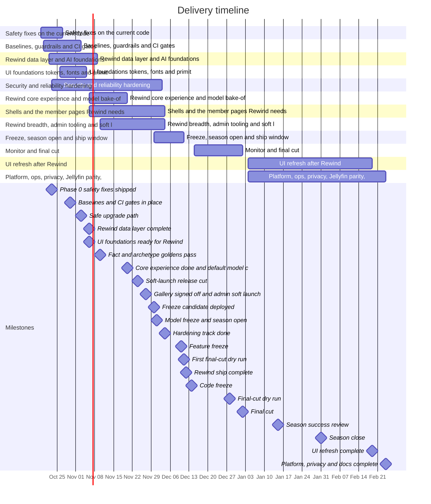

# Implementation Plan: Audit Remediation, UI Refresh and Rewind 2026

This plan is test-driven and incremental. Each step is a working, demoable increment that builds on the steps before it and ends wired into the running app, with no orphaned code. Tests are written with the code in the same step, never deferred to a later one. Every step names:
- the files and functions it changes;
- the tests that prove the change;
- how it is wired in;
- a demo;
- a "Done when" list, which is its acceptance criteria.

The plan assumes the research and design documents listed below are available as context.

The plan turns the 2026-10-17 audit and design work into 181 steps (187 pull requests) in 12 phases, running from Monday 2026-10-19 to 2027-02-24. The audit reports raised 241 findings: 2 critical, 27 high, 120 medium, 87 low and 5 info. The plan addresses 240 of them and defers one, RWV-14, with a reason. It also delivers the UI refresh in `design/ui-design-system.md` and Rewind 2026 in `design/rewind-2026-design.md`, whose requirements Appendix D maps to steps. The Rewind dates are fixed by the design, and everything else is scheduled around them:

- 2026-12-01: the season opens, and the model and prompt are frozen.
- 2026-12-10: feature freeze.
- 2026-12-12: Rewind ship complete.
- 2026-12-14: code freeze. Only data or security fixes merge until the final cut has finished.
- 2027-01-01/02: the final cut.

The order of the phases follows from risk:
- **First week.** Phase 0 closes the urgent security and data-exposure problems on today's code before anything is rebuilt, under day-0 rules that stop CI publishing PR code, keep E2E off real databases and require a dump before every migration.
- **Baselines.** Phase 1 puts baselines and CI gates in place, so every later styling or refactoring change arrives with a reviewed diff, and makes the upgrade path safe before the November migrations deploy.
- **Until the season opens.** Three lanes run in parallel: Rewind (P2, P5, P7 and P8), the UI steps Rewind needs (P3 and P6) and hardening (P4). Work with no Rewind consumer waits for January.
- **After the final cut.** The rest of the UI refresh (P10) and the platform, privacy and documentation work (P11) run from 2027-01-04, so nothing risky lands during the season.

## Where the plan lives

This file is the index. Each phase has its own file, and finished phases move to `phases/archive/`:

- [Phase 0: Safety fixes on the current code](phases/archive/p0-safety-fixes-on-the-current-code.md)
- [Phase 1: Baselines, guardrails and CI gates](phases/archive/p1-baselines-guardrails-and-ci-gates.md)
- [Phase 2: Rewind data layer and AI foundations](phases/archive/p2-rewind-data-layer-and-ai-foundations.md)
- [Phase 3: UI foundations: tokens, fonts and primitives](phases/archive/p3-ui-foundations-tokens-fonts-and-primitives.md)
- [Phase 4: Security and reliability hardening](phases/archive/p4-security-and-reliability-hardening.md)
- [Phase 5: Rewind core experience and model bake-off](phases/archive/p5-rewind-core-experience-and-model-bake-off.md)
- [Phase 6: Shells and the member pages Rewind needs](phases/p6-shells-and-the-member-pages-rewind-needs.md)
- [Phase 7: Rewind breadth, admin tooling and soft launch](phases/p7-rewind-breadth-admin-tooling-and-soft-launch.md)
- [Phase 8: Freeze, season open and ship window](phases/p8-freeze-season-open-and-ship-window.md)
- [Phase 9: Monitor and final cut](phases/p9-monitor-and-final-cut.md)
- [Phase 10: UI refresh after Rewind](phases/p10-ui-refresh-after-rewind.md)
- [Phase 11: Platform, ops, privacy, Jellyfin parity, locale and docs](phases/p11-platform-ops-privacy-jellyfin-parity-locale-and-docs.md)
- [Appendices](appendices.md): D (Rewind requirements map), review notes, A (traceability matrix), B (risks) and C (decisions needed from the owner)

## How to use this plan

**Work lane by lane.**
- Each phase opens with its goal, window and lanes, plus an "Ordering that matters" or "Ground rules" section. That section gives the merge order for files that several steps edit, and names the helpers one step creates for another. Read it before starting any step in the phase.
- A step's "Depends on" line lists only its hard dependencies. A dependency may merge on the morning of the dependent step's first day. Where a step also builds on a helper from another step in the same window, the phase header and the step's guidance name that helper.
- A step is done when every item in its "Done when" list holds and its pull requests have merged with CI green.

**Sizes and windows.** Effort is agent work plus review, in working days:
- **S**: one day or less, one PR.
- **M**: two to three days, one PR unless the step says otherwise.
- **L**: four to five days, or two to three PRs; the metadata line gives the PR count.

A step's window is the span in which it is built, reviewed and merged. Review is counted in units: S is 0.5, M is 1 per PR and L is 2 or its PR count, whichever is larger.

**Three lanes until the code freeze, at most two open PRs each.**
- **Rewind lane:** the rewind steps of P0, then P2, P5, P7 and P8, then P9.
- **UI lane:** the ui steps of P1, then P3 and P6, plus the Rewind UI steps the phase headers assign to it (P2.15, P5.3, P5.4, P5.12, P7.4, P7.5, P7.12, and in the ship window P7.6, P7.13 and P8.8).
- **Hardening lane:** the security, ops and platform steps of P0 and P1, then P4, plus P7.17's runbook and P8.9's freeze gate.

Each step's metadata line names its lane. When more windows overlap in a lane than it has PR slots, agents keep building on their branches and the next PR is marked ready for review only when one of the lane's two has merged, in the order the phase header gives. From 2027-01-04 four lanes run: admin and member for P10, and security and ops, and platform, for P11, each with at most two open PRs.

**Weekly review budget.** About 18 review units a week until the season opens, counted by due date. The design's P0 scope for Rewind alone needs about 10 units a week from 2026-10-26 to 2026-11-24, so a budget of 12 would mean cutting P0 pages before work starts (Appendix C decision 30). Everything without a Rewind consumer moved to January to stay inside 18: the token codemod (P10.13 to P10.15), the status screens, command menu, admin users and settings, the home refresh and every member and public page (P10.16 to P10.28), the watchlist sync (P11.28), the v2 viewer deletion (P11.29), the eval results page (P11.30), the duplicate service-row clean-up (P11.31) and the setup claim (P11.32).

| Week of | Review units | PRs | Rewind lane | UI lane | Hardening lane |
|---|---|---|---|---|---|
| 2026-10-19 | 17 | 25 | 7 | 3 | 7 |
| 2026-10-26 | 18 | 21 | 6 | 6 | 6 |
| 2026-11-02 | 18 | 18 | 8.5 | 5 | 4.5 |
| 2026-11-09 | 17.5 | 15 | 11.5 | 4 | 2 |
| 2026-11-16 | 18 | 18 | 9.5 | 4 | 4.5 |
| 2026-11-23 | 7.5 | 9 | 2 | 2 | 3.5 |
| 2026-11-30 | 6.5 | 8 | 2 | 3 | 1.5 |
| 2026-12-07 | 6 | 7 | 4.5 | 1 | 0.5 |

From 2027-01-04 to 2027-02-24 the four January lanes carry 57.5 units in 63 PRs, at most 11.5 units a week. If a week before the season runs over budget, the next hardening-lane step slips first, because only P4.16 of that lane feeds the soft launch; then the plan-level cuts apply (Appendix B).

**Owner calendar.** Work only the owner can do, with its own time. Decisions in Appendix C carry their own decide-by dates and are not repeated here.

| Date | Owner task | Step | Time |
|---|---|---|---|
| Mon 2026-10-19, first thing | `gh workflow disable docker-publish.yml`; merge P0.3, then P0.4, before any other PR; re-enable the workflow once P0.3 is on main | P0 day-0 rules | 30 min |
| 2026-10-21 | Take a dump before P0.5's deploy; review the Jellyfin and Plex linked-rows list | P0.5 | 1 h |
| 2026-10-23 | Run the strip script on production after the P0.8 and P0.19 release is live: dry run, apply, second dry run | P0.20 | 1 h |
| 2026-10-28 | Remove the exemptions or shares on the Jellyfin-invite rows list | P4.12 | 30 min |
| 2026-10-30 | Mark the ten required checks on `main` | P1.5 | 15 min |
| 2026-11-06 | Sign off the 20 fixture profiles and the eval budget | P2.10 | 3 h |
| by 2026-11-10 | Review the hand-checked fact and archetype goldens | P2.16 | 3 h |
| 2026-11-18 to 2026-11-20 | Read the bake-off results and confirm the default model | P5.13 | 2 h |
| from 2026-11-20, daily | Check the admin-audience Rewinds generated on real data | P7.8 | 15 min |
| 2026-11-23 | VoiceOver and TalkBack pass on an iPhone and an Android phone | P7.15 | 3 h |
| 2026-11-24 | Dump, then deploy the soft-launch release | Milestone | 30 min |
| 2026-11-25 and 2026-11-27 | Gallery review and soft-launch sign-off (Thanksgiving is 11-26) | P7.16 | 3 h and 2 h |
| 2026-11-30 | Fixes merged by 12:00; tag, dump and deploy by 18:00; rehearse the season open on staging in the evening | P8.1 | 4 h |
| 2026-12-01 | Check Prepare after 00:15; set Audience to Everyone at 08:00 | P8.2 | 1 h |
| 2026-12-02 | Run the read-only validator against production | P8.5 | 30 min |
| 2026-12-10 to 2026-12-12 | Enable each P1 feature after checking it on the heavy test member; record it in `ship-check.md` | P8.3, P8.4 | 2 h |
| 2026-12-11 | Review the staging final-cut dry run | P8.10 | 1 h |
| 2026-12-14, 00:00 | Set `CODE_FREEZE` to `on` | P8.9 | 5 min |
| 2026-12-15, then daily to 12-31 | First success review; daily season-dashboard check | P9.1 | 2 h, then 15 min |
| 2026-12-28 | Second final-cut dry run and the go or no-go | P9.2 | 2 h |
| 2027-01-01/02 | Dump, then the final cut | P9.3 | 3 h |
| 2027-01-15 | Season success review | P11.18 | 2 h |
| 2027-02-01 | Dump, then the season-close clean-up | P11.18 | 1 h |

**Critical path and float.** Float is counted in working days to the latest finish that still meets the 2026-11-24 soft-launch release cut (P7.17's runbook: 2026-11-25). It is shared along a chain: an upstream slip uses it up for every later link. Every other step that feeds the release has six or more days.

| Step | Lane | Window | Latest finish | Float |
|---|---|---|---|---|
| P7.17 | hardening | 2026-11-24 to 2026-11-25 | 2026-11-25 | 0 |
| P7.15 | Rewind | 2026-11-19 to 2026-11-23 | 2026-11-24 | 1 |
| P5.13 | Rewind | 2026-11-16 to 2026-11-20 | 2026-11-24 | 2 |
| P7.11 | Rewind | 2026-11-19 to 2026-11-20 | 2026-11-24 | 2 |
| P7.14 | Rewind | 2026-11-19 to 2026-11-20 | 2026-11-24 | 2 |
| P7.2 | Rewind | 2026-11-17 to 2026-11-18 | 2026-11-20 | 2 |
| P4.16 | hardening | 2026-11-18 to 2026-11-19 | 2026-11-24 | 3 |
| P5.11 | Rewind | 2026-11-17 to 2026-11-18 | 2026-11-23 | 3 |
| P6.9 | UI | 2026-11-17 to 2026-11-18 | 2026-11-23 | 3 |
| P7.1 | Rewind | 2026-11-16 to 2026-11-17 | 2026-11-20 | 3 |
| P5.2 | Rewind | 2026-11-09 to 2026-11-12 | 2026-11-18 | 4 |
| P5.5 | Rewind | 2026-11-12 to 2026-11-13 | 2026-11-19 | 4 |
| P5.8 | Rewind | 2026-11-06 to 2026-11-09 | 2026-11-13 | 4 |
| P5.9 | Rewind | 2026-11-09 to 2026-11-12 | 2026-11-18 | 4 |
| P2.6 | Rewind | 2026-11-02 to 2026-11-03 | 2026-11-10 | 5 |
| P2.8 | Rewind | 2026-11-03 to 2026-11-04 | 2026-11-11 | 5 |
| P2.9 | Rewind | 2026-11-04 to 2026-11-05 | 2026-11-12 | 5 |
| P5.10 | Rewind | 2026-11-12 to 2026-11-13 | 2026-11-20 | 5 |
| P5.4 | UI | 2026-11-12 to 2026-11-13 | 2026-11-20 | 5 |

The soft launch (P7.16) depends only on P7.11's gallery, P7.12, P7.15 and P4.16. P7.6's remaining cards, P7.13's archive articles, the v2 viewer deletion and the eval page are off the chain, and admin-audience generation on real data from 2026-11-20 makes the soft launch a sign-off rather than the first shakedown. A soft-launch fix that misses 12:00 on 2026-11-30 becomes a cut through `rewindDisabledPages` or a flag.

**Respect the calendar rules.**
- **Day 0.** The Phase 0 day-0 rules come first: publishing off, P0.3 then P0.4 merged before any other PR, and E2E only against an `E2E_DATABASE_URL` whose database ends in `_test`.
- **Dumps.** A `pg_dump` is taken before every deploy that carries a migration, as the P0 header shows, and through P1.10's documented path from 2026-11-03. Every step that adds a migration lists "Dump taken before deploy; `prisma migrate status` clean" in its Done-when.
- **Migrations.** The last pre-season migration ships in the 2026-11-24 soft-launch release. None merges from 2026-11-25 to 2027-01-02 except a named freeze exception through P1.10's backup-first path; the P8 header lists every pre-season migration by step and date.
- **30 November.** Sign-off fixes merge by 12:00 server time. Then tag, dump, deploy and rehearse; nothing else merges that day.
- **Deploy blackout.** Nothing deploys between 18:00 on 2026-11-30 and 12:00 on 2026-12-01, server time. The noon deploy carries no sign-in-path change.
- **Sign-in path.** No change to sign-in, callback, invite, onboarding or subscribe merges between 2026-11-25 and 2026-12-10, except a security fix.
- **Feature freeze.** No new feature code lands after 2026-12-10. Every P1 feature ships with its flag off, and the owner enables it in production.
- **Code freeze.** From 2026-12-14 only data or security fixes merge, until the final cut has finished. P8.9's CI freeze gate, merged and tested by 2026-12-09 with `CODE_FREEZE` off, enforces it once the owner flips the variable at 00:00 on 2026-12-14.
- **January.** Rewind stays live until the season closes on 2027-01-31, so the steps that change runtime pieces Rewind depends on (P11.1, P11.3) wait until after it.
- **Cuts.** The fixed Rewind dates do not move. If Rewind work slips, the plan-level cuts and then the design's cut list apply in order (Appendix B and the P7 header), and `rewindDisabledPages` turns pages off without a deploy. The ten core pages, sharing, privacy and accessibility are never cut.

**Turn steps into issues with `/create-issues`.** The tracking document for the command is [`issues-backlog.md`](issues-backlog.md), next to this plan.
1. Run `/create-issues`. When it asks for the tracking document, give it `.agents/planning/2026-10-17-app-audit-and-rewind-2026/implementation/issues-backlog.md`. Pass a section name or a keyword to narrow the selection.
2. Create issues for the steps whose start date is within the next two weeks, not all 181 at once. The backlog marks them `[READY]`. That way each issue reflects what the earlier steps actually merged.
3. Check each preview before confirming. The issue should carry:
   - the step id in its title, for example "P0.8: Share-safe v2 projection and share routes; stored Rewinds keep no roster";
   - a link to the step's section in this plan, and the findings it addresses;
   - its "Depends on" steps as issue links;
   - the "Done when" list as its acceptance criteria.

   Add the track and the lane as labels so each lane can be filtered.
4. After creating each issue, the command moves the backlog item to the backlog's Completed section with the issue number. The backlog then doubles as the map from steps to issues.

**Implement with `/implement-issue <number>`.** The command fetches the issue and creates a `{type}/{number}-{short-description}` branch. It plans the work as a todo list, implements it with tests, and runs the tests, build and lint before a PR is opened. To keep each run on plan:
- Point the agent at the step's section in this plan and at the design sections it cites. The step's guidance is more specific than the issue body.
- Rebase on the steps the phase header says merge first. If a hard dependency has not merged, stop and ask instead of re-implementing it.
- Keep to the step's scope. Work the step leaves to a later step stays there. New problems found along the way become new backlog items, not extra scope.
- Put the step id in the PR title and link the issue. Include the demo evidence the step asks for: a screenshot diff, test output or a log excerpt.
- Run `/review` on the diff before merging. Security-track steps also get `/security-review`.
- After the merge, close the issue and tick the step in the progress checklist.

**Owner decisions.** Appendix C lists the decisions the plan has assumed, each with its planned default and a decide-by date: the start of the first step that needs the answer. If no answer arrives by then, the default applies. Three are due on 2026-10-20: season timing (decision 1), member time zones (decision 5) and rate limits without Redis (decision 24). Three more are due on 2026-10-23: the January moves (decisions 22 and 28) and the review budget (decision 30).

## Source documents

All paths are relative to this file. Steps cite design sections by number, for example "Rewind 13.1" for `rewind-2026-design.md` section 13.1, or "ui-design-system 9.2".

**Audit reports.** Every finding id appears in Appendix A with the step that addresses it. Every Rewind requirement (FR-1 to FR-51, NFR-1 to NFR-14) appears in Appendix D with the steps that deliver it.
- [Security audit](../research/security-audit.md): SEC-01 to SEC-57 (57 findings).
- [Best practices, architecture and operations](../research/best-practices-and-ops.md): BP-01 to BP-39 (39 findings).
- [Code duplication and dead code](../research/code-duplication.md): DUP-01 to DUP-16 (16 findings).
- [Rewind (Wrapped) pipeline audit](../research/rewind-pipeline-audit.md): RWP-01 to RWP-22 (22 findings).
- [Rewind (Wrapped) presentation audit](../research/rewind-visuals-audit.md): RWV-01 to RWV-14 (14 findings).
- [UI and UX consistency audit](../research/ui-ux-audit.md): UI-01 to UI-46 (46 findings).
- [Additional findings (gap sweep)](../research/additional-findings.md): GAP-01 to GAP-47 (47 findings).

Several findings share a root cause, and one step may address several of them. For example, SEC-01 and BP-01 describe the same Next.js image-optimizer problem, and P0.1 closes both.

**Research reports.**
- [Modern UI stack and incremental migration path](../research/modern-ui-stack-2026.md)
- [AI models and provider architecture for Rewind 2026](../research/llm-and-generative-models-2026.md)
- [Rewind 2026 inspiration and stat catalogue](../research/rewind-inspiration.md)
- [Agent skills and tooling for generating better visuals](../research/visual-generation-skills.md)

**Design documents.** These were reviewed and are authoritative for UI and Rewind decisions. Where a step deliberately departs from them, the step says so and why.
- [UI design system and app-wide refresh](../design/ui-design-system.md), with mockups in [`design/mockups/ui/`](../design/mockups/ui)
- [Rewind 2026: experience and system design](../design/rewind-2026-design.md), with mockups in [`design/mockups/rewind/`](../design/mockups/rewind)

**Background.**
- [Rough idea](../rough-idea.md): the original request and its scope.
- [CLAUDE.md](../../../../CLAUDE.md): the project conventions summarised below.

## Phases at a glance

The findings column counts the distinct finding ids each phase addresses. A finding that two phases share, such as BP-01 in P0.1 and P1.5, is counted in both. "New" counts each finding only in the first phase that addresses it, and those numbers add up to 240.

| Phase | Window | Goal | Steps | Findings addressed |
|---|---|---|---|---|
| [P0: Safety fixes on the current code](phases/archive/p0-safety-fixes-on-the-current-code.md#phase-0-safety-fixes-on-the-current-code) | 2026-10-19 to 2026-10-27 | Close the critical and high security and data-exposure problems that are small on today's code, and put stop-gaps on the v2 Rewind, under the day-0 rules. | 20 | 42 (42 new) |
| [P1: Baselines, guardrails and CI gates](phases/archive/p1-baselines-guardrails-and-ci-gates.md#phase-1-baselines-guardrails-and-ci-gates) | 2026-10-20 to 2026-11-03 | Delete dead code, take visual, axe and design-debt baselines, wire lint and type checks, gate CI with integration services and the drift check, vendor pinned agent skills, and make the upgrade path safe. | 10 | 20 (18 new) |
| [P2: Rewind data layer and AI foundations](phases/archive/p2-rewind-data-layer-and-ai-foundations.md#phase-2-rewind-data-layer-and-ai-foundations) | 2026-10-22 to 2026-11-09 | Rewind Phase 1: the data layer, stats engine v3, facts and scorers, queues and locks, generation as a job, the AI facade, fonts and typesetting, and signed-off golden fixtures. | 17 | 33 (28 new) |
| [P3: UI foundations: tokens, fonts and primitives](phases/archive/p3-ui-foundations-tokens-fonts-and-primitives.md#phase-3-ui-foundations-tokens-fonts-and-primitives) | 2026-10-26 to 2026-11-05 | Design-system Phase 1: tokens and the Rewind scope contract, fonts, Base UI primitives behind adapters, and the shared `lib/ui` and format modules. | 10 | 30 (23 new) |
| [P4: Security and reliability hardening](phases/archive/p4-security-and-reliability-hardening.md#phase-4-security-and-reliability-hardening) | 2026-10-23 to 2026-12-03 | Harden boot, auth, sessions, entitlement, Stripe, Discord, logs, LLM spend and the Docker image, with every migration in by 2026-11-24. | 18 | 45 (42 new) |
| [P5: Rewind core experience and model bake-off](phases/archive/p5-rewind-core-experience-and-model-bake-off.md#phase-5-rewind-core-experience-and-model-bake-off) | 2026-11-06 to 2026-11-20 | Rewind Phase 2: the story player, the ten core pages, copy and grounding, the v3 pipeline, share-safe cards and links, article mode and the model bake-off. | 13 | 29 (14 new) |
| [P6: Shells and the member pages Rewind needs](phases/p6-shells-and-the-member-pages-rewind-needs.md#phase-6-shells-and-the-member-pages-rewind-needs) | 2026-11-06 to 2026-12-04 | The app and public shells, the admin composites, the home RewindCard and the account page, then the AdminShell in the ship window. | 5 | 15 (8 new) |
| [P7: Rewind breadth, admin tooling and soft launch](phases/p7-rewind-breadth-admin-tooling-and-soft-launch.md#phase-7-rewind-breadth-admin-tooling-and-soft-launch) | 2026-11-10 to 2026-12-04 | Rewind Phase 3: the remaining pages and editions, desktop, the public share page, the season console, dry runs and the gallery, the runbook, the accessibility and performance passes, and the admin soft launch; the remaining cards and archive articles in the ship window. | 17 | 19 (4 new) |
| [P8: Freeze, season open and ship window](phases/p8-freeze-season-open-and-ship-window.md#phase-8-freeze-season-open-and-ship-window) | 2026-11-30 to 2026-12-11 | Tag, dump, deploy and rehearse, open the season on 2026-12-01, land the P1 items behind default-off flags, the validator, the final-cut job and the freeze gate, and rehearse the final cut on staging. | 8 | 5 (2 new) |
| [P9: Monitor and final cut](phases/p9-monitor-and-final-cut.md#phase-9-monitor-and-final-cut) | 2026-12-15 to 2027-01-02 | Monitor the season under the code freeze, rehearse the final cut again on 2026-12-28 and run it on 1-2 January. | 3 | 0 |
| [P10: UI refresh after Rewind](phases/p10-ui-refresh-after-rewind.md#phase-10-ui-refresh-after-rewind) | 2027-01-04 to 2027-02-19 | The token codemod, status screens, admin users and settings, the home refresh and every member and public page, then the remaining admin pages, data loading, Overview, charts, the light theme and adapter removal. | 28 | 54 (22 new) |
| [P11: Platform, ops, privacy, Jellyfin parity, locale and docs](phases/p11-platform-ops-privacy-jellyfin-parity-locale-and-docs.md#phase-11-platform-ops-privacy-jellyfin-parity-locale-and-docs) | 2027-01-04 to 2027-02-24 | Platform, operations, privacy, Jellyfin-parity, locale and documentation work, the setup claim and the clean-ups moved out of the season, plus the season review and close. | 32 | 58 (37 new) |
| **Total** | 2026-10-19 to 2027-02-24 | | **181** | **240 assigned, 1 deferred (RWV-14)** |

## Conventions every step follows

These come from [CLAUDE.md](../../../../CLAUDE.md). P1.2 and P11.26 correct the facts in CLAUDE.md that are out of date. Where CLAUDE.md and this list differ, follow CLAUDE.md.

- **Components.**
  - Server Components by default. Add `'use client'` only for interactivity, hooks or browser APIs.
  - Client data fetching uses TanStack Query, with loading and error states.
- **Mutations.**
  - Server Actions for mutations. API routes only for webhooks, third-party integrations and the few routes a step names explicitly, such as the admin search, health and card routes.
  - Server Actions return error objects instead of throwing, and check the session before doing anything else.
- **Validation.** Zod validates every boundary: user input, external API responses and stored JSON. Internal function arguments are trusted to TypeScript.
- **Security.**
  - Rate limiting goes through `@/lib/security/rate-limit`, and admin actions are audit-logged through `@/lib/security/audit-log`.
  - Secrets never reach client components. Stored secrets are `ENCRYPTED_FIELDS` in `lib/prisma.ts`.
  - No `dangerouslySetInnerHTML` without sanitisation. From P3.8, Markdown renders through `MarkdownBody`.
- **TypeScript.** Strict mode with no `any`: use `unknown` with type guards. Imports use the `@/` alias.
- **Database.**
  - Import the Prisma client and types from `@/lib/generated/prisma/client`.
  - Use Prisma queries only, never raw SQL, and `$transaction` for multi-step writes.
  - Create migrations with `npm run db:migrate` and descriptive names, and never edit a merged migration.
- **Logging.** Use `createLogger` from `@/lib/utils/logger` instead of `console`.
- **UI.**
  - Use the primitives in `components/ui/`. Never build a raw `<select>`, a raw checkbox or a custom dropdown.
  - Style with Tailwind utilities and the `cn()` helper, dark theme first and mobile first, with no custom CSS unless it is unavoidable.
- **Tests.**
  - Tests live in `__tests__/` directories next to the code and are written in the same step.
  - Jest and Testing Library use `@testing-library/user-event`.
  - Playwright selects elements by `data-testid` only. Add a test id to the component when one is missing.
- **Size and scope.**
  - React components stay under about 200-300 lines and utility modules under about 150.
  - Build no features nobody asked for and no premature abstractions, delete unused code, and comment only non-obvious logic.
- **Documentation.** Complex modules get JSDoc with `@example` blocks that a test verifies.
- **Git hygiene.** Commits reference their issue, and `.env` files and secrets are never committed.

## Timeline

## Milestones

| Date | Milestone | Exit criteria |
|---|---|---|
| 2026-10-23 | Phase 0 safety fixes shipped | Next 16.4.2 or later, React 19.3.1 and next-auth 4.24.15 are deployed, with images unoptimized and no remotePatterns wildcard. `npm audit --omit=dev` reports no high or critical advisory. docker-publish builds only main and tags, and E2E refuses databases whose name does not end in _test. Public v2 share responses pass the projection key-snapshot test, and only enableWrappedShareLink writes shareToken. The strip script ran against production after that release, its counts are recorded, and a second run is a no-op. v2 generation is rate-limited, single-flight and limited to the season year. No configured model was on the 2026-10-23 retirement list. |
| 2026-10-30 | Baselines and CI gates in place | Visual baselines exist for the 20 screens P1.6 lists (the 16 of ui-design-system 9.2 Phase 0 item 3, plus /discord/link, /auth/denied, the admin user detail page and the stored v2 Rewind), 40 images in all. The axe wcag22aa baseline is recorded. design-debt.json is committed after the dead-code deletion. Ten checks are required on main: lint, typecheck (tests included), unit, integration (postgres:16 and redis:7), schema drift, build, audit, knip, design system and E2E against a production build with Redis. |
| 2026-11-03 | Safe upgrade path | npm run db:deploy is the documented install and upgrade command. The entrypoint logs pending migrations and honours SKIP_MIGRATIONS, and docs/operations.md holds the backup and restore commands and the dump-before-every-upgrade rule (P1.10). |
| 2026-11-06 | Rewind data layer complete | The stats-level values of all 20 golden fixtures match their hand-checked values, and the owner has signed off the profiles and the eval budget. Generation runs as a job on the Rewind queues, with single-flight, stale recovery and the FR-50 Redis check. The AI facade records billed failures. Cards are re-measured on Next 16.4.2, and CARD_VERSION is fixed. |
| 2026-11-06 | UI foundations ready for Rewind | Tokens and the Rewind scope contract are merged. Sheet, Toggle, Slider, SegmentedControl and the ink Button entries are merged. The token sync and contrast tests pass. lib/utils/format.ts has replaced the old formatters. |
| 2026-11-10 | Fact and archetype goldens pass | P2.16's hand-checked facts, editions and archetypes match for all 20 fixtures under two process zones, and the owner has reviewed the golden values. |
| 2026-11-20 | Core experience done and default model chosen | The ten core pages pass visual and axe tests on three fixtures, on chromium and webkit, at every listed viewport. The default model reaches 98% or more first-pass grounding on the golden fixtures in the bake-off. The home RewindCard is merged, with its before-season state live. Admin-audience generation runs on real data from this date (P7.8). |
| 2026-11-24 | Soft-launch release cut | Everything the season-open release needs is merged and deployed: P1.10's upgrade path, P4.20's spend caps and scan throttles, P7.8's generation audience, P7.14's notification fan-out and the last pre-season migration (P4.18). P7.17's runbook follows on 2026-11-25. |
| 2026-11-27 | Gallery signed off and admin soft launch | The gallery of the review fixtures (core pages first) is reviewed and signed off, and no P0 bug is open. Log redaction is live. rewindEnabled is on with rewindAudience = admins, and admin Rewinds have been generated on real data since 2026-11-20. |
| 2026-11-30 | Freeze candidate deployed | Sign-off fixes merged by 12:00 server time. rewind-2026.1 and the freeze lock are tagged, the dump is taken, the release is deployed by 18:00, and the staging rehearsal of the season open has passed. Nothing else merged that day. |
| 2026-12-01 | Model freeze and season open | The model, the rewind-2026.1 prompt and the fact catalogue are frozen. Prepare ran with data through 30 November, and the audience became all at 08:00. 100% of eligible members have a completed Rewind, and the ready notifications were sent. The validator runs against production on 2026-12-02. |
| 2026-12-04 | Hardening track done | Every P4 step is merged, P6.1's AdminShell is merged, and the late P0 items P7.6 (remaining cards) and P7.13 (archive articles) are merged. |
| 2026-12-10 | Feature freeze | Every Rewind P0 and P1 row of Appendix D is merged, or cut through the cut list, rewindDisabledPages or its default-off flag. The validator, the final-cut job and the freeze gate (with CODE_FREEZE off) are merged. |
| 2026-12-11 | First final-cut dry run | P8.10 ran the final cut on a staging copy with --through=2026-12-10, and the validator reported zero failures. |
| 2026-12-12 | Rewind ship complete | Every Appendix D row is verified in production, row by row in ship-check.md, with each P1 flag enable recorded. The Rewind runbook is published, and RewindView and RewindShare rows are recording. |
| 2026-12-14 | Code freeze | The owner sets CODE_FREEZE to on at 00:00. Only data or security fixes merge until the final cut has finished. |
| 2026-12-28 | Final-cut dry run | On a staging copy, the second dry run re-calls the LLM for fewer than 30% of members, and every Rewind validates against RewindDataV3. |
| 2027-01-02 | Final cut | Every Rewind says 'Final cut'. Failed items have been retried interactively. 'Your Rewind now includes December' has been sent. |
| 2027-01-15 | Season success review | P11.18 records the results against the Rewind 1.4 targets in docs/rewind.md: 70% of members with history opened their Rewind, 75% of openers reached the centrefold, 25% of openers shared, 0 confirmed wrong numbers, 0 leaked fields, and LLM cost under $0.03 per member. |
| 2027-01-31 | Season close | Default share links have expired, v2 tokens no longer resolve, and P11.18's cleanup is scheduled for 2027-02-01. |
| 2027-02-19 | UI refresh complete | Every member and admin route meets the ui-design-system 9.5 definition of done. The adapters are removed, and the guardrails and raw-element bans are enforced as errors. chart.js is uninstalled. |
| 2027-02-24 | Platform, privacy and docs complete | Offboarding, retention and export are shipped, and the Jellyfin parity steps are merged. Observability and the worker role are in place. Deployment docs, releases and the changelog are published. No finding is open outside the deferred list. |

## Progress checklist

**Safety fixes on the current code** (2026-10-19 to 2026-10-27)

- [ ] P0.1: Upgrade Next.js, React and next-auth; close the image optimizer (security, M, due 2026-10-21)
- [ ] P0.2: Clear the remaining production advisories (security, S, due 2026-10-22)
- [ ] P0.3: Stop publishing unmerged pull-request code to GHCR (ops, S, due 2026-10-19)
- [ ] P0.4: Guard E2E and the seed against non-test databases (ops, S, due 2026-10-19)
- [ ] P0.5: Remove email-based account linking (security, M, due 2026-10-21)
- [ ] P0.6: Jellyfin 12 sign-in header and server-only Jellyfin helpers (security, S, due 2026-10-22)
- [ ] P0.7: Keep the Discord bot lease alive (platform, S, due 2026-10-23)
- [ ] P0.8: Share-safe v2 projection and share routes; stored Rewinds keep no roster (rewind, M, due 2026-10-21)
- [ ] P0.19: Opt-in v2 share links; only one action sets a token (rewind, S, due 2026-10-22)
- [ ] P0.20: Strip stored rosters, Rewind LLM text and legacy visits (rewind, M, due 2026-10-22)
- [ ] P0.9: Typed error when the Tautulli match fails (rewind, S, due 2026-10-19)
- [ ] P0.10: Redis-backed rate limiter with namespaced keys and trusted proxy hops (security, M, due 2026-10-22)
- [ ] P0.11: Share page reads the database directly (rewind, S, due 2026-10-23)
- [ ] P0.12: Generation guardrails on the v2 action (rewind, S, due 2026-10-23)
- [ ] P0.13: LLM stop-gaps for current models (rewind, S, due 2026-10-20)
- [ ] P0.14: Resolve the Rewind year from data, not the calendar (rewind, S, due 2026-10-21)
- [ ] P0.15: Correct the Overseerr request status mapping (rewind, S, due 2026-10-26)
- [ ] P0.16: Poster proxy: private caching, access check, fast 404 (security, S, due 2026-10-26)
- [ ] P0.17: Explain Rewind to members without Plex history (rewind, S, due 2026-10-27)
- [ ] P0.18: Stop sending plexAuthToken to the admin browser (security, S, due 2026-10-22)

**Baselines, guardrails and CI gates** (2026-10-20 to 2026-11-03)

- [ ] P1.1: Delete unreachable code; revive the Discord link panel (ui, M, due 2026-10-21)
- [x] P1.2: Remove dead exports, the orphaned model and stale CLAUDE.md facts (ops, S, due 2026-10-27)
- [x] P1.3: Wire the Next, react-hooks and jsx-a11y ESLint presets (ops, S, due 2026-10-26)
- [x] P1.4: Type-check the test files (ops, M, due 2026-10-27)
- [ ] P1.5: CI gates: typecheck, audit, knip, coverage, integration, schema drift and production-mode E2E (ops, L, due 2026-10-30)
- [ ] P1.6: Visual-regression project and baselines (ui, M, due 2026-10-23)
- [x] P1.7: axe at wcag22aa on every route (ui, S, due 2026-10-22)
- [x] P1.8: Design-system guardrail script and debt baseline (ui, S, due 2026-10-22)
- [ ] P1.9: Vendor the recommended agent skills with pinned commits (ops, S, due 2026-10-23)
- [x] P1.10: Safe upgrade path: db:deploy, migration pre-flight and backups (ops, M, due 2026-11-03)

**Rewind data layer and AI foundations** (2026-10-22 to 2026-11-09)

- [x] P2.1: Rewind 2026 schema migration and versioned stored-data parser (rewind, M, due 2026-10-23)
- [x] P2.2: Server and member time zones and the zone-aware year window (rewind, M, due 2026-10-27)
- [x] P2.3: Shared outbound HTTP client and one Tautulli client (platform, M, due 2026-10-23)
- [x] P2.4: Rewind sources with Zod and PlayEvent (rewind, M, due 2026-10-29)
- [x] P2.5: Rewind queues, locks, semaphore and fail-fast Redis (rewind, M, due 2026-10-30)
- [x] P2.17: Generation becomes a job: processor, actions and status hook (rewind, M, due 2026-11-03)
- [x] P2.6: Server-wide history pass and metadata cache (rewind, M, due 2026-11-03)
- [x] P2.7: Stats modules, part 1 (rewind, M, due 2026-11-02)
- [x] P2.8: Stats modules, part 2 (rewind, M, due 2026-11-04)
- [x] P2.9: Fact catalogue, build-facts and archetype scorers v3 (rewind, M, due 2026-11-05)
- [x] P2.10: Twenty golden fixtures with hand-checked stats (rewind, M, due 2026-11-04)
- [x] P2.16: Fact and archetype goldens for the twenty fixtures (rewind, M, due 2026-11-09)
- [x] P2.11: Provider-agnostic AI facade (rewind, M, due 2026-10-27)
- [x] P2.12: LLM provider settings and the admin assistant on the registry (rewind, M, due 2026-10-30)
- [x] P2.13: Fonts, typesetting, Rewind format and the registry skeleton (rewind, L, due 2026-11-03)
- [x] P2.14: Re-measure cards on Next 16.4.2 (rewind, S, due 2026-11-04)
- [x] P2.15: framer-motion to motion with a global reduced-motion policy (ui, M, due 2026-10-28)

**UI foundations: tokens, fonts and primitives** (2026-10-26 to 2026-11-05)

- [x] P3.1: Semantic tokens and the Rewind scope contract (ui, M, due 2026-10-27)
- [x] P3.2: Fonts and root layout (ui, M, due 2026-11-05)
- [x] P3.3: Token mirror module and contrast tests (ui, S, due 2026-10-28)
- [x] P3.4: Base primitives on Base UI behind adapters (ui, L, due 2026-10-30)
- [x] P3.5: Form primitives and the Field pattern (ui, M, due 2026-11-04)
- [x] P3.6: Overlay and feedback primitives (ui, M, due 2026-11-03)
- [x] P3.7: Rewind-ready primitives (ui, M, due 2026-11-05)
- [x] P3.8: Safe Markdown, safe links and error copy (ui, S, due 2026-10-29)
- [x] P3.9: Status vocabulary, icons, brand and chart theme (ui, M, due 2026-11-05)
- [x] P3.10: One formatter module (ui, M, due 2026-10-29)

**Security and reliability hardening** (2026-10-23 to 2026-12-03)

- [x] P4.1: Validate the environment at boot (security, S, due 2026-10-23)
- [x] P4.2: Boot and shutdown resilience (ops, M, due 2026-10-28)
- [x] P4.3: One action helper for auth, Zod and result shape (security, M, due 2026-11-02)
- [x] P4.5: Enforce entitlement beyond the layout (security, M, due 2026-11-05)
- [x] P4.6: Never send a stored secret to a new address; audit config changes (security, M, due 2026-11-06)
- [x] P4.7: Sessions end when access ends; role changes stick (security, M, due 2026-11-10)
- [x] P4.8: Bind the Plex PIN to the browser (security, M, due 2026-11-12)
- [x] P4.9: Discord OAuth redirect and state binding (security, S, due 2026-11-23)
- [x] P4.10: Stripe event ordering, idempotency and live re-checks (security, L, due 2026-11-19)
- [x] P4.11: Unshare only this server, idempotently (security, S, due 2026-12-02)
- [x] P4.12: Jellyfin invites: no Plex redemption, complete compensation (security, S, due 2026-10-28)
- [x] P4.13: Watchlist requests filed as the member (security, M, due 2026-12-03)
- [x] P4.15: Harden the admin assistant (security, S, due 2026-11-06)
- [x] P4.16: Redact secrets and identifiers from logs (security, M, due 2026-11-19)
- [x] P4.17: Harden the Docker image and compose file; add a health check (ops, M, due 2026-11-24)
- [x] P4.18: Discord role metadata follows access; marking acts as the member (security, M, due 2026-11-24)
- [x] P4.19: Discord privacy firewall fails closed (security, S, due 2026-11-20)
- [x] P4.20: LLM quotas and spend caps for the assistant and Discord (security, M, due 2026-11-19)

**Rewind core experience and model bake-off** (2026-11-06 to 2026-11-20)

- [x] P5.1: Rewind routes, layout and redirects (rewind, S, due 2026-11-09)
- [x] P5.2: Story stage and player (rewind, L, due 2026-11-12)
- [x] P5.3: Story sheets and accessibility semantics (rewind, M, due 2026-11-16)
- [ ] P5.4: Rewind visual, axe and performance test projects (rewind, M, due 2026-11-13)
- [x] P5.5: Registry and the front pages (rewind, M, due 2026-11-13)
- [x] P5.6: Features pages: Guess, Top shows, Top films (rewind, M, due 2026-11-17)
- [x] P5.7: Habits and centrefold: Clock, Calendar, Centrefold, Back cover (rewind, M, due 2026-11-16)
- [x] P5.8: Copy slots, templates, grounding and token rendering (rewind, M, due 2026-11-09)
- [x] P5.9: The v3 pipeline end to end (rewind, L, due 2026-11-12)
- [x] P5.10: Share-safe projection v3 and card routes (rewind, M, due 2026-11-13)
- [x] P5.11: Share sheet, core cards and opt-in public links (rewind, M, due 2026-11-18)
- [x] P5.12: Article mode (rewind, M, due 2026-11-18)
- [x] P5.13: Eval harness and model bake-off (rewind, M, due 2026-11-20)

**Shells and the member pages Rewind needs** (2026-11-06 to 2026-12-04)

- [x] P6.1: AdminShell, navigation config and route builders (ui, M, due 2026-12-04)
- [x] P6.3: AppShell and PublicShell (ui, M, due 2026-11-09)
- [x] P6.5: Admin composites (ui, M, due 2026-11-09)
- [x] P6.9: Home RewindCard (ui, M, due 2026-11-18)
- [x] P6.11: Account page and Discord link page (ui, M, due 2026-11-18)

**Rewind breadth, admin tooling and soft launch** (2026-11-10 to 2026-12-04)

- [x] P7.1: Pages: Taste, People, The race, Records (rewind, M, due 2026-11-17)
- [x] P7.2: Pages: Setup, Requests, Standing, Next year (rewind, M, due 2026-11-18)
- [x] P7.3: Pocket edition, Short list and postcard (rewind, S, due 2026-11-23)
- [x] P7.4: Desktop spread and Notes (rewind, M, due 2026-11-24)
- [x] P7.5: Public share page and OG card (rewind, M, due 2026-11-23)
- [x] P7.6: Remaining cards (rewind, M, due 2026-12-04)
- [x] P7.7: Hide and unhide a title (rewind, M, due 2026-11-17)
- [x] P7.8: Season dashboard and bulk generation (rewind, L, due 2026-11-13)
- [x] P7.9: Admin preview, roll back and audited reads (rewind, S, due 2026-11-16)
- [x] P7.10: Dry runs and preview mode (rewind, M, due 2026-11-13)
- [x] P7.11: Gallery of the review fixtures (rewind, M, due 2026-11-20)
- [x] P7.12: Rewind settings section and feature flags (rewind, M, due 2026-11-11)
- [x] P7.13: Legacy archive articles (rewind, M, due 2026-12-04)
- [x] P7.14: Ready notifications and view tracking (rewind, M, due 2026-11-20)
- [x] P7.15: Accessibility and low-end performance pass (rewind, M, due 2026-11-23)
- [ ] P7.16: Gallery review and admin soft launch (rewind, S, due 2026-11-27)
- [x] P7.17: Rewind operator runbook (docs, M, due 2026-11-25)

**Freeze, season open and ship window** (2026-11-30 to 2026-12-11)

- [ ] P8.1: Freeze candidate: tag, dump, deploy and rehearse (rewind, S, due 2026-11-30)
- [ ] P8.2: Season open (rewind, S, due 2026-12-01)
- [ ] P8.3: P1 story features (rewind, M, due 2026-12-03)
- [ ] P8.4: P1 comparison, Edit card, Save all and remaining Notes (rewind, L, due 2026-12-09)
- [ ] P8.5: Validator and final-cut job (rewind, L, due 2026-12-07)
- [ ] P8.8: Playground on the production pipeline (P1) (rewind, M, due 2026-12-09)
- [ ] P8.9: CI freeze gate, off until the code freeze (ops, S, due 2026-12-09)
- [ ] P8.10: First final-cut dry run on staging (rewind, S, due 2026-12-11)

**Monitor and final cut** (2026-12-15 to 2027-01-02)

- [ ] P9.1: Season monitoring and the first success review (ops, S, due 2026-12-31)
- [ ] P9.2: Second final-cut dry run (rewind, S, due 2026-12-28)
- [ ] P9.3: Final cut and final-cut notifications (rewind, S, due 2027-01-02)

**UI refresh after Rewind** (2027-01-04 to 2027-02-19)

- [ ] P10.1: Invites list and detail pages (ui, M, due 2027-01-25)
- [ ] P10.2: Analytics pages: shares, LLM usage and cost (ui, M, due 2027-01-27)
- [ ] P10.3: Queues page with live status (ui, S, due 2027-01-28)
- [ ] P10.4: Prompts pages and the split editor (ui, M, due 2027-02-01)
- [ ] P10.5: Announcements and Discord admin pages (ui, M, due 2027-02-03)
- [ ] P10.6: User detail, Rewind history and conversation pages (ui, M, due 2027-02-05)
- [ ] P10.7: Client data-loading and boundary sweep (ui, M, due 2027-02-10)
- [ ] P10.8: Admin Overview page (ui, M, due 2027-02-09)
- [ ] P10.9: Charts on shadcn Chart; chart.js removed (ui, M, due 2027-02-12)
- [ ] P10.10: Light theme behind its flag (ui, M, due 2027-02-17)
- [ ] P10.11: Remove adapters and enforce the guardrails (ui, M, due 2027-02-19)
- [ ] P10.12: 'New on' poster row on home (ui, S, due 2027-01-15)
- [ ] P10.13: Token codemod: the tool and the member slices (ui, L, due 2027-01-07)
- [ ] P10.14: Token codemod: admin users and settings slices (ui, M, due 2027-01-11)
- [ ] P10.15: Spinner and icon sweeps (ui, M, due 2027-02-04)
- [ ] P10.16: Admin command menu (ui, S, due 2027-01-21)
- [ ] P10.17: Status screens, 404, global error and route skeletons (ui, M, due 2027-01-07)
- [ ] P10.18: Admin users page as the reference list page (ui, M, due 2027-01-13)
- [ ] P10.19: Settings layout and connection status (ui, M, due 2027-01-15)
- [ ] P10.20: Settings sections with SecretInput and audited saves (ui, M, due 2027-01-20)
- [ ] P10.21: Home page refresh (ui, M, due 2027-01-12)
- [ ] P10.22: Announcements, help and membership pages (ui, M, due 2027-01-14)
- [ ] P10.23: Onboarding refresh (ui, M, due 2027-01-19)
- [ ] P10.24: Setup wizard model: string step ids and Skip (ui, M, due 2027-01-28)
- [ ] P10.25: Setup wizard UI (ui, M, due 2027-02-01)
- [ ] P10.26: Invite page as a server-rendered pass (ui, M, due 2027-01-25)
- [ ] P10.27: Sign-in, callback and denied screens (ui, M, due 2027-01-21)
- [ ] P10.28: Subscribe pages (ui, S, due 2027-01-26)

**Platform, ops, privacy, Jellyfin parity, locale and docs** (2027-01-04 to 2027-02-24)

- [ ] P11.1: Encryption-key safety and at-rest encryption by default (security, M, due 2027-02-03)
- [ ] P11.2: Watchlist lock and fallback polling (platform, M, due 2027-01-11)
- [ ] P11.3: Separate worker process and queue hygiene (ops, M, due 2027-02-10)
- [ ] P11.4: Observability (ops, M, due 2027-01-15)
- [ ] P11.5: Admin actions on the action helper; server-only boundaries (security, M, due 2027-01-08)
- [ ] P11.6: Migration naming and the ?schema= parameter (ops, S, due 2027-01-18)
- [ ] P11.7: Discord bot lifecycle and command registration (platform, S, due 2027-02-04)
- [ ] P11.8: Plex API contract fixes (platform, M, due 2027-01-13)
- [ ] P11.9: Chatbot tool and Prometheus client fixes (platform, S, due 2027-01-14)
- [ ] P11.10: Jellyfin member parity: service, admin visibility and tests (platform, M, due 2027-01-18)
- [ ] P11.11: Stripe for Jellyfin-only members (platform, M, due 2027-01-25)
- [ ] P11.12: Discord for Jellyfin members; stats from stored facts (platform, M, due 2027-01-27)
- [ ] P11.13: Member offboarding and deletion (security, M, due 2027-01-20)
- [ ] P11.14: Retention jobs for content tables (security, M, due 2027-01-25)
- [ ] P11.15: Member export and item-level deletion (security, M, due 2027-01-28)
- [ ] P11.16: Disclosures and the admin audit trail (security, M, due 2027-01-13)
- [ ] P11.17: Locale follow-ups (platform, S, due 2027-01-28)
- [ ] P11.18: Season success review and season close cleanup (rewind, S, due 2027-02-02)
- [ ] P11.19: Adopt Cache Components (platform, L, due 2027-02-19)
- [ ] P11.20: Strict CSP (security, M, due 2027-02-24)
- [ ] P11.21: Split oversized files (platform, M, due 2027-02-03)
- [ ] P11.22: Test coverage backfill (ops, M, due 2027-02-15)
- [ ] P11.23: Dependency majors and the auth spike (platform, M, due 2027-02-24)
- [ ] P11.24: Deployment, environment and domain-move docs (docs, M, due 2027-02-08)
- [ ] P11.25: Versioned releases and a changelog (ops, S, due 2027-02-10)
- [ ] P11.26: README and CLAUDE.md accuracy pass (docs, S, due 2027-02-16)
- [ ] P11.27: Project-authored agent skills (docs, S, due 2027-02-18)
- [ ] P11.28: Watchlist sync resolves IDs and files valid TV requests (platform, M, due 2027-01-06)
- [ ] P11.29: Remove the v2 viewer (rewind, M, due 2027-01-06)
- [ ] P11.30: Eval results page (rewind, S, due 2027-01-11)
- [ ] P11.31: One active row per service: audit, then a reviewed apply (platform, M, due 2027-01-21)
- [ ] P11.32: Claim the server before first-run setup (security, M, due 2027-01-21)
