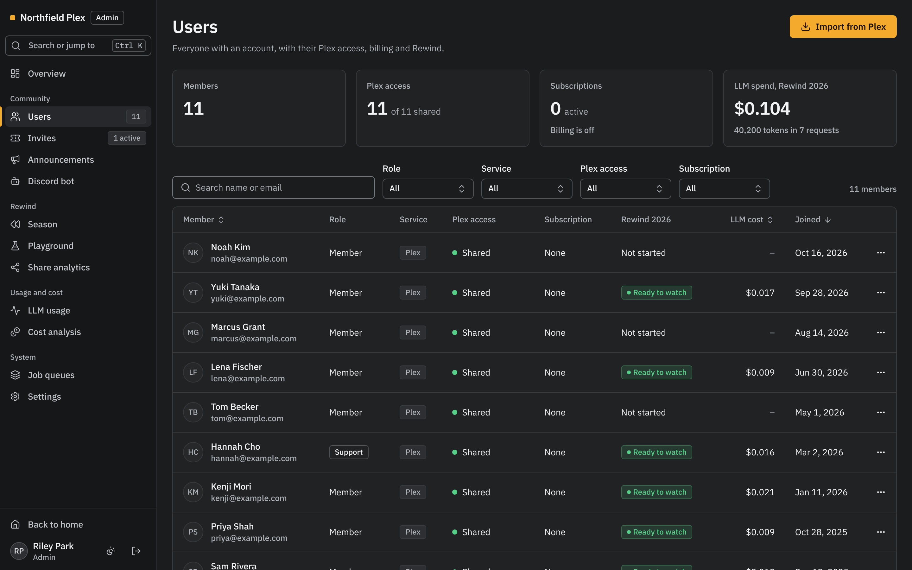

# Plex Manager

[](https://github.com/mchestr/plex-manager/actions/workflows/build.yml)
[](https://github.com/mchestr/plex-manager/releases)
[](LICENSE)

Plex Manager is a web app for the owner of a Plex Media Server. With it, you
can invite new members, show them how to use your server, and control their
access. Each year, it also makes Rewind: a year in review for each member, from
their watch history.

> [!NOTE]
> Plex Manager is not at version 1.0. Until then, a new release can change the
> features, the settings and the database.

<p align="center">
  
  
</p>

<details>
<summary>More screenshots</summary>
<br>

<br><br>

</details>

## Features

- **Sign-in and invites.** Members sign in with their Plex account. If you
  enable Jellyfin sign-in, members can also sign in with a Jellyfin account.
  Invites share your Plex libraries or make a Jellyfin account. Each invite has
  a code, the libraries to share, a maximum number of members and, if you set
  one, an end date.
- **Member guide.** New members get the playback settings for their devices,
  the steps to request titles, and the place to report a problem.
- **Rewind.** Plex Manager can make a Rewind of the year for each Plex member,
  from Tautulli history. An AI provider writes the text, or Plex Manager uses
  templates. Rewind is off until you enable it in **Admin > Settings**. There,
  you also set the audience (admins only by default) and the season (1 December
  to 31 January by default). Until a member makes a share link, only that
  member and the admins can see their Rewind.
- **Requests and watchlist sync.** Members request titles in Overseerr. A Plex
  member can also let Plex Manager request the titles on their Plex watchlist.
  Each request goes to Overseerr from the Overseerr account of that member.
  Overseerr uses the permissions and limits of that member. Request limits can
  give more requests to members who watch more.
- **Assistants.** An AI assistant in the admin pages can read the state of your
  server from Plex, Tautulli, Overseerr, Sonarr and Radarr. Members with a
  linked Discord account can also use an assistant in Discord. Each place that
  offers an assistant tells users that server admins can read assistant
  conversations, and which AI provider gets the messages.
- **Discord.** Linked roles change with the access and the watch hours of each
  member. Members can use slash commands, for example `/mystats` and
  `/watching`.
- **Stripe subscriptions.** A Stripe subscription can give a member access to
  your server. When the subscription ends, Plex Manager removes that access.
  Stripe Checkout and the Stripe Billing Portal take the payments. This feature
  is off until you enable it.
- **Admin tools.** The admin pages show members, invites, the settings of each
  service, connection health, announcements, job queues and AI cost. Plex
  Manager encrypts service keys and tokens in the database, and records each
  admin action in an audit log. An admin can remove a member, with their
  access and their personal data.

## Before you start

You must have these items:

- A Plex Media Server that you own.
- Tautulli, connected to that server. Plex Manager gets the watch history from
  Tautulli.
- A host with Docker Engine and Docker Compose. The Compose file also starts
  PostgreSQL 16 and Redis 7.
- A domain name and a reverse proxy with HTTPS. A production server does not
  start with an `http` URL.

You can also connect these services:

- Overseerr, for requests and watchlist sync.
- Sonarr and Radarr, for the admin assistant. Rewind also shows the next
  seasons from the Sonarr calendar.
- Jellyfin, for Jellyfin sign-in and Jellyfin invites.
- An AI provider (OpenAI, Anthropic, Google, or a server with an
  OpenAI-compatible API), for the Rewind text and the assistants.
- A Discord bot, for linked roles and slash commands.
- A Stripe account, for Stripe subscriptions.

## Install

These steps install Plex Manager with Docker Compose. For the reverse proxy,
other ways to install, and all the details, refer to the
[deployment guide](docs/deployment.md).

1. Download the Compose file and the example settings into a new folder:

   ```bash
   mkdir -p /opt/plex-manager && cd /opt/plex-manager
   curl -fsSLo docker-compose.yml https://raw.githubusercontent.com/mchestr/plex-manager/main/deploy/docker-compose.yml
   curl -fsSLo .env https://raw.githubusercontent.com/mchestr/plex-manager/main/example.env
   chmod 600 .env
   ```

2. Set these values in `.env`. Replace each `<openssl ...>` value with the
   output of that command. Use the same two passwords in `DATABASE_URL` and
   `REDIS_URL`. Set `PLEX_MANAGER_VERSION` to the number of the newest
   [release](https://github.com/mchestr/plex-manager/releases), without the `v`
   (for example, `0.6.0`).

   ```env
   POSTGRES_PASSWORD="<openssl rand -hex 16>"
   REDIS_PASSWORD="<openssl rand -hex 16>"
   PLEX_MANAGER_VERSION="<newest release number>"

   NEXTAUTH_URL="https://plex.example.com"
   NEXT_PUBLIC_APP_URL="https://plex.example.com"
   NEXTAUTH_SECRET="<openssl rand -base64 32>"
   PLEX_CLIENT_IDENTIFIER="<openssl rand -hex 16>"
   ENCRYPTION_KEYS="k1:<openssl rand -base64 32>"

   DATABASE_URL="postgresql://postgres:<POSTGRES_PASSWORD>@db:5432/plex_wrapped?schema=public"
   REDIS_URL="redis://:<REDIS_PASSWORD>@redis:6379"
   ```

   > [!CAUTION]
   > Keep a copy of `ENCRYPTION_KEYS` in a password manager, away from your
   > database backups. If you lose it, Plex Manager cannot decrypt the service
   > keys and tokens in the database.

3. Start Plex Manager:

   ```bash
   docker compose up -d
   ```

   After approximately one minute, `docker compose ps` shows the app as
   `(healthy)`.

4. Put your reverse proxy in front of `127.0.0.1:3000`. If more than one proxy
   is in front of the app, set `TRUSTED_PROXY_HOPS`. Refer to
   [Reverse proxy](docs/deployment.md#reverse-proxy).

5. Get the setup code from the log:

   ```bash
   docker compose logs app | grep 'Setup code'
   ```

6. Open `https://plex.example.com/setup`. Type the setup code.

7. Do the steps in the setup wizard. Plex and Tautulli are necessary. For each
   other service, you can select **Skip for now** and add it later in
   **Admin > Settings**.

The Plex account that you connect in the wizard becomes the admin account.

## Upgrade

Use a release tag in production. The `latest` tag is the newest build of `main`,
and it changes with each merge.

> [!CAUTION]
> Make a database dump before each upgrade. Prisma has no down migrations.
> Without a dump, you cannot return to the release that you used before.

1. Make a database dump. Refer to [Backup](docs/operations.md#backup).
2. Read the upgrade notes in [CHANGELOG.md](CHANGELOG.md) for each release
   after your current release.
3. Set `PLEX_MANAGER_VERSION` in `.env` to the new release.
4. Download the new image with `docker compose pull`. Then start the new
   release with `docker compose up -d`.

The container updates the database when it starts. Outside Docker, update the
database with `npm run db:deploy`.

To return to the release that you used before:

> [!CAUTION]
> Do not use `docker compose start app` after you restore the dump. That
> command starts the newer release, which updates the restored database again.

1. Stop the app with `docker compose stop app`.
2. Set `PLEX_MANAGER_VERSION` in `.env` to the release that you used before.
3. Restore the dump. Refer to [Roll back](docs/operations.md#roll-back).
4. Start the app with `docker compose up -d`.

[Operations](docs/operations.md#upgrade) gives the full upgrade procedure.

## Documentation

The guides in `docs/` give the full details:

| Guide | Contents |
| --- | --- |
| [Deployment](docs/deployment.md) | Docker Compose, the reverse proxy, the setup claim, web and worker containers, and how to install without Docker |
| [Environment variables](docs/environment.md) | Each variable, its default value, and if production must have it |
| [Operations](docs/operations.md) | Backups, restores, upgrades, encryption keys, metrics and security headers |
| [Domain move](docs/domain-move.md) | How to move Plex Manager to a new host name |
| [Rewind runbook](docs/rewind.md) | The Rewind season: its settings, its start and end, and the daily checks |
| [Privacy](docs/privacy.md) | The personal data that Plex Manager keeps, how to remove it, and retention |
| [Roles](docs/roles.md) | Admins, the Support role and permissions |
| [Assistant](docs/assistant.md) | The data, MCP servers and knowledge base that the admin assistant can use |
| [Request limits](docs/request-limits.md) | Request limits from watch time, and the Discord stat channels |
| [Stripe](docs/stripe.md) | Subscriptions, the webhook, and Plex and Jellyfin access |
| [Discord bot](docs/discord-bot.md) | The bot, slash commands and linked roles |
| [Releases](docs/releasing.md) and [CHANGELOG.md](CHANGELOG.md) | Versions, tags and the upgrade notes of each release |

## Bugs and questions

To report a bug or to ask a question, open an
[issue](https://github.com/mchestr/plex-manager/issues).

## Contributing

To change the code, read the [contributing guide](.github/CONTRIBUTING.md)
first. It tells you how to prepare a development environment, which checks to
do, and how to send a pull request.

## License

Plex Manager uses the [MIT License](LICENSE).
